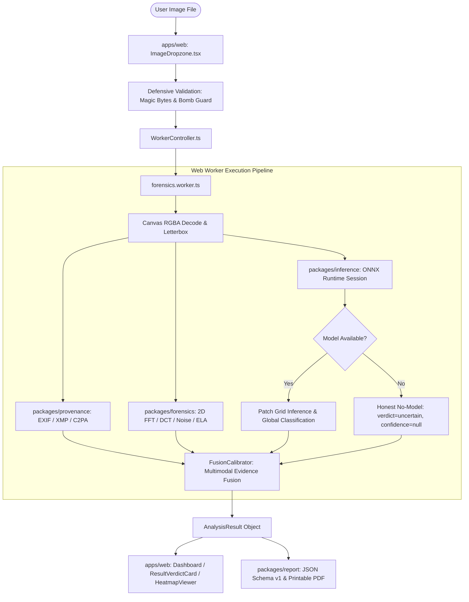

# Code Index: Forensics Web Lab

> **Thư mục**: `docs/continuity/CODE_INDEX.md`
> **Mục đích**: Bản đồ kiến trúc, mã nguồn thực tế và định vị trách nhiệm module cho các phiên làm việc của AI.
> **Quy ước**: Toàn bộ đường dẫn trong tài liệu đều là đường dẫn tương đối từ gốc repository.

---

## 1. Mục tiêu Hệ thống & Nguyên tắc Kiến trúc

- **Tên hiển thị giao diện**: `Forensics Web Lab`
- **Tên đề tài nghiên cứu**: _Nghiên cứu và xây dựng công cụ nhẹ phát hiện và định vị hình ảnh do AI tạo sinh và chỉnh sửa trên nền tảng web_
- **Nguyên tắc cốt lõi**:
  1. **Zero-Egress Client-Side**: Toàn bộ quá trình giải mã ảnh, phân tích DSP và suy luận ONNX diễn ra 100% trong trình duyệt (Web Worker), không gửi ảnh lên máy chủ.
  2. **WASM-First & WebGPU Optional**: Mặc định chạy CPU/WASM đa luồng SIMD; tự động tăng tốc WebGPU khi phần cứng hỗ trợ.
  3. **Dual-Track Data Isolation (ADR-0006)**: Tách biệt tuyệt đối Research Track (`data/research/`, `models/research/`) và Product Track (`data/product/`, `models/product/`).

---

## 2. Sơ đồ Luồng Xử lý Ảnh (Processing Flow Diagram)



---

## 3. Cấu trúc Monorepo & Vai trò Package

| Workspace / Package     | Thư mục                | Vai trò và Trách nhiệm Kỹ thuật                                                            | Entry Point                        |
| :---------------------- | :--------------------- | :----------------------------------------------------------------------------------------- | :--------------------------------- |
| `@forensics/shared`     | `packages/shared/`     | Định nghĩa contracts, TypeScript types, schemas, registry validators, evidence validators  | `packages/shared/src/index.ts`     |
| `@forensics/provenance` | `packages/provenance/` | Trích xuất siêu dữ liệu EXIF, XMP, IPTC, kiểm tra chữ ký AI software, C2PA adapter         | `packages/provenance/src/index.ts` |
| `@forensics/forensics`  | `packages/forensics/`  | Xử lý tín hiệu số 2D (FFT spectrum, DCT frequency energy, noise variance, JPEG block ELA)  | `packages/forensics/src/index.ts`  |
| `@forensics/inference`  | `packages/inference/`  | ONNX Runtime Web session loader, sliding patch inference, fusion calibrator, worker driver | `packages/inference/src/index.ts`  |
| `@forensics/report`     | `packages/report/`     | Tạo báo cáo JSON chuẩn schema và render HTML printable view cho xuất PDF                   | `packages/report/src/index.ts`     |
| `apps/web`              | `apps/web/`            | Giao diện người dùng React 18, Vite, CSS design tokens, Canvas heatmap viewer              | `apps/web/src/main.tsx`            |
| `ml`                    | `ml/`                  | Workspace Python cho dataset adapters, group splitting, PyTorch training, ONNX export      | `ml/training/train.py`             |

---

## 4. Định vị File Chịu trách nhiệm Cốt lõi (Core Responsibility Map)

| Nhiệm vụ chức năng                                                                  | File chịu trách nhiệm chính                                                                                                                                                                                                                                                                                                                                                                                                                                                                                                                                                                                                                                                                                                                | Trạng thái kỹ thuật                                                                 |
| :---------------------------------------------------------------------------------- | :----------------------------------------------------------------------------------------------------------------------------------------------------------------------------------------------------------------------------------------------------------------------------------------------------------------------------------------------------------------------------------------------------------------------------------------------------------------------------------------------------------------------------------------------------------------------------------------------------------------------------------------------------------------------------------------------------------------------------------------- | :---------------------------------------------------------------------------------- |
| **Validation & Magic Bytes**                                                        | `packages/shared/src/validation.ts`                                                                                                                                                                                                                                                                                                                                                                                                                                                                                                                                                                                                                                                                                                        | `implemented-and-tested`                                                            |
| **Metadata & Provenance**                                                           | `packages/provenance/src/exif-parser.ts`, `c2pa-adapter.ts`                                                                                                                                                                                                                                                                                                                                                                                                                                                                                                                                                                                                                                                                                | `implemented-and-tested`                                                            |
| **DSP Frequency (FFT/DCT)**                                                         | `packages/forensics/src/fft2d.ts`, `dct2d.ts`                                                                                                                                                                                                                                                                                                                                                                                                                                                                                                                                                                                                                                                                                              | `implemented-and-tested`                                                            |
| **DSP Noise & JPEG Artifacts**                                                      | `packages/forensics/src/noise-residual.ts`, `jpeg-artifacts.ts`                                                                                                                                                                                                                                                                                                                                                                                                                                                                                                                                                                                                                                                                            | `implemented-and-tested`                                                            |
| **Model Runtime Inference**                                                         | `packages/inference/src/session-loader.ts`, `patch-infer.ts`                                                                                                                                                                                                                                                                                                                                                                                                                                                                                                                                                                                                                                                                               | `implemented-and-tested`                                                            |
| **Evidence Fusion & Calibration**                                                   | `packages/inference/src/fusion-calibrator.ts`                                                                                                                                                                                                                                                                                                                                                                                                                                                                                                                                                                                                                                                                                              | `implemented-and-tested`                                                            |
| **Web Worker Coordinator**                                                          | `apps/web/src/workers/forensics.worker.ts`, `WorkerController.ts`                                                                                                                                                                                                                                                                                                                                                                                                                                                                                                                                                                                                                                                                          | `implemented-and-tested`                                                            |
| **Heatmap Visualization**                                                           | `apps/web/src/components/HeatmapViewer.tsx`                                                                                                                                                                                                                                                                                                                                                                                                                                                                                                                                                                                                                                                                                                | `implemented-and-tested`                                                            |
| **Report Generation**                                                               | `packages/report/src/report-generator.ts`, `html-print.ts`                                                                                                                                                                                                                                                                                                                                                                                                                                                                                                                                                                                                                                                                                 | `implemented-and-tested`                                                            |
| **Dataset Manifest & Adapters**                                                     | `ml/datasets/manifest.py`, `ml/datasets/adapters/`                                                                                                                                                                                                                                                                                                                                                                                                                                                                                                                                                                                                                                                                                         | `implemented-and-tested`                                                            |
| **Deduplication & Group Split**                                                     | `ml/datasets/dedup.py`, `ml/datasets/split.py`                                                                                                                                                                                                                                                                                                                                                                                                                                                                                                                                                                                                                                                                                             | `implemented-and-tested`                                                            |
| **Model Architecture (PyTorch)**                                                    | `ml/training/mobilenetv3_forensics.py`                                                                                                                                                                                                                                                                                                                                                                                                                                                                                                                                                                                                                                                                                                     | `implemented-and-tested`                                                            |
| **Loss & Training Engine**                                                          | `ml/training/losses.py`, `ml/training/train.py`                                                                                                                                                                                                                                                                                                                                                                                                                                                                                                                                                                                                                                                                                            | `implemented-and-tested`                                                            |
| **Temperature Scaling**                                                             | `ml/evaluation/calibration.py`                                                                                                                                                                                                                                                                                                                                                                                                                                                                                                                                                                                                                                                                                                             | `implemented-and-tested`                                                            |
| **Evaluation Metrics Harness**                                                      | `ml/evaluation/metrics.py`, `evaluate.py`                                                                                                                                                                                                                                                                                                                                                                                                                                                                                                                                                                                                                                                                                                  | `implemented-and-tested`                                                            |
| **ONNX Export & Parity Test**                                                       | `ml/export/export_onnx.py`, `validate_contract.py`                                                                                                                                                                                                                                                                                                                                                                                                                                                                                                                                                                                                                                                                                         | `implemented-and-tested`                                                            |
| **Acquisition Guard CLI**                                                           | `ml/datasets/acquire.py`                                                                                                                                                                                                                                                                                                                                                                                                                                                                                                                                                                                                                                                                                                                   | `implemented-and-tested`                                                            |
| **Acquisition Safety & Execution Gate**                                             | `ml/datasets/acquire.py` (free-disk, .part, resume, checksum, safe-extract, staging, receipt)                                                                                                                                                                                                                                                                                                                                                                                                                                                                                                                                                                                                                                              | `implemented-and-tested`                                                            |
| **Component-Scoped Acquisition**                                                    | `ml/datasets/acquire.py` (`--component`, `--max-download-bytes`, `HostnameRestrictedRedirectHandler`)                                                                                                                                                                                                                                                                                                                                                                                                                                                                                                                                                                                                                                      | `implemented-and-tested`                                                            |
| **Mask Inventory & Audit Processor**                                                | `ml/datasets/audit_masks.py` (PIL verification, pixel profile, dimension, source_id mapping)                                                                                                                                                                                                                                                                                                                                                                                                                                                                                                                                                                                                                                               | `implemented-and-tested`                                                            |
| **Mask Data Manifest (Local)**                                                      | `data/research/tgif/manifests/masks-manifest.jsonl` (31,238 records, outside Git)                                                                                                                                                                                                                                                                                                                                                                                                                                                                                                                                                                                                                                                          | `generated-and-verified`                                                            |
| **Acquisition Receipt Location**                                                    | `data/research/tgif/acquisition-receipt.json`                                                                                                                                                                                                                                                                                                                                                                                                                                                                                                                                                                                                                                                                                              | `generated-and-verified`                                                            |
| **Acquisition Plan & Schema**                                                       | `docs/schemas/acquisition-plan.v1.schema.json`, `datasets/acquisition-plans/pilot-a-tgif.v1.json`                                                                                                                                                                                                                                                                                                                                                                                                                                                                                                                                                                                                                                          | `implemented-and-tested`                                                            |
| **Paired Bootstrap Guard**                                                          | `ml/evaluation/bootstrap_guard.py` (stratified paired bootstrap 95% CI)                                                                                                                                                                                                                                                                                                                                                                                                                                                                                                                                                                                                                                                                    | `implemented-and-tested`                                                            |
| **TGIF Cardinality Audit**                                                          | `research/evidence/phase-4a.4/tgif-cardinality-audit.json`                                                                                                                                                                                                                                                                                                                                                                                                                                                                                                                                                                                                                                                                                 | `audited-and-verified`                                                              |
| **Claim–Evidence Registry & Canonical Bibliography**                                | `docs/EVIDENCE_REGISTER.md` (eight evidence statuses plus separate source classification), `docs/references.bib` (stable keys and verified paper/model/dataset/software metadata)                                                                                                                                                                                                                                                                                                                                                                                                                                                                                                                                                          | `documentation-registry-verified`                                                   |
| **Pilot Protocols & Configs**                                                       | `ml/configs/validator.py`, `pilot_tgif_edit.yaml`, `pilot_genimage_generated.yaml`                                                                                                                                                                                                                                                                                                                                                                                                                                                                                                                                                                                                                                                         | `implemented-and-tested`                                                            |
| **Source ID Auditor & Collision Engine**                                            | `ml/datasets/audit_source_ids.py` (COCO source vs category-task disambiguation)                                                                                                                                                                                                                                                                                                                                                                                                                                                                                                                                                                                                                                                            | `implemented-and-tested`                                                            |
| **Remote Metadata Inventory**                                                       | `research/evidence/phase-4b.1/tgif-orig-remote-inventory.json`, `tgif-sd2-sp-remote-inventory.json`                                                                                                                                                                                                                                                                                                                                                                                                                                                                                                                                                                                                                                        | `audited-and-verified`                                                              |
| **Small-Data Protocol & Options**                                                   | `docs/SMALL_DATA_PROTOCOL.md`, `research/evidence/phase-4b.1/small-data-options.json`                                                                                                                                                                                                                                                                                                                                                                                                                                                                                                                                                                                                                                                      | `protocol-established`                                                              |
| **Learning Curve Config & Validator**                                               | `ml/configs/pilot_a_learning_curve.yaml`, `ml/configs/validator.py` (sample size, overflow guard)                                                                                                                                                                                                                                                                                                                                                                                                                                                                                                                                                                                                                                          | `implemented-and-tested`                                                            |
| **Option P Acquisition Plan**                                                       | `datasets/acquisition-plans/pilot-a-tgif-option-p.v1.json`                                                                                                                                                                                                                                                                                                                                                                                                                                                                                                                                                                                                                                                                                 | `implemented-and-tested`                                                            |
| **Option P Downloader & Safe Extract**                                              | `ml/datasets/acquire.py` (`safe_extract_tar`, HTTP Range resume, Windows file lock retry/fallback)                                                                                                                                                                                                                                                                                                                                                                                                                                                                                                                                                                                                                                         | `implemented-and-tested`                                                            |
| **Option P Verification & Split Freeze**                                            | `ml/datasets/verify_option_p.py` (Pillow decode audit, pairability matching, split freeze)                                                                                                                                                                                                                                                                                                                                                                                                                                                                                                                                                                                                                                                 | `implemented-and-tested`                                                            |
| **Option P Manifest (Local)**                                                       | `data/research/tgif/manifests/manifest_pilot_a_option_p.csv` (outside Git)                                                                                                                                                                                                                                                                                                                                                                                                                                                                                                                                                                                                                                                                 | `generated-and-verified`                                                            |
| **Option P Split Lock Artifact**                                                    | `research/evidence/phase-4b.2/split-lock.json` (343 locked test sources, SHA-256 seal)                                                                                                                                                                                                                                                                                                                                                                                                                                                                                                                                                                                                                                                     | `frozen-and-sealed`                                                                 |
| **Option P Test Suite**                                                             | `ml/tests/test_option_p_protocol.py` (11 targeted tests: Tar Slip, resume, drift, split lock, coverage)                                                                                                                                                                                                                                                                                                                                                                                                                                                                                                                                                                                                                                    | `implemented-and-tested`                                                            |
| **Pair-Aware Sampler & Aggregator**                                                 | `ml/datasets/pair_aware_loader.py` (Strategy B: authentic native paired with edited native, 100% matched pixel geometry, balanced bbox/segm cycling, SHA-256 stable offset, source-level aggregation)                                                                                                                                                                                                                                                                                                                                                                                                                                                                                                                                      | `implemented-and-tested`                                                            |
| **Locked-Test Role Access Guard**                                                   | `ml/evaluation/locked_test_guard.py` (role-based permissions, ExperimentLockBinding verification)                                                                                                                                                                                                                                                                                                                                                                                                                                                                                                                                                                                                                                          | `implemented-and-tested`                                                            |
| **Training Manifest Schema**                                                        | `docs/schemas/training-manifest.v1.schema.json` (source-isolated manifest validation)                                                                                                                                                                                                                                                                                                                                                                                                                                                                                                                                                                                                                                                      | `schema-enforced`                                                                   |
| **Experiment Lock Schema**                                                          | `docs/schemas/experiment-lock.v1.schema.json` (cryptographic evaluation binding schema)                                                                                                                                                                                                                                                                                                                                                                                                                                                                                                                                                                                                                                                    | `schema-enforced`                                                                   |
| **Phase 4C Preregistered Config**                                                   | `ml/configs/pilot_a_binary_preregistered.yaml` (hash `727fc316...`, superseded `54140d42...`, `839531a7...`), `docs/BINARY_CLASSIFICATION_PREREGISTRATION.md`                                                                                                                                                                                                                                                                                                                                                                                                                                                                                                                                                                              | `preregistered-resealed`                                                            |
| **Phase 4C.1 Learning Curve Config**                                                | `ml/configs/phase_4c1_learning_curve.yaml` (derived from `pilot_a_binary_preregistered.yaml`), `docs/LEARNING_CURVE_EXECUTION_PLAN.md`                                                                                                                                                                                                                                                                                                                                                                                                                                                                                                                                                                                                     | `planned-awaiting-approval`                                                         |
| **Phase 4C.1 Colab Bundle Scripts**                                                 | `ml/datasets/export_learning_curve_bundle.py` (reusable N250 bundle creation with frozen cohorts N50/N100/N250, package_tar_archive, audits), `ml/datasets/validate_learning_curve_bundle.py` (fail-closed validator with 14 criteria: locked-test exclusion, dev/val isolation, nested cohorts, class balance, tarball verification), `ml/requirements-colab.txt`, `notebooks/phase_4c1_learning_curve_colab.ipynb` (canonical single Colab launcher with 5-cell structure, default EXECUTE=True, capability-based GPU detection, hardened error reporting, and persistent Drive input/output architecture for resumable 15-run execution; historical notebook preserved via git SHA `f26576cb...`), `docs/LEARNING_CURVE_COLAB_GUIDE.md` | `implemented-and-tested`                                                            |
| **Phase 4C.1 Training Runner**                                                      | `ml/training/run_learning_curve.py` (canonical CLI for N=50, 100, 250 across 5 seeds, frozen cohorts, baselines, receipts, 9 required artifacts, checkpoints)                                                                                                                                                                                                                                                                                                                                                                                                                                                                                                                                                                              | `implemented-and-tested`                                                            |
| **Phase 4C.1 Test Suite**                                                           | `ml/tests/test_learning_curve_notebook.py` (17 canonical notebook tests: 5-cell structure, EXECUTE=True default, read-only fail-closed preflight, persistent Drive output staging, no mkdir on inputs, hardened error reporting, 15-run audit), `ml/tests/test_learning_curve_operator.py` (48 tests: 9 static invariants, 10 GPU capability & policy, 9 scientific binding vs runtime observation, 3 dependency preflight policy, 17 fault injections & resume assertions), `test_learning_curve_bundle.py` (unit & fault injection for reusable bundle & validator), `test_learning_curve_runner.py` (frozen cohort invariance & multi-size loader tests)                                                                                | `implemented-and-tested`                                                            |
| **Phase 4C.1B.4 Verification Scripts**                                              | `run_smoke_local.py` (standalone local GPU smoke runner), `ml/evaluation/metrics.py` (added `compute_ece`), `ml/training/run_learning_curve.py` (fixed config access)                                                                                                                                                                                                                                                                                                                                                                                                                                                                                                                                                                      | `implemented-and-tested`                                                            |
| **Phase 4C.1B.4 Verification Evidence**                                             | `research/evidence/phase-4c.1b.4/` (artifact-inventory, checksum-verification, partition-audit, metric-reproduction, baseline-reproduction, stage2-gate-audit, evidence-manifest, PHASE_REPORT)                                                                                                                                                                                                                                                                                                                                                                                                                                                                                                                                            | `implemented-and-tested`                                                            |
| **Phase 4C.1B.5 Verification Evidence**                                             | `research/evidence/phase-4c.1b.5/` (artifact-inventory, checksum-verification, partition-audit, metric-reproduction, baseline-reproduction, confidence-intervals, stage2-gate-audit, test-summary, evidence-manifest, PHASE_REPORT)                                                                                                                                                                                                                                                                                                                                                                                                                                                                                                        | `implemented-and-tested`                                                            |
| **Phase 4C.1B.6 Verification Evidence**                                             | `research/evidence/phase-4c.1b.6/` (environment, leakage-finding, validation-partition-audit, corrected-metric-reproduction, corrected-baseline-reproduction, confidence-intervals, stage2-gate-audit, test-summary, evidence-manifest, PHASE_REPORT)                                                                                                                                                                                                                                                                                                                                                                                                                                                                                      | `implemented-and-tested`                                                            |
| **Phase 4C.1B.6R Verification Evidence**                                            | `research/evidence/phase-4c.1b.6r/` (environment, leakage-finding, validation-partition-audit, corrected-metric-reproduction, corrected-baseline-reproduction, confidence-intervals, stage2-gate-audit, test-summary, evidence-manifest, PHASE_REPORT)                                                                                                                                                                                                                                                                                                                                                                                                                                                                                     | `implemented-and-tested`                                                            |
| **Phase 4C.1B.6R.1 Verification Evidence**                                          | `research/evidence/phase-4c.1b.6r.1/` (environment, source-repair-audit, fault-injection, predictions-dummy, dummy-baseline-metrics, dummy-baseline-receipt, dummy-baseline-contract, confidence-intervals, metadata-baseline-status, stage2-gate-status, regression-test-summary, test-summary, pytest-collection, pytest-full-output, cleanup-audit, PHASE_REPORT, evidence-manifest)                                                                                                                                                                                                                                                                                                                                                    | `implemented-and-tested`                                                            |
| **Phase 4C.1B.6R.2 Verification Evidence**                                          | `research/evidence/phase-4c.1b.6r.2/` (environment, stage1-prediction-receipt, predictions-stage1-validation-only, dummy-prediction-verification, predictions-dummy, dummy-baseline-metrics, paired-bootstrap-distribution-summary, confidence-intervals, fault-injection-results, regression-test-summary, metadata-baseline-status, stage2-gate-status, pytest-collection, pytest-full-output, test-summary, PHASE_REPORT, evidence-manifest)                                                                                                                                                                                                                                                                                            | `implemented-and-tested`                                                            |
| **Phase 4C.1B.6R.3 Verification Evidence**                                          | `research/evidence/phase-4c.1b.6r.3/` (environment, historical-root-cause-audit, fault-injection-results, prediction-key-audit, paired-bootstrap-verification, confidence-intervals, metadata-baseline-status, stage2-gate-status, regression-test-summary, pytest-collection, pytest-full-output, test-summary, notebook-hash-audit, PHASE_REPORT, evidence-manifest)                                                                                                                                                                                                                                                                                                                                                                     | `implemented-and-tested`                                                            |
| **Phase 4C.1B.6R.3.1 Verification Evidence**                                        | `research/evidence/phase-4c.1b.6r.3.1/` (timestamp-audit, prior-manifest-correction, notebook-hash-audit, historical-root-cause-wording-audit, dependency-audit, clean-environment-verification, multiseed-execution-contract, test-summary, PHASE_REPORT, evidence-manifest)                                                                                                                                                                                                                                                                                                                                                                                                                                                              | `implemented-and-tested`                                                            |
| **Phase 4C.1B.6R.3.2 Verification Evidence**                                        | `research/evidence/phase-4c.1b.6r.3.2/` (environment, json-validation, dependency-declaration-audit, clean-venv-creation, clean-install-log, clean-pip-check, clean-import-check, clean-test-summary, colab-requirements-audit, prior-evidence-corrections, PHASE_REPORT, evidence-manifest)                                                                                                                                                                                                                                                                                                                                                                                                                                               | `implemented-and-tested`                                                            |
| **Phase 4C.1B.6R.3.2a Verification Evidence**                                       | `research/evidence/phase-4c.1b.6r.3.2a/` (environment, dependency-amendment, preinstall-package-list, clean-install-log, clean-pip-check, clean-environment-lock, clean-import-check, clean-test-summary, lint-debt, t4-environment-policy, json-validation, evidence-manifest)                                                                                                                                                                                                                                                                                                                                                                                                                                                            | `implemented-and-tested`                                                            |
| **Phase 4C.1C.0 Operator Receipt**                                                  | `research/evidence/phase-4c.1c.0-preflight/t4-operator-script-receipt.json` (one-command operator receipt, 13/13 static safety validations, notebook superseded)                                                                                                                                                                                                                                                                                                                                                                                                                                                                                                                                                                           | `generated-and-verified`                                                            |
| **Phase 4C.1C.0d Reusable Bundle Receipt**                                          | `research/evidence/phase-4c.1c.0-preflight/reusable-bundle-receipt.json` (724,633,600 bytes, SHA-256 `d49a106f...`, 250 dev sources, 91 inner val sources, 0 locked test, nested cohorts N50/N100/N250)                                                                                                                                                                                                                                                                                                                                                                                                                                                                                                                                    | `generated-and-verified`                                                            |
| **Phase 4C.1C.0d 15-Run T4 Operator Receipt**                                       | `research/evidence/phase-4c.1c.0-preflight/t4-operator-all-stage1-receipt.json` (resumable 15-run operator script, 49,684 bytes, SHA-256 `bae476db...`, 91/91 assertions, ephemeral staging from verified code archive, config_hash & requirements_sha256 locked fail-closed, strict dictionary checksums, exact inner_validation cohort check, baseline pip-freeze preserved, completed run N50 seed42 verified COMPLETED_VALID, remote completed runs 1/15, 14 remaining)                                                                                                                                                                                                                                                                | `generated-and-verified`                                                            |
| **Phase 4C.1C.0d Execution Code Receipt**                                           | `research/evidence/phase-4c.1c.0-preflight/execution-code-n250-receipt.json` (snapshot HEAD `79bb115...`, archive `phase_4c1_code_79bb115.tar.gz`, SHA-256 `5e775a77...`, operatorSha256 `bae476db...`, canonicalNotebookSha256 `d3b27ce0...`, bundleArchiveSha256 `d49a106f...`, bundleContentSha256 `c365c812...`)                                                                                                                                                                                                                                                                                                                                                                                                                       | `generated-and-verified`                                                            |
| **Phase 4C.1C.0d.1 Snapshot Binding Audit**                                         | `research/evidence/phase-4c.1c.0-preflight/execution-snapshot-binding-audit.json` (verified diff `79bb115..dbb51d1` contains 0 executable code changes, code archive immutable, audited commit `dbb51d1...`)                                                                                                                                                                                                                                                                                                                                                                                                                                                                                                                               | `audited-and-verified`                                                              |
| **Phase 4C.1C.0d.1 Pre-Execution Verdict**                                          | `research/evidence/phase-4c.1c.0-preflight/PRE_EXECUTION_GO_NO_GO.json` (verdict GO / RESUME: capability-based GPU detection, fail-closed scientific invariants, 80/80 operator checks, 19/19 notebook tests, canonical notebook compiled, remote completed runs=1/15, remaining=14, locked-test=0, stage 2=0)                                                                                                                                                                                                                                                                                                                                                                                                                             | `sealed-and-verified`                                                               |
| **Phase 4C.2 Stage 2 Configuration**                                                | `ml/configs/phase_4c2_stage2_finetuning.yaml` (preregistered protocol, partial fine-tuning allowlist, differential LRs, 15-run matrix)                                                                                                                                                                                                                                                                                                                                                                                                                                                                                                                                                                                                     | `implemented-and-tested`                                                            |
| **Phase 4C.2 Stage 2 Runner**                                                       | `ml/training/run_partial_finetuning.py` (dedicated runner for Stage 2 partial fine-tuning with frozen BN policy and differential LRs)                                                                                                                                                                                                                                                                                                                                                                                                                                                                                                                                                                                                      | `implemented-and-tested`                                                            |
| **Human Authorization Schemas**                                                     | `docs/schemas/human-unsealing-authorization.v1.schema.json` (legacy), `human-unsealing-authorization.v2.schema.json` (confirmatory structural/required-field contract; exact commit/archive/components supplied by external binding), and `human-manifest-custodian-authorization.v1.schema.json` (one data-integrity sealing session, no model/metrics/modification/disclosure)                                                                                                                                                                                                                                                                                                                                                           | `current-schemas-enforced-with-external-exact-bindings`                             |
| **Phase 4C.2G.0 Confirmatory Evaluator Preflight/Interface Engine**                 | `ml/evaluation/locked_test_evaluator.py`, `confirmatory_metrics.py`, `run_phase_4c2f_evaluator.py` (authorization/schema/checkpoint preflight, tamper-evident ledger, evaluation interface, metrics and synthetic dry-run are implemented; formal CLI does not call execute_checkpoint_evaluation, sealed package has no real inference function, locked-test loader, five-checkpoint orchestration, or Windows read-only/isolation enforcement compatible with the current controller receipt)                                                                                                                                                                                                                                            | `preflight-implemented-real-execution-blocked`                                      |
| **Phase 4C.2G.0.12–0.13 Complete Confirmatory Execution Surface**                   | `ml/evaluation/run_phase_4c2g_confirmatory.py`, `phase_4c2g_dataset.py`, `phase_4c2g_model.py`, `phase_4c2g_windows.py`, `phase_4c2g_io.py` (external binding verified before locked-test mount/read; exact 343-source/686-sample manifest contract; only exact regular root `custodian_inventory.json` excluded from sample inventory; nested metadata, arbitrary extras, traversal, symlink/reparse, duplicates and checksum failures rejected; canonical five-seed orchestration; exact sealed package completed one authorized recovery session)                                                                                                                                                                                       | `locked-test-confirmatory-complete-insufficient-evidence`                           |
| **Phase 4C.2G.0.13 Confirmatory Result Evidence**                                   | `research/evidence/phase-4c.2g.0.13/` (redacted authorization/binding audit, per-checkpoint and aggregate metrics, bootstrap CI/decision, cumulative ledger audit, external artifact hashes, wrapper adjudication, independent cleanup audit, phase report; no raw authorization/manifest/dataset/checkpoint/prediction/ledger)                                                                                                                                                                                                                                                                                                                                                                                                            | `verified-and-published`                                                            |
| **Phase 4C.2G.0.14 Read-Only Closure Analyzer**                                     | `scripts/research/analyze_confirmatory_closure.py`, `ml/tests/test_confirmatory_closure_analysis.py` (checksum and immutability verification; exact metric/confusion recomputation from existing logits; aggregate/bootstrap-summary/wrapper reconciliation; exploratory probability and source-grouped error summaries with no raw identifiers; zero inference/training)                                                                                                                                                                                                                                                                                                                                                                  | `implemented-tested-and-executed`                                                   |
| **Phase 4C.2G.0.14 Closure Evidence**                                               | `research/evidence/phase-4c.2g.0.14/` (fixed closure verdict, artifact reconciliation, post-hoc exploratory confusion/probability/source-error analysis, prospective development experiment and new independent-validation plan, tests, phase report)                                                                                                                                                                                                                                                                                                                                                                                                                                                                                      | `phase-closed-insufficient-confirmatory-evidence`                                   |
| **Phase 4C.2H.0 Development Contracts**                                             | `ml/training/phase_4c2h_development.py`, `ml/configs/phase_4c2h_development_nested_cv.yaml` (sealed package-member path retained; strict label map, exact transform, classifier/frozen-buffer policy, pair-ranking loss, pixels-only validation API, deterministic 5x4 source-grouped fold commitments, exact two-recipe/three-seed/150-fit budget)                                                                                                                                                                                                                                                                                                                                                                                        | `implemented-and-tested`                                                            |
| **Phase 4C.2H.0 Diagnostics and Colab Launcher**                                    | `scripts/research/run_nested_cv_diagnostics.py`, `notebooks/phase_4c2h_development_colab.ipynb`, `ml/tests/test_nested_cv_development.py`, `ml/tests/test_nested_cv_notebook.py` (development-only hash/mapping/preprocessing/gradient/buffer/overfit/ranking probes; thin 8-source launcher; independent prediction regression)                                                                                                                                                                                                                                                                                                                                                                                                           | `implemented-tested-and-smoke-executed`                                             |
| **Phase 4C.2H.0 Evidence**                                                          | `research/evidence/phase-4c.2h.0/` (machine-readable diagnostics and fold commitments plus phase report; official nested-CV training not executed)                                                                                                                                                                                                                                                                                                                                                                                                                                                                                                                                                                                         | `development-protocol-locked`                                                       |
| **Phase 4C.2H.1 Official Runner and Snapshot Builder**                              | `ml/training/run_nested_cv_development.py`, `scripts/research/build_nested_cv_snapshot.py`, `ml/tests/test_nested_cv_runner.py` (exact 120-inner/30-outer execution matrix; shared frozen BatchNorm-eval feature cache; inner-only epoch selection; post-refit outer predictions; atomic hash-bound resume artifacts; deterministic Git-blob + pretrained-weight Colab snapshot)                                                                                                                                                                                                                                                                                                                                                           | `implemented-fixture-tested-packaged-preflight-pass`                                |
| **Phase 4C.2H.1 Colab Pilot Launcher and Evidence**                                 | `notebooks/phase_4c2h_development_colab.ipynb`, `ml/tests/test_nested_cv_notebook.py`, `research/evidence/phase-4c.2h.1/` (exact input/runtime/dependency staging; default two-fit pilot; explicit full-run guard; persistent Drive resume; snapshot/preflight receipts and upload/run instructions)                                                                                                                                                                                                                                                                                                                                                                                                                                       | `ready-for-colab-two-fit-pilot`                                                     |
| **Phase 4C.2H.2 Read-Only Nested-CV Analyzer**                                      | `scripts/research/analyze_nested_cv_results.py`, `ml/tests/test_nested_cv_results_analysis.py` (CLI `--execution-root/--protocol/--output`; streams every execution file, verifies declared hashes, receipt/checkpoint bindings, fold lock, outer-epoch median rule and OOF cardinality; recomputes metrics from stored predictions; derives verdict from seed signs; deterministic CSV/JSON/PNG/SVG/report output; zero training/inference/locked-test access; tests include internal recomputation of published tables)                                                                                                                                                                                                                  | `implemented-tested-and-executed`                                                   |
| **Phase 4C.2H.2 Exploratory Evidence**                                              | `research/evidence/phase-4c.2h.2/` (artifact audit/inventory, fit audit, outer epoch selection, per-seed OOF metrics, recipe summary, paired deltas, four figures, phase report with explicit non-comparability to the Phase 4C.2G locked test; no raw predictions, checkpoints, source IDs, or absolute paths)                                                                                                                                                                                                                                                                                                                                                                                                                            | `development-exploratory-no-consistent-improvement`                                 |
| **Phase 4C.2G.0.10 Authorized-Session Orchestrator & Mixed-Commit Package Builder** | `scripts/research/RUN_PHASE4C2G_AUTHORIZED_SESSION.ps1`, `scripts/research/build_phase4c2g_execution_package.py` (exact ifIndex + Name/InterfaceDescription/MacAddress resolution through `Get-NetAdapter -IncludeHidden`; InputObject pipeline isolation/recovery/restoration; self-testing contract mode with redirected child `-WhatIf`; bounded watchdog polling; deterministic package independently binds immutable evaluator, controller hotfix, and execution-package commits)                                                                                                                                                                                                                                                     | `implemented-tested-sealed-packaged-preflight-pass`                                 |
| **Phase 4C.2G.0.10 Package/Binding/Authorization Evidence**                         | `research/evidence/phase-4c.2g.0.10/` (source/diff root cause, mixed-commit source binding, canonical execution binding, package receipt, exact packaged-controller preflight, preserved scientific invariants, supersession lineage, pending authorization request)                                                                                                                                                                                                                                                                                                                                                                                                                                                                       | `ready-for-human-evaluator-authorization`                                           |
| **Phase 4C.2G.0.5.1 Authorization Schema, External Binding & Evidence**             | `docs/schemas/human-unsealing-authorization.v2.schema.json`, `research/evidence/phase-4c.2g.0.5/execution_authorization_binding.json`, `research/evidence/phase-4c.2g.0.5.1/` (schema validates structure; external file binds exact commit/archive/schema/components; missing independent locked manifest commitment yields `BLOCKED_MANIFEST_COMMITMENT_ABSENT`)                                                                                                                                                                                                                                                                                                                                                                         | `generated-verified-blocked`                                                        |
| **Phase 4C.2G.0.6 Manifest Custodian Sealer**                                       | `scripts/research/seal_locked_test_manifest.py` (evaluator/model/image-decoder/network independent; read-only/isolation proof before reservation; exact inventory/streaming SHA-256; NFC deterministic manifest; atomic outputs; interruption accounting and no retry)                                                                                                                                                                                                                                                                                                                                                                                                                                                                     | `implemented-synthetic-tested-sealed`                                               |
| **Phase 4C.2G.0.6 One-UAC Controller & Package Builder**                            | `scripts/research/RUN_PHASE4C2G_MANIFEST_CUSTODIAN_SESSION.ps1`, `build_phase4c2g_manifest_custodian_package.py` (exact authorization/package preflight, watchdog/isolation/read-only/sealer/restoration flow; zero evaluator calls; deterministic Git-blob archive)                                                                                                                                                                                                                                                                                                                                                                                                                                                                       | `implemented-contract-tested-sealed`                                                |
| **Phase 4C.2G.0.6 Custodian Authorization & Evidence**                              | `docs/schemas/human-manifest-custodian-authorization.v1.schema.json`, `research/evidence/phase-4c.2g.0.6/` (prospective addendum, canonicalization, exact source/archive/schema binding, PRE_CUSTODIAN gate; role-separated automated process, no independent human claimed)                                                                                                                                                                                                                                                                                                                                                                                                                                                               | `ready-for-human-manifest-custodian-approval`                                       |
| **Phase 4C.2G.0.7 Custodian PowerShell 5.1 Hotfix**                                 | `scripts/research/RUN_PHASE4C2G_MANIFEST_CUSTODIAN_SESSION.ps1`, `ml/tests/test_manifest_custodian.py`, `research/evidence/phase-4c.2g.0.7/` (scalarized equal-key component-count comparison at formal preflight; real failure regression; exact Git-object reseal at `a86888d`)                                                                                                                                                                                                                                                                                                                                                                                                                                                          | `resealed-awaiting-exact-reauthorization`                                           |
| **Phase 4C.2G.0.8 Authorized Manifest Commitment**                                  | `research/evidence/phase-4c.2g.0.8/` (redacted authorization lineage, exact commitment/hash counters, post-commit no-retry adjudication, verified network/watchdog/VHDX cleanup; manifest content remains external)                                                                                                                                                                                                                                                                                                                                                                                                                                                                                                                        | `commitment-sealed-evaluator-authorization-absent`                                  |
| **Phase 4C.2G.0.9 Evaluator Authorization Preparation**                             | `research/evidence/phase-4c.2g.0.9/` (exact package/schema/component/checkpoint/manifest bindings; non-actionable pending request draft; fixture results; non-mutating Windows cmdlet reproduction; disabled post-approval command plan)                                                                                                                                                                                                                                                                                                                                                                                                                                                                                                   | `blocked-sealed-orchestrator-adapter-parameter-binding`                             |
| **Locked-Test Manifest Schema**                                                     | `docs/schemas/locked-test-manifest.v1.schema.json` (exact 686 samples, binary labels and IDs, locked_test partition, per-file SHA-256 and strict additionalProperties=false)                                                                                                                                                                                                                                                                                                                                                                                                                                                                                                                                                               | `schema-enforced`                                                                   |
| **Phase 4C.2G.0.4 Readiness & Execution-Surface Audit Evidence**                    | `research/evidence/phase-4c.2g.0.4/` (PHASE_REPORT.md, readiness_retry_receipt_binding.json, sealed_execution_surface_audit.json, environment.json, provenance_bindings.json)                                                                                                                                                                                                                                                                                                                                                                                                                                                                                                                                                              | `generated-and-verified`                                                            |
| **Phase 4C.2G.0.3.4 Egress/Reconciliation Controller**                              | `scripts/research/RUN_PHASE4C2G_AUTOMATED_ISOLATION.ps1` (PowerShell v1.4.0: ActiveStore IPv4/IPv6 route-owner isolation, protected internal adapters informational only when route-free, VPN and unidentified route-owner fail-closed checks, all-exit streaming verifier receipt SHA-256 binding with current-session timestamp validation, strict array-valued persistent_routes_ignored, exact adapter identity restoration polling up to 60 seconds, adapters initially Up require both AdminStatus=Up and Status=Up, NETWORK_RECOVERY_REQUIRED retains watchdog, non-mutating contract validation)                                                                                                                                   | `implemented-and-tested`                                                            |
| **Phase 4C.2G.0.3.4 Standalone Offline Verifier & Wrapper**                         | `scripts/research/verify_phase_4c2g_offline_runtime.py`, `scripts/research/RUN_PHASE4C2G_OFFLINE_VERIFIER.ps1` (shared route-owner egress semantics; output split into active_egress_adapters, protected_internal_adapters, connected_adapters_informational, persistent_routes_ignored; wrapper reports exact machine-readable reasons and never claims an active route when none exists)                                                                                                                                                                                                                                                                                                                                                 | `implemented-and-tested`                                                            |
| **Phase 4C.2G.0.3.4 Evidence Package**                                              | `research/evidence/phase-4c.2g.0.3.4/` (PHASE_REPORT.md, runtime_attempt_2125_audit.json, hotfix_contract.json, offline_verifier_source_binding.json, environment.json, provenance_bindings.json)                                                                                                                                                                                                                                                                                                                                                                                                                                                                                                                                          | `generated-and-verified`                                                            |
| **Phase 4C.2G.0.3.3 Pipeline Object Isolation Controller**                          | `scripts/research/RUN_PHASE4C2G_AUTOMATED_ISOLATION.ps1` (historical v1.3.2 controller; superseded by Phase 4C.2G.0.3.4)                                                                                                                                                                                                                                                                                                                                                                                                                                                                                                                                                                                                                   | `superseded`                                                                        |
| **Phase 4C.2G.0.3.3 Evidence Package**                                              | `research/evidence/phase-4c.2g.0.3.3/` (PHASE_REPORT.md, adapter_cmdlet_contract_audit.json, interrupted_attempt_parameter_binding_audit.json, stale_watchdog_cleanup_attempt_audit.json, passive_route_source_disagreement_attempt_audit.json, adapter_resolution_contract.json, controller_source_binding.json, provenance_bindings.json, environment.json)                                                                                                                                                                                                                                                                                                                                                                              | `generated-and-verified`                                                            |
| **Phase 4C.2G.0.3.2 Hardened Recovery Script Controller**                           | `scripts/research/RUN_PHASE4C2G_AUTOMATED_ISOLATION.ps1` (PowerShell v1.2.0 hardened route-based network isolation controller: atomic `.part` staging with fileStream.Flush($true), AST syntax validation via [System.Management.Automation.Language.Parser]::ParseFile, semantic allowlist verification, automated quarantine of invalid recovery scripts to failed_recovery_scripts/, single-quote escaping, -ValidateRecoveryScriptOnly test mode, DryRun pre-flight AST validation, readiness status READY_FOR_SINGLE_UAC_READINESS_RETRY)                                                                                                                                                                                             | `implemented-and-tested`                                                            |
| **Phase 4C.2G.0.3.2 Evidence Package**                                              | `research/evidence/phase-4c.2g.0.3.2/` (PHASE_REPORT.md, recovery_script_root_cause.json, generated_recovery_ast_test_receipt.json, interrupted_attempt_audit.json, timestamp_correction.json, controller_source_binding.json, provenance_bindings.json, environment.json)                                                                                                                                                                                                                                                                                                                                                                                                                                                                 | `generated-and-verified`                                                            |
| **Phase 4C.2G.0.3.1 Minimal Network-Isolation Controller**                          | `scripts/research/RUN_PHASE4C2G_AUTOMATED_ISOLATION.ps1` (PowerShell v1.1.0 minimal route-based network isolation controller: minimal adapter selection based on InterfaceIndex and route ownership, active default route 0.0.0.0/0 and ::/0 ownership check, strict protection of internal adapters VMnet1/VMnet8/WSL/Hyper-V, 15-minute scheduled task recovery watchdog with AST syntax validation and schtasks /query read-back verification, iterative multi-round rescan with ambiguous route owner fail-closed restoration, 10-field DryRun table, 4 summary counters, single-UAC elevation workflow, DryRun inspection verdict DRY_RUN_INSPECTION_PASS, readiness status READY_FOR_SINGLE_UAC_READINESS_TEST)                      | `implemented-and-tested`                                                            |
| **Phase 4C.2G.0.3.1 Evidence Package**                                              | `research/evidence/phase-4c.2g.0.3.1/` (PHASE_REPORT.md, minimal_adapter_selection_contract.json, route_to_adapter_dry_run_receipt.json, recovery_watchdog_contract.json, controller_security_audit.json, provenance_bindings.json, environment.json)                                                                                                                                                                                                                                                                                                                                                                                                                                                                                      | `generated-and-verified`                                                            |
| **Phase 4C.2G.0.3 Automated Network-Isolation Controller**                          | `scripts/research/RUN_PHASE4C2G_AUTOMATED_ISOLATION.ps1` (PowerShell automated network isolation controller: remote session fail-closed detection RDP/SSH/WinRM/CI, Administrator privilege check with detached UAC worker dispatch, snapshot of active egress adapters, 10-minute scheduled task recovery watchdog Phase4C2G_Emergency_Network_Recovery, try/finally exact allowlist adapter restoration, passive zero-probe inspection, offline verifier wrapper invocation, 12-point receipt validation, atomic receipt emission outside Git, DryRun inspection verdict DRY_RUN_INSPECTION_PASS, non-elevated verdict USER_UAC_CONFIRMATION_REQUIRED)                                                                                   | `implemented-and-tested`                                                            |
| **Phase 4C.2G.0.3 Evidence Package**                                                | `research/evidence/phase-4c.2g.0.3/` (PHASE_REPORT.md, automated_isolation_controller_binding.json, controller_dry_run_receipt.json, controller_security_audit.json, recovery_watchdog_contract.json, provenance_bindings.json, environment.json)                                                                                                                                                                                                                                                                                                                                                                                                                                                                                          | `generated-and-verified`                                                            |
| **Phase 4C.2G.0.2B Offline Verifier Runner**                                        | `scripts/research/RUN_PHASE4C2G_OFFLINE_VERIFIER.ps1` (PowerShell wrapper resolving exact local host paths, 0 placeholders, prints current UTC/HEAD/receipt warning, exits 0/2/1, calls verify_phase_4c2g_offline_runtime.py only)                                                                                                                                                                                                                                                                                                                                                                                                                                                                                                         | `implemented-and-tested`                                                            |
| **Phase 4C.2G.0.2B Evidence Package**                                               | `research/evidence/phase-4c.2g.0.2b/` (PHASE_REPORT.md, OFFLINE_USER_RUNBOOK.md, provenance_bindings.json, environment.json)                                                                                                                                                                                                                                                                                                                                                                                                                                                                                                                                                                                                               | `generated-and-verified`                                                            |
| **Phase 4C.2G.0.2A Standalone Offline Verifier**                                    | `scripts/research/verify_phase_4c2g_offline_runtime.py` (fail-closed offline runtime verifier: Python stdlib only, 0 socket, 0 DNS, 0 HTTP, 0 torch/evaluator calls, atomic receipt generation via `.part` and `fsync`, passive network route/adapter inspection, worktree clean status, sealed components SHA-256, 5 canonical checkpoint digests, pip freeze checksum verification, unmounted locked-test confirmation)                                                                                                                                                                                                                                                                                                                  | `implemented-and-tested`                                                            |
| **Phase 4C.2G.0.2A Evidence Package**                                               | `research/evidence/phase-4c.2g.0.2a/` (PHASE_REPORT.md, TIMESTAMP_CORRECTION_AUDIT.json, offline_verifier_source_binding.json, offline_verifier_test_receipt.json, PRE_PHYSICAL_DISCONNECTION_GATE.json, provenance_bindings.json, environment.json)                                                                                                                                                                                                                                                                                                                                                                                                                                                                                       | `generated-and-verified`                                                            |
| **Phase 4C.2G Preparation & Runtime Test Suite**                                    | `ml/tests/test_confirmatory_preparation.py` (123 tests; Phase 4C.2G.0.3.4 adds g114-g123 for exact protected-internal-adapter fixture, VPN/proxy failures, persistent-route exclusion, accurate wrapper diagnostics, receipt hash/session binding, strict restoration polling/watchdog behavior, and locked-test zero access)                                                                                                                                                                                                                                                                                                                                                                                                              | `implemented-and-tested`                                                            |
| **Phase 4C.2G.0.2 Evidence Package**                                                | `research/evidence/phase-4c.2g.0.2/` (PHASE_REPORT.md, OFFLINE_HOST_PREPARATION.json, EXECUTION_WORKTREE_VERIFICATION.json, CHECKPOINT_STAGING_VERIFICATION.json, DEPENDENCY_ENVIRONMENT_LOCK.json, NETWORK_ISOLATION_INSPECTION.json, FILESYSTEM_PREPARATION.json, PRE_AUTHORIZATION_RUNTIME_GATE.json, provenance_bindings.json, environment.json)                                                                                                                                                                                                                                                                                                                                                                                       | `generated-and-verified`                                                            |
| **Phase 4C.2G.0 Evidence Package**                                                  | `research/evidence/phase-4c.2g.0/` (PHASE_REPORT.md, EXECUTION_PACKAGE_RECEIPT.json, OFFLINE_RUNTIME_READINESS.json, HUMAN_AUTHORIZATION_REQUEST.json, PRE_AUTHORIZATION_GO_NO_GO.json, provenance_bindings.json, environment.json, HUMAN_APPROVAL_TEMPLATE.md)                                                                                                                                                                                                                                                                                                                                                                                                                                                                            | `generated-and-verified`                                                            |
| **Phase 4C.2F.2 Evaluator Test Suite**                                              | `ml/tests/test_locked_test_evaluator.py` (45 unit, contract, exactness, and fault-injection tests: 30 base + 15 Phase 4C.2F.2 regression tests for schema const exactness, seed ordering, format checker, expiry oneOf, effective commit lock, pre-hotfix commit rejection, schema SHA self-verification, future timestamp rejection)                                                                                                                                                                                                                                                                                                                                                                                                      | `implemented-and-tested`                                                            |
| **Phase 4C.2F.2 Evidence Package**                                                  | `research/evidence/phase-4c.2f/` (PHASE_REPORT.md, evaluator_contract.json, metric_implementation_contract.json, bootstrap_contract.json, evaluator_source_binding.json, checkpoint_resolution_audit.json, synthetic_dry_run_receipt.json, PRE_UNSEALING_GO_NO_GO.json, provenance_bindings.json, environment.json)                                                                                                                                                                                                                                                                                                                                                                                                                        | `generated-and-verified`                                                            |
| **Phase 4C.2E Preregistration Test Suite**                                          | `ml/tests/test_confirmatory_protocol.py` (30 unit, contract, and fault-injection tests: candidate protocol locked as Stage 1 N=250, 5 seeds and 5 checkpoint hashes verified against Stage 1 lineage, no cherry-picking, no Stage 2 checkpoints, no retraining, no post-hoc ensemble, primary aggregate Macro-F1 across 5 checkpoints, source-cluster bootstrap 10,000 replicates with RNG seed 20261002, 0.5000 balanced binary uninformative reference, secondary descriptive metrics, evaluation-only calibration, zero accesses, clean paths, 10 fault-injections PASS)                                                                                                                                                                | `implemented-and-tested`                                                            |
| **Phase 4C.2E Evidence Package**                                                    | `research/evidence/phase-4c.2e/` (PHASE_REPORT.md, candidate_checkpoint_binding.json, confirmatory_metrics_plan.json, unsealing_protocol.json, LOCKED_TEST_PREREGISTRATION.json, PRE_EXECUTION_GO_NO_GO.json, provenance_bindings.json, environment.json)                                                                                                                                                                                                                                                                                                                                                                                                                                                                                  | `generated-and-verified`                                                            |
| **Phase 4C.2D Model Selection Tool**                                                | `scripts/research/finalize_candidate_model_selection.py` (verifies 30-run cross-artifact numerical parity $\le 10^{-6}$, audits Stage 1 lineage and checkpoint reload contract, executes conservative model-selection decision, exact N=100 seed variability narrative with 3 exact SDs, two-step provenance model, verifies locked-test seal, generates CSV/JSON evidence and PHASE_REPORT.md)                                                                                                                                                                                                                                                                                                                                            | `implemented-and-tested`                                                            |
| **Phase 4C.2D Test Suite**                                                          | `ml/tests/test_candidate_model_selection.py` (14 unit and regression tests: 10 base parity/lineage tests + 3 variability exact SD parity and fault-injection tests + 1 non-circular evidence seal test)                                                                                                                                                                                                                                                                                                                                                                                                                                                                                                                                    | `implemented-and-tested`                                                            |
| **Phase 4C.2D Evidence Package**                                                    | `research/evidence/phase-4c.2d/` (PHASE_REPORT.md, FINAL_MODEL_SELECTION.json, final_metric_parity.json, stage1_metric_lineage.csv, stage1_metric_lineage.json, locked_test_readiness.json, environment.json, provenance_bindings.json)                                                                                                                                                                                                                                                                                                                                                                                                                                                                                                    | `generated-and-verified`                                                            |
| **Phase 4C.2C.1 Lineage Reconciliation Tool**                                       | `scripts/research/reconcile_partial_finetuning_lineage.py` (audits 7 Stage 2 raw sources, fail-closed cross-phase discrepancy gate, canonical endpoint decision generator, Erratum generator, deterministic machine-readable lineage CSV/JSON outputs)                                                                                                                                                                                                                                                                                                                                                                                                                                                                                     | `implemented-and-tested`                                                            |
| **Phase 4C.2C.1 Lineage & Paired Test Suite**                                       | `ml/tests/test_partial_finetuning_paired_analysis.py` (40 unit and regression tests: 20 paired analysis tests + 20 lineage reconciliation & calibration semantics tests: C.0 discrepancy detection, receipt best/final extraction, metrics.json extraction, prediction recomputation, epoch_history computation, checkpoint metadata extraction, wrong root, duplicate candidates, cross-artifact checksum mismatch, lineage mismatch blocking, canonical endpoint determinism, markdown parity, calibration separation, overconfidence wording guard, legend verification, sparse bins, erratum verification, raw artifact byte-identity, locked-test denial)                                                                             | `implemented-and-tested`                                                            |
| **Phase 4C.2C.1 Evidence Package**                                                  | `research/evidence/phase-4c.2c.1/` (PHASE_REPORT.md, stage2_metric_lineage.csv, stage2_metric_lineage.json, cross_phase_discrepancies.json, canonical_endpoint_decision.json, PHASE_4C2C0_ERRATUM.md)                                                                                                                                                                                                                                                                                                                                                                                                                                                                                                                                      | `generated-and-verified`                                                            |
| **Phase 4C.2C Paired Analysis Tool**                                                | `scripts/research/analyze_partial_finetuning_pairs.py` (canonical paired Stage 1 vs Stage 2 analysis script, CLI flags, 15-pair discovery, metric recomputation parity, exploratory paired t-test, exact 32 sign-flip permutation tests, Holm step-down correction, 95% t-interval df=4, multi-seed calibration reliability diagrams, publication SVG/PNG figure generator, machine-readable CSV/JSON evidence)                                                                                                                                                                                                                                                                                                                            | `implemented-and-tested`                                                            |
| **Phase 4C.2C Paired Analysis Test Suite**                                          | `ml/tests/test_partial_finetuning_paired_analysis.py` (20 unit & fault-injection tests: 15-pair matching, missing S1/S2 fail-closed, duplicate N/seed fail-closed, receipt stage mismatch fail-closed, locked-test access fail-closed, stage 1 write fail-closed, source cohort mismatch fail-closed, target mismatch fail-closed, metric recomputation parity, delta direction identity, paired t-test analytical parity, exact 32 sign-flip permutations, minimum p-value 0.0625, Holm correction correctness, 95% t-interval correctness, clean paths, clean Git evidence, deterministic outputs, prohibited claims guard)                                                                                                              | `implemented-and-tested`                                                            |
| **Phase 4C.2C Evidence Package**                                                    | `research/evidence/phase-4c.2c/` (PHASE_REPORT.md, paired_run_metrics.csv, primary_statistical_tests.csv/json, paired_summary.csv/json, calibration_summary.csv, analysis_environment.json, provenance_bindings.json, figures/paired_macro_f1_by_n, delta_macro_f1_by_seed, calibration_comparison in SVG and PNG)                                                                                                                                                                                                                                                                                                                                                                                                                         | `generated-and-verified`                                                            |
| **Phase 4C.2C.0 Ingestion & Audit Tool**                                            | `scripts/research/ingest_partial_finetuning_results.py` (portable streaming SHA-256, sidecar parser, strict TAR safety audit, atomic extraction, idempotent reuse, 15-run artifact verification, prediction cohort & leakage guards, provenance verifier)                                                                                                                                                                                                                                                                                                                                                                                                                                                                                  | `implemented-and-tested`                                                            |
| **Phase 4C.2C.0 Ingestion Test Suite**                                              | `ml/tests/test_partial_finetuning_results_ingest.py` (21 unit and fault-injection tests: valid archive, wrong hash/bytes, malformed sidecar, corrupt archive, absolute/traversal/symlink/special entries, duplicate entries, valid reuse, invalid fail-closed, missing run/artifact, checksum mismatch, wrong N/seed, locked-test access, Stage 1 writes, prediction cohort anomalies, trainable inventory mismatch, provenance checks)                                                                                                                                                                                                                                                                                                    | `implemented-and-tested`                                                            |
| **Phase 4C.2C.0 Evidence Package**                                                  | `research/evidence/phase-4c.2c.0/` (import_audit_summary.json, archive_inventory.json, PHASE_REPORT.md)                                                                                                                                                                                                                                                                                                                                                                                                                                                                                                                                                                                                                                    | `generated-and-verified`                                                            |
| **Phase 4C.2A Preregistration Evidence**                                            | `research/evidence/phase-4c.2a/` (dataset_binding.json, PRE_EXECUTION_GO_NO_GO.json, environment.json, stage1_stage2_hyperparameter_diff.json, PHASE_REPORT.md)                                                                                                                                                                                                                                                                                                                                                                                                                                                                                                                                                                            | `generated-and-verified`                                                            |
| **Phase 4C.2A Preregistration Test Suite**                                          | `ml/tests/test_partial_finetuning_protocol.py` (9 unit tests: dataset binding read-only, namespace isolation, cohort/seed alignment, layer allowlist 204,674 params, differential LRs, capability-based GPU policy, locked-test block, 0-run invariants)                                                                                                                                                                                                                                                                                                                                                                                                                                                                                   | `implemented-and-tested`                                                            |
| **Phase 4C.2A.1 Contract Test Suite**                                               | `ml/tests/test_partial_finetuning_contract.py` (14 contract tests: actual named params, shapes/numel, init contract, hyperparameter diff, FocalLoss parity, frozen BN buffer invariance, gradient allowlist, optimizer groups, receipt schema, output rejection, locked test denial, capability GPU, 0 training runs)                                                                                                                                                                                                                                                                                                                                                                                                                      | `implemented-and-tested`                                                            |
| **Phase 4C.2B.3.1 Operator Script**                                                 | `scripts/phase_4c2_execute_all.sh` (canonical resumable 15-run operator script, 64,776 bytes, SHA-256 `2a967a475c9bdc45515addc7123b8312f2d180b5e21fc735d8e6f7f5f4aa8929`, quoted heredocs `<<'PY'`, 10 TAR security fixtures, jsonschema preflight gate, 5 GiB disk capacity formula, safe deletion regex guards, failed publish quarantine, CRLF->LF normalization, exact 20-parameter scientific env lock with requirements hash binding, hardened artifact verifier, capability-based GPU detection, atomic publishing via `.part`, preflight retry failure archiving, resume fail-closed)                                                                                                                                              | `implemented-and-tested`                                                            |
| **Phase 4C.2B Execution Snapshot Receipt**                                          | `research/evidence/phase-4c.2b/execution_snapshot_receipt.json` (snapshot HEAD `9ee7fdb...`, archive `phase_4c2_code_9ee7fdb.tar.gz`, 10,478,136 bytes, SHA-256 `951e9089...`)                                                                                                                                                                                                                                                                                                                                                                                                                                                                                                                                                             | `generated-and-verified`                                                            |
| **Phase 4C.2B.3.1 Operator Receipt**                                                | `research/evidence/phase-4c.2b/operator_receipt.json` (operator receipt, 64,776 bytes, SHA-256 `2a967a475c9bdc45515addc7123b8312f2d180b5e21fc735d8e6f7f5f4aa8929`, status READY_FOR_USER_COLAB_PREFLIGHT)                                                                                                                                                                                                                                                                                                                                                                                                                                                                                                                                  | `generated-and-verified`                                                            |
| **Phase 4C.2B.3.2 Colab Launcher Notebook**                                         | `notebooks/phase_4c2_finetuning_colab.ipynb` (canonical Colab notebook, 15,668 bytes, SHA-256 `dee8f7c46879584c006419ace8a3e79153211011de304efd15dba00d70dc36e0`, 5 cells, default `EXECUTE = False`, exact code archive binding, exact execution_9ee7fdb audit without glob, Python >= 3.10 capability check, operator SHA/bytes verification, atomic restaging, 5 canonical REQUIRED_ARCHIVES, and full post-execution audit)                                                                                                                                                                                                                                                                                                            | `implemented-and-tested`                                                            |
| **Phase 4C.2B Pretrained Weights Binding**                                          | `research/evidence/phase-4c.2b/pretrained_weights_binding.json` (`MobileNet_V3_Small_Weights.IMAGENET1K_V1`, file SHA-256 `047dcff4...`, backbone state fingerprint `d42bb32a...`)                                                                                                                                                                                                                                                                                                                                                                                                                                                                                                                                                         | `generated-and-verified`                                                            |
| **Phase 4C.2B.3.2 Operator & Notebook Tests**                                       | `ml/tests/test_partial_finetuning_operator.py` (89 tests including 10 TAR security behavioral fixtures, 18 Section J behavioral tests, 11 Section K lock mutation tests, path guards, component hash checks, verifiers), `ml/tests/test_partial_finetuning_notebook.py` (16 tests including archive parity and 8 fault injections)                                                                                                                                                                                                                                                                                                                                                                                                         | `implemented-and-tested`                                                            |
| **Phase 4C.1D Deterministic Analysis Pipeline**                                     | `scripts/research/analyze_learning_curve_runs.py` (audits archives, verifies 15 runs, computes exact stats, permutation tests, Holm correction, per-seed baseline comparisons, draws figures, generates all CSV/JSON/MD)                                                                                                                                                                                                                                                                                                                                                                                                                                                                                                                   | `implemented-and-tested`                                                            |
| **Phase 4C.1D Evidence & Summary**                                                  | `research/evidence/phase-4c.1d/` (run_level_metrics.csv, learning_curve_summary.csv/json, paired_seed_deltas.csv, phase_4c1_results_audit.json, phase_4c1_learning_curve_report.md, PHASE_REPORT.md, figures/)                                                                                                                                                                                                                                                                                                                                                                                                                                                                                                                             | `generated-and-verified`                                                            |
| **Phase 4C.1D Test Suite**                                                          | `ml/tests/test_learning_curve_analysis.py` (9 unit tests: ingestion hashes, 15-run verification, 15 checkpoint prefixes match receipts, markdown table-CSV parity, summary recalculation, baseline per seed, figure canonical summary, fault-injection detection, and forbidden phrases assertion)                                                                                                                                                                                                                                                                                                                                                                                                                                         | `implemented-and-tested`                                                            |
| **Phase 4C.1B.6 Eval Leakage Regression Tests**                                     | `ml/tests/test_eval_leakage_regression.py` (10 tests: fault injection, validation-only, key matching, bootstrap integrity, delta identity, CI rejection, metadata NOT_EVALUATED, dummy reproduction)                                                                                                                                                                                                                                                                                                                                                                                                                                                                                                                                       | `implemented-and-tested`                                                            |
| **Phase 4C.1B.6R.1 Reproducibility Scripts**                                        | `scripts/research/create_dummy_baseline_artifact.py`, `scripts/research/reproduce_paired_source_bootstrap.py` (paired source bootstrap, dummy baseline artifact generation)                                                                                                                                                                                                                                                                                                                                                                                                                                                                                                                                                                | `implemented-and-tested`                                                            |
| **Phase 4C.1B.6R.2 Reproducibility Scripts**                                        | `scripts/research/create_stage1_validation_artifact.py`, `scripts/research/reproduce_paired_cluster_bootstrap.py` (Stage 1 validation filter, paired cluster bootstrap)                                                                                                                                                                                                                                                                                                                                                                                                                                                                                                                                                                    | `implemented-and-tested`                                                            |
| **Phase 4C.1B.6R.3 Reproducibility Scripts**                                        | `scripts/research/reproduce_paired_cluster_bootstrap.py` (paired cluster bootstrap verification)                                                                                                                                                                                                                                                                                                                                                                                                                                                                                                                                                                                                                                           | `implemented-and-tested`                                                            |
| **Pixel-Reality Gate Auditor**                                                      | `scripts/audit_pixel_reality.py` (measure 6,156 images, confirm Case B native canvas, generate `pixel-geometry-audit.json`, `real-variant-map.json`)                                                                                                                                                                                                                                                                                                                                                                                                                                                                                                                                                                                       | `implemented-and-tested`                                                            |
| **Sampler Runtime Auditor**                                                         | `scripts/audit_sampler_runtime.py` (verify stable offset across PYTHONHASHSEED, generate `sampler-runtime-audit.json`)                                                                                                                                                                                                                                                                                                                                                                                                                                                                                                                                                                                                                     | `implemented-and-tested`                                                            |
| **Pretrained Weight Downloader**                                                    | `scripts/download_mobilenet_weights.py` (restricted domain, <=12 MiB ceiling, atomic rename, `pretrained-weight-receipt.json`)                                                                                                                                                                                                                                                                                                                                                                                                                                                                                                                                                                                                             | `implemented-and-tested`                                                            |
| **Stage 0 Baselines Runner**                                                        | `scripts/run_stage0_baselines.py` (Dummy, Metadata-only, DSP-only on N=50,100,250 evaluated on inner_validation)                                                                                                                                                                                                                                                                                                                                                                                                                                                                                                                                                                                                                           | `implemented-and-tested`                                                            |
| **Smoke Training Runner**                                                           | `scripts/run_smoke_training.py` (single-seed N=50 seed 42, frozen backbone, resource profile, metrics, checkpoint)                                                                                                                                                                                                                                                                                                                                                                                                                                                                                                                                                                                                                         | `implemented-and-tested`                                                            |
| **Phase 4C.0 Gate Tests**                                                           | `ml/tests/test_binary_protocol_gates.py` (9 targeted tests: Case B audit, real variant map, resolution match, stable sampler, leakage guard, frozen backbone, locked-test denial, network ceiling, checkpoint isolation)                                                                                                                                                                                                                                                                                                                                                                                                                                                                                                                   | `implemented-and-tested`                                                            |
| **Phase 4C.0a Reconciliation Script**                                               | `scripts/reconcile_training_baseline.py` (checkpoint re-evaluation, Stage 0 prediction hashing, Option A vs B reconciliation, resource accounting)                                                                                                                                                                                                                                                                                                                                                                                                                                                                                                                                                                                         | `implemented-and-tested`                                                            |
| **Phase 4C.0a Reconciliation Tests**                                                | `ml/tests/test_training_baseline_reconciliation.py` (8 targeted tests: architecture binding, BCEWithLogitsLoss, metric tolerance, paired aggregation, bootstrap grouping, artifact hashes, heap vs RSS, locked-test zero)                                                                                                                                                                                                                                                                                                                                                                                                                                                                                                                  | `implemented-and-tested`                                                            |
| **Phase 4B.3/4B.4 Unit Tests**                                                      | `ml/tests/test_pair_aware_loader.py` (10 tests), `ml/tests/test_locked_test_guard.py` (7 tests), `ml/tests/test_evidence_reproducer.py` (7 tests)                                                                                                                                                                                                                                                                                                                                                                                                                                                                                                                                                                                          | `implemented-and-tested`                                                            |
| **Evidence Reproducer Script**                                                      | `scripts/reproduce_dataset_evidence.py` (portable live measurement: Git, runtime, archives SHA-256/bytes, manifest invariants, clean-link audit; `--verify` and `--write-evidence` modes)                                                                                                                                                                                                                                                                                                                                                                                                                                                                                                                                                  | `implemented-and-tested`                                                            |
| **Repository Naming Map**                                                           | `docs/REPOSITORY_NAMING_MAP.md` (46 old-to-current path mappings, phase-to-workstream index, and 21 sealed exact-path exceptions)                                                                                                                                                                                                                                                                                                                                                                                                                                                                                                                                                                                                          | `normalized-with-historical-bindings-preserved`                                     |
| **Continuity Checker CLI**                                                          | `scripts/continuity-check.mjs`                                                                                                                                                                                                                                                                                                                                                                                                                                                                                                                                                                                                                                                                                                             | `implemented-and-tested`                                                            |
| **Continuity Checker Tests**                                                        | `scripts/__tests__/continuity-check.test.mjs`                                                                                                                                                                                                                                                                                                                                                                                                                                                                                                                                                                                                                                                                                              | `implemented-and-tested`                                                            |
| **Continuity Contract**                                                             | `AGENTS.md` (Mục 4: Continuity Contract)                                                                                                                                                                                                                                                                                                                                                                                                                                                                                                                                                                                                                                                                                                   | `contract-enforced`                                                                 |
| **CI Continuity Gate**                                                              | `.github/workflows/ci.yml` (Model-Agnostic Continuity Check)                                                                                                                                                                                                                                                                                                                                                                                                                                                                                                                                                                                                                                                                               | `ci-enforced`                                                                       |
| **Visual/DSP Ablation Protocol**                                                    | `ml/configs/visual_dsp_ablation_protocol.yaml` (prospective 341-source nested CV protocol across visual_control, dsp_only, visual_dsp_fusion: 420 inner fits + 15 outer refits = 435 total fits)                                                                                                                                                                                                                                                                                                                                                                                                                                                                                                                                           | `protocol-locked`                                                                   |
| **DSP Feature Extractor**                                                           | `ml/training/dsp_features.py` (16-dim deterministic DSP feature extractor mirroring packages/forensics: FFT, DCT, Noise, JPEG, Laplacian)                                                                                                                                                                                                                                                                                                                                                                                                                                                                                                                                                                                                  | `implemented-and-tested`                                                            |
| **Visual/DSP Ablation Harness**                                                     | `ml/training/visual_dsp_ablation.py` (341 development pairs loader, locked-test rejection, 5x4 nested grouped CV, visual/DSP feature caching)                                                                                                                                                                                                                                                                                                                                                                                                                                                                                                                                                                                              | `implemented-and-tested`                                                            |
| **Visual/DSP Ablation Runner**                                                      | `ml/training/run_visual_dsp_ablation.py` (CLI runner supporting preflight, pilot, full, resume, nested CV fits with Logistic Regression)                                                                                                                                                                                                                                                                                                                                                                                                                                                                                                                                                                                                   | `implemented-and-tested`                                                            |
| **Visual/DSP OOF Analyzer**                                                         | `scripts/research/analyze_visual_dsp_ablation.py` (OOF evaluation across 341 sources: Macro-F1, AUROC, Brier, ECE, FPR, FNR, paired deltas, SVG/PNG plots)                                                                                                                                                                                                                                                                                                                                                                                                                                                                                                                                                                                 | `implemented-and-tested`                                                            |
| **Visual/DSP Package Builder**                                                      | `scripts/research/build_visual_dsp_ablation_package.py` (self-contained reproducible code snapshot archive builder)                                                                                                                                                                                                                                                                                                                                                                                                                                                                                                                                                                                                                        | `implemented-and-tested`                                                            |
| **Visual/DSP Colab Notebook**                                                       | `notebooks/visual_dsp_ablation_colab.ipynb` (5-cell execution notebook: intro, Drive bindings, staging, runner, OOF analysis)                                                                                                                                                                                                                                                                                                                                                                                                                                                                                                                                                                                                              | `implemented-and-tested`                                                            |
| **Visual/DSP Ablation Unit Tests**                                                  | `ml/tests/test_dsp_features.py`, `ml/tests/test_visual_dsp_ablation.py`, `ml/tests/test_visual_dsp_ablation_analysis.py` (15/15 PASS)                                                                                                                                                                                                                                                                                                                                                                                                                                                                                                                                                                                                      | `implemented-and-tested`                                                            |
| **Calibrated Late Fusion Protocol**                                                 | `ml/configs/calibrated_late_fusion_protocol.yaml` (Phase 4C.3A development protocol: same 341 sources/5x4 folds/C grid as the ablation, per-modality temperature scaling + logistic stacker on inner-OOF scores, 6 recipes, primary ΔBrier vs `visual_calibrated`, 305 fits)                                                                                                                                                                                                                                                                                                                                                                                                                                                               | `protocol-locked`                                                                   |
| **Calibrated Late Fusion Core**                                                     | `ml/training/calibrated_late_fusion.py` (pure per-fold pipeline on `[sources, 2, dim]` arrays, temperature/stacker fits, run-manifest bindings, hash-verified fold persistence/resume, fail-closed tamper detection)                                                                                                                                                                                                                                                                                                                                                                                                                                                                                                                       | `implemented-and-tested` (synthetic)                                                |
| **Calibrated Late Fusion Runner**                                                   | `ml/training/run_calibrated_late_fusion.py` (CLI `--mode preflight                                                                                                                                                                                                                                                                                                                                                                                                                                                                                                                                                                                                                                                                         | pilot                                                                               | full`, `--feature-cache-dir` read-only reuse of ablation caches) | `implemented-and-tested` (synthetic); real run pending |
| **Calibrated Late Fusion Analyzer**                                                 | `scripts/research/analyze_calibrated_late_fusion.py` (OOF metrics incl. log-loss and ADR-0004 τ=0.65 coverage, vectorised paired source-cluster bootstrap, reliability bins/diagram, reproduction check vs ablation; refuses synthetic output under `research/evidence/`)                                                                                                                                                                                                                                                                                                                                                                                                                                                                  | `implemented-and-tested` (synthetic)                                                |
| **Calibrated Late Fusion Package Builder**                                          | `scripts/research/build_calibrated_late_fusion_package.py` (deterministic archive from Git objects at one commit + `SNAPSHOT_MANIFEST.json`, optional weights)                                                                                                                                                                                                                                                                                                                                                                                                                                                                                                                                                                             | `implemented-and-tested`                                                            |
| **Calibrated Late Fusion Colab Notebook**                                           | `notebooks/calibrated_late_fusion_colab.ipynb` (6 cells; default `MODE="preflight"`, `ALLOW_FULL=False`; snapshot-manifest verification; results bundle)                                                                                                                                                                                                                                                                                                                                                                                                                                                                                                                                                                                   | `implemented-and-tested` (structure only)                                           |
| **Calibrated Late Fusion Tests**                                                    | `ml/tests/test_calibrated_late_fusion.py` (24), `ml/tests/test_calibrated_late_fusion_analysis.py` (15) — 39/39 PASS                                                                                                                                                                                                                                                                                                                                                                                                                                                                                                                                                                                                                       | `implemented-and-tested`                                                            |
| **Development Robustness Protocol**                                                 | `ml/configs/development_robustness_protocol.yaml` (Phase 4C.4A: 6 locked image conditions × 3 frozen 4C.3B recipes, image-pipeline lock, original-reproduction gate, primary ΔMacro-F1 jpeg_q75−original, source-cluster bootstrap)                                                                                                                                                                                                                                                                                                                                                                                                                                                                                                        | `protocol-locked`                                                                   |
| **Development Robustness Core**                                                     | `ml/training/development_robustness.py` (deterministic transforms, reference MobileNetV3-Small+DSP16 extractor, frozen estimator rebuild without fitting, per-fold scoring, gate, hash-bound condition resume, `MissingArtifactsError`)                                                                                                                                                                                                                                                                                                                                                                                                                                                                                                    | `implemented-and-tested`                                                            |
| **Development Robustness Runner**                                                   | `ml/training/run_development_robustness.py` (CLI `--mode preflight\|pilot\|full`, data paths via CLI only, in-repo output guard)                                                                                                                                                                                                                                                                                                                                                                                                                                                                                                                                                                                                           | `implemented-and-tested-real-run-verified`                                          |
| **Development Robustness Analyzer**                                                 | `scripts/research/analyze_development_robustness.py` (per-condition metrics incl. coverage/selective accuracy at τ=0.65, paired deltas/CI, JPEG degradation figure, conditions table; refuses synthetic output in research/evidence)                                                                                                                                                                                                                                                                                                                                                                                                                                                                                                       | `implemented-and-tested-real-run-verified`                                          |
| **Development Robustness Notebook**                                                 | `notebooks/development_robustness_colab.ipynb` (4 code cells, default preflight; pinned full `EXPECTED_COMMIT` `3a0292c8…`, detached checkout + HEAD assert, no branch name)                                                                                                                                                                                                                                                                                                                                                                                                                                                                                                                                                               | `implemented-and-tested` (structure only)                                           |
| **Development Robustness Tests**                                                    | `ml/tests/test_development_robustness.py` (30, incl. executable notebook checkout test), fixture `ml/tests/fixtures/robustness_fixture.py`                                                                                                                                                                                                                                                                                                                                                                                                                                                                                                                                                                                                 | `implemented-and-tested`                                                            |
| **Reliability Figure Re-render**                                                    | `scripts/research/analyze_calibrated_late_fusion.py::rerender_reliability_from_bins` (per-recipe panels with ticks and per-bin n strip from `reliability_bins.csv`)                                                                                                                                                                                                                                                                                                                                                                                                                                                                                                                                                                        | `implemented-and-tested`                                                            |
| **Phase 4C.4B Evidence Package**                                                    | `research/evidence/development_robustness/`, `research/evidence/phase-4c.4b/` (PHASE_REPORT.md, environment.json, condition_metrics.csv, paired_deltas.csv, ROBUSTNESS_REPORT.md, jpeg_degradation figure)                                                                                                                                                                                                                                                                                                                                                                                                                                                                                                                                 | `executed-and-verified`                                                             |
| **Fusion Shift Diagnostics**                                                        | `scripts/research/diagnose_fusion_shift.py` (Phase 4C.5A/4C.5B; CLI `--mode preflight\|analyze\|verify`, `--robustness-dir`, `--late-fusion-dir`, `--ablation-dir`, `--output-dir`, optional `--evidence-dir`; reads 4C.4B `full/` scope + frozen 4C.3B/ablation fold artifacts read-only; exact reconstruction gate, `fold_components` decomposition `fusion = b + a_v·z_v/T_v + a_d·z_d/T_d` with per-DSP-feature split, outer-train-only normalisation, per-fold-then-pooled tables, 5 SVG figures, hash-bound resume; no dataset/weights/locked-test input, 0 fits)                                                                                                                                                                    | `implemented-tested-and-real-run-verified`                                          |
| **Fusion Shift Diagnostics Tests**                                                  | `ml/tests/test_fusion_shift_diagnostics.py` (35; reuses `ml/tests/fixtures/robustness_fixture.py`)                                                                                                                                                                                                                                                                                                                                                                                                                                                                                                                                                                                                                                         | `implemented-and-tested`                                                            |
| **Controlled DSP Augmentation Protocol**                                            | `ml/configs/dsp_augmentation_protocol.yaml` (Phase 4C.6A: 3 recipes, DSP training variants original/jpeg_q95/jpeg_q75/resize_0.5 at weight 1/4, stress-only jpeg_q50 and resize→q75, predecessor SHA bindings incl. 4C.4B condition receipts, gates, primary ΔMacro-F1 jpeg_q75 augmented − original late fusion, bootstrap PCG64 20261006, budget 460/92 fits)                                                                                                                                                                                                                                                                                                                                                                            | `protocol-locked`                                                                   |
| **Controlled DSP Augmentation Core**                                                | `ml/training/dsp_augmentation.py` (`load_protocol`, `planned_budget`, `augmented_training_set`, `fit_augmented_classifier`, `select_c_augmented`, `run_augmented_outer_fold`, `score_images`; reuses `calibrated_late_fusion.run_outer_fold` for the baseline, which now also returns in-memory fitted objects and inner-OOF scores)                                                                                                                                                                                                                                                                                                                                                                                                       | `implemented-tested-and-real-run-verified`                                          |
| **Controlled DSP Augmentation Runner**                                              | `ml/training/run_dsp_augmentation.py` (CLI `--mode preflight\|pilot\|full`, `--manifest --data-root --ablation-dir --late-fusion-dir --robustness-dir --output-dir`; 0-fit preflight reconstruction, per-fold baseline gate, hash-bound resume, budget gate; no image reads)                                                                                                                                                                                                                                                                                                                                                                                                                                                               | `implemented-tested-and-real-run-verified`                                          |
| **Controlled DSP Augmentation Analyzer**                                            | `scripts/research/analyze_dsp_augmentation.py` (CLI `--verify`, `--summary-table`; `render_comparative_table`, `render_visual_comparison_table`; condition metrics, paired deltas with finite-replicate counts, contribution shifts per fold/class, verdict, 2 SVG figures; refuses synthetic output in research/evidence and runs off-budget)                                                                                                                                                                                                                                                                                                                                                                                             | `implemented-tested-and-real-run-verified`                                          |
| **Experiment Package Builder**                                                      | `scripts/research/build_calibrated_late_fusion_package.py` (`--experiment calibrated_late_fusion\|controlled_dsp_augmentation`; `EXPERIMENT_MEMBERS`)                                                                                                                                                                                                                                                                                                                                                                                                                                                                                                                                                                                      | `implemented-and-tested`                                                            |
| **Controlled DSP Augmentation Tests**                                               | `ml/tests/test_dsp_augmentation.py` (57 tests: 49 base tests reusing `ml/tests/fixtures/robustness_fixture.py` + 8 consistency and arithmetic guards for condition lock, confusion matrix derivation, paired delta differences, summary table parity, and strict CI improvement threshold)                                                                                                                                                                                                                                                                                                                                                                                                                                                 | `implemented-and-tested`                                                            |
| **Controlled DSP Augmentation Notebook and Package Receipt**                        | `notebooks/dsp_augmentation_colab.ipynb` (3 code cells, default preflight, pinned snapshot manifest `4ed15a2b…`, refuses empty pin), `research/evidence/phase-4c.6a/package_receipt.json` (functional commit `97018d05…`, 19 members)                                                                                                                                                                                                                                                                                                                                                                                                                                                                                                      | `implemented-and-tested` (structure; setup cell simulated against the real package) |
| **Phase 4C.6B Evidence Package**                                                    | `research/evidence/dsp_augmentation/`, `research/evidence/phase-4c.6b/` (PHASE_REPORT.md, environment.json, preflight_receipt.json, pilot_summary.json, full_summary.json, analysis_summary.json, ANALYSIS_REPORT.md, condition_metrics.csv, paired_deltas.csv, contribution_shifts.csv, reproduction_check.json, 2 figures SVG)                                                                                                                                                                                                                                                                                                                                                                                                           | `executed-and-verified`                                                             |
| **Phase 4C.5B Evidence Package**                                                    | `research/evidence/fusion_shift_diagnostics/`, `research/evidence/phase-4c.5b/` (PHASE_REPORT.md, environment.json, preflight_receipt.json, diagnostics_summary.json, DIAGNOSTICS_REPORT.md, component_shift.csv, dsp_feature_shift.csv, dsp_feature_contribution.csv, decision_transitions.csv, confidence_histogram.csv, fold_parameters.csv, 5 figures SVG)                                                                                                                                                                                                                                                                                                                                                                             | `executed-and-verified`                                                             |
| **Independent Validation Protocol**                                                 | `ml/configs/independent_validation_protocol.yaml` (Phase 4C.7A: prespecified protocol for independent cohort evaluation comparing visual_calibrated vs late_fusion_dsp_augmented across 6 conditions, 5 outer-fold models fixed, arithmetic mean Macro-F1 estimand, paired cluster bootstrap 10,000 / PCG64 20261007, success lower CI > 0; Amendment v1.1 locks $N_{\text{target}}=400$ and DSP feature order)                                                                                                                                                                                                                                                                                                                            | `protocol-locked`                                                                   |
| **Candidate Model Bindings & Audit**                                                | `research/evidence/phase-4c.7a/candidate_model_bindings.json`, `ml/evaluation/independent_model_bindings.py`, `scripts/research/audit_candidate_model_bindings.py` (verifies streaming SHA-256 and byte sizes [58418, 58030, 58465, 58455, 58390] for all 5 outer-fold models on disk, audits against chat hallucination, enforces 16-d DSP feature order aligned with `ml/training/dsp_features.py` with runtime order validation)                                                                                                                                                                                                                                                                                                        | `implemented-tested-and-verified`                                                   |
| **Independent Cohort Specification & Multi-Layer Guard**                            | `research/evidence/phase-4c.7a/cohort_specification.json`, `ml/evaluation/independent_cohort.py` (`validate_cohort_manifest`, `load_historical_source_ids`, `load_historical_image_hashes`, `load_historical_origin_ids`, `generate_synthetic_planning_cohort`; canonical cohort specification locking N=400, buffer 440, authentic quotas 40/35/25%, tool quotas 40/40/20%, orthogonal allocation matrix; multi-layer guard vs 684 historical Option P sources on source_id, image_sha256, origin_id, and resolution parity)                                                                                                                                                                                                              | `implemented-and-tested`                                                            |
| **Monte Carlo Sample Size Planning Tool**                                           | `scripts/research/simulate_sample_size_planning.py` (runs paired source-cluster bootstrap simulation across 5 effect scenarios and 5 sample sizes with 50 cohorts x 500 replicates; evaluates Wilson 95% CIs on MC proportions, null rejection 2.0%-4.0%, subtle effect power 50/50 = 100.0% [92.9%, 100.0%], locks $N_{\text{target}}=400$ with ME +-0.0098)                                                                                                                                                                                                                                                                                                                                                                              | `implemented-and-tested`                                                            |
| **Independent Evaluation Pipeline**                                                 | `ml/evaluation/independent_pipeline.py` (`IndependentEvaluationPipeline`: handles PIL decode -> transforms -> MobileNetV3-Small/DSP extraction -> candidate model scoring -> arithmetic mean Macro-F1 -> bootstrap; enforces image isolation)                                                                                                                                                                                                                                                                                                                                                                                                                                                                                              | `implemented-and-tested`                                                            |
| **Independent Evaluator Engine**                                                    | `ml/evaluation/independent_evaluator.py` (`compute_point_metrics`, `aggregate_per_model_metrics`, `run_paired_source_cluster_bootstrap`, `derive_independent_verdict`; enforces arithmetic mean of 5 fold Macro-F1 scores, strictly prohibits probability averaging before metric derivation)                                                                                                                                                                                                                                                                                                                                                                                                                                              | `implemented-and-tested`                                                            |
| **Independent Validation Runner & CLI**                                             | `scripts/research/run_independent_validation.py` (CLI `--check-readiness`, `--synthetic-preflight`, `--image-preflight`, `--evaluate`; exports `readiness.json`, executes synthetic preflight simulation and synthetic image preflight)                                                                                                                                                                                                                                                                                                                                                                                                                                                                                                    | `implemented-and-tested`                                                            |
| **Independent Cohort Acquisition Tests (Phase 4C.7B trace)**                        | `ml/tests/test_independent_cohort_acquisition.py`, `ml/tests/test_independent_cohort_bindings.py` (allocation quotas, provenance, strict registered mask-class geometry, edit-plan target/bbox validation, outside-mask invariance, locked Technical QC thresholds, notebook binding/path, run binding/audit, GPU policy); `ml/tests/conftest.py` provides marker-locked cleanup for explicit workspace pytest basetemp roots; SYNTHETIC catalog fixture `ml/tests/fixtures/cohort_catalog_fixture.py`                                                                                                                                                                                                                                     | `implemented-and-tested`; real pilot audited separately, no new generation          |
| **Independent Validation Tests**                                                    | `ml/tests/test_independent_validation_preparation.py` (25 tests: 21 hermetic CI tests passing on CI with mock generators + 4 artifact-gated tests verifying real disk models and manifests; schema, pair requirements, multi-layer guard, model bindings & hash verification, feature order parity, tamper detection, estimand arithmetic vs probability averaging, bootstrap determinism, verdict rules, image pipeline end-to-end, CLI preflights, model sizes/hashes regression, DSP feature order regression, cohort quotas regression)                                                                                                                                                                                                | `implemented-and-tested`                                                            |
| **Phase 4C.7A Evidence Package**                                                    | `research/evidence/phase-4c.7a/` (PHASE_REPORT.md, independent_validation_protocol.yaml, PROTOCOL_AMENDMENT_V1.1.md, candidate_model_bindings.json, model_bindings_audit.json, MODEL_BINDINGS_AUDIT.md, sample_size_planning_results.json, SAMPLE_SIZE_JUSTIFICATION.md, cohort_specification.json, COHORT_ACQUISITION_PLAN.md, EXECUTION_GUIDE.md, readiness.json)                                                                                                                                                                                                                                                                                                                                                                        | `preparation-finalized-verified`                                                    |
| **ONNX FP32 6-Layer Reference Exporter**                                            | `scripts/research/export_fp32_layer_reference.py` (exports bit-exact PyTorch and ONNX CPU reference across 6 pipeline layers: Input Tensor stats, Visual 576-d, DSP 16-d, Standardized features, Logits 5 Folds, Probabilities & Predictions; saves to `development_panel_reference_fp32.json`)                                                                                                                                                                                                                                                                                                                                                                                                                                            | `implemented-and-verified`                                                          |
| **FP32 Reference Tensor Exporter**                                                 | `scripts/research/export_fp32_reference_tensors.py` (exports 16 raw binary Float32 NCHW tensors [1, 3, 224, 224] from Pillow bicubic preprocessing; outputs to `research/evidence/browser_fp32_parity/tensors/reference/` with SHA-256 manifest)                                                                                                                                                                                                                                                                                                                                                                                                                                                                                             | `implemented-and-verified`                                                          |
| **FP32 Layer 1 Tensor Auditor**                                                     | `scripts/research/audit_fp32_layer1_tensors.py` (performs element-wise verification on 2,408,448 Float32 values across 16 reference vs Chromium browser tensors; checks shapes, dtypes, non-finites, MAE, and max absolute difference; outputs `layer1_tensor_parity_audit_receipt.json`)                                                                                                                                                                                                                                                                                                                                                                                                                                                  | `implemented-and-verified`                                                          |
| **FP32 Layer 1 Tensor Tests**                                                       | `ml/tests/test_audit_fp32_layer1.py` (unit tests validating Layer 1 auditor contracts: nominal tolerance checks, missing file rejection, shape mismatch rejection, and NaN/Inf fail-closed enforcement)                                                                                                                                                                                                                                                                                                                                                                                                                                                                                                                                  | `implemented-and-tested`                                                            |
| **Production Build Smoke Test & Egress Auditor**                                   | `scripts/research/smoke_test_production_build.mjs` (automated Chrome CDP runner testing production preview bundle at localhost:4173: verifies research disclaimer elements, initial sample inference, sample switching, error defense, and audits network egress to confirm zero image/pixel data egress; outputs `production_smoke_test_receipt.json`)                                                                                                                                                                                                                                                                                                                                                                                 | `implemented-and-verified`                                                          |
| **ONNX INT8 Trade-Off Evaluator**                                                   | `scripts/research/evaluate_int8_tradeoff.py` (evaluates RQ3 trade-offs: Dynamic INT8 vs Static QDQ INT8 vs FP32, measures artifact sizes, single-thread ORT CPU latency, 576-d feature drifts, decision flip rates, and 5-fold Macro-F1/BAcc/AUROC/Brier/ECE on 100 development images)                                                                                                                                                                                                                                                                                                                                                                                                                                                    | `implemented-and-verified`                                                          |
| **In-Browser FP32 Parity Auditor**                                                 | `scripts/research/audit_browser_fp32_parity.py` (independently audits raw browser outputs `browser_raw_outputs.json` against `development_panel_reference_fp32.json` across 6 layers and checks tolerances; outputs `browser_fp32_parity_audited_receipt.json`)                                                                                                                                                                                                                                                                                                                                                                                                             | `implemented-and-verified`                                                          |
| **In-Browser 6-Layer Parity Audited Receipts**                                      | `research/evidence/browser_fp32_parity/browser_raw_outputs.json` (unmodified raw in-browser Web Worker outputs on 16 samples) and `browser_fp32_parity_audited_receipt.json` (160/160 matched decisions, Layer 1 tensor mean diff 9.71e-6, Layer 2 visual cosine sim 0.99999958, Layer 3 DSP max diff 2.63e-5; VERDICT: PASS)                                                                                                                                                                                                                                                                                                                                             | `generated-and-verified`                                                            |
| **In-Browser FP32 Binary Tensors & Manifests**                                      | `research/evidence/browser_fp32_parity/tensors/` (16 reference binary tensors, 16 captured browser binary tensors, SHA-256 manifests, and `layer1_tensor_parity_audit_receipt.json`)                                                                                                                                                                                                                                                                                                                                                                                                                                                                                                                                                          | `generated-and-verified`                                                            |
| **Hardened 3-Isolated-Session Browser Benchmark Receipt**                           | `research/evidence/browser_fp32_parity/browser_benchmark_3isolated_sessions_receipt.json` (receipt of 3 fresh Chrome sessions via CDP: segregated cold start 844.1 - 1156.8 ms vs warm inference 48-run mean 80.8 ms, median P50 65.6 ms, P95 200.7 ms with 2.49x headroom against 500ms budget; VERDICT: PASS)                                                                                                                                                                                                                                                                                                                                                     | `generated-and-verified`                                                            |
| **Production Build Smoke Test Receipt**                                            | `research/evidence/browser_fp32_parity/production_smoke_test_receipt.json` (receipt confirming production bundle preview smoke test PASS: 4 disclaimer conditions met, authentic and edited inference matched, zero image/pixel data egress; VERDICT: PRODUCTION_BUILD_SMOKE_PASS)                                                                                                                                                                                                                                                                                                                                                                                                                                                         | `generated-and-verified`                                                            |
| **ONNX INT8 Trade-Off Evidence Package**                                            | `research/evidence/onnx_int8_tradeoff/int8_tradeoff_receipt.json` (formal receipt recording 70.58% size reduction to 1.09 MB, CPU latency slowdown to 40.37 ms, and Macro-F1 drop to 0.3333 demonstrating drop-in PTQ unviability without QAFT)                                                                                                                                                                                                                                                                                                                                                                                                                                                                                            | `generated-and-verified`                                                            |
| **Optimized Canonical DSP TS Extractor**                                            | `packages/forensics/src/canonical-dsp.ts` (Separable 1D-then-1D DCT with static cosine basis table reducing DCT latency from 203.69 ms to 6.11 ms, 33.3x faster; reusable scratch Float64Array for noise residual)                                                                                                                                                                                                                                                                                                                                                                                                                                                                                                                         | `implemented-and-tested`                                                            |
| **Research Lab 6-Layer Parity UI**                                                  | `apps/web/src/components/ResearchLabView.tsx` (fetches `development_panel_reference_fp32.json`, executes Web Worker, verifies 6 layers live, exports receipt, displays latency/P95 targets, and includes research disclaimer banner)                                                                                                                                                                                                                                                                                                                                                                                                                                                                                                      | `implemented-and-tested`                                                            |
| **ONNX INT8 Artifacts**                                                             | `models/research/onnx/mobilenet_v3_small_backbone_int8.onnx`, `apps/web/public/models/mobilenet_v3_small_backbone_int8.onnx` (1,093,511 bytes dynamic INT8 quantized backbone)                                                                                                                                                                                                                                                                                                                                                                                                                                                                                                                                                             | `generated-and-verified`                                                            |
| **Production Pipeline Diagnostics Script**                                           | scripts/research/diagnose_production_pipeline.mjs (automated Chrome CDP diagnostic evaluating preview DOM outputs, 5 outer folds tables, visual vs late fusion probabilities, and verifying model/bindings hashes; outputs diagnose_pipeline_output.json)                                                                                                                                                                                                                                                                                                                                                                                                                                              | implemented-and-verified                                                            |
| **GitHub Pages Automated Deployment Workflow**                                      | .github/workflows/deploy-pages.yml (GitHub Actions workflow building production web app with subpath VITE_BASE_PATH=/forensics-web-lab/ and deploying via official actions/deploy-pages@v4)                                                                                                                                                                                                                                                                                                                                                                                                                                                                                                                | implemented-and-tested                                                            |
| **Local Dataset Inventory & Candidate Manifest Auditor** | `scripts/research/audit_local_dataset_inventory.py` (audits 6,156 local images with Pillow decode and SHA-256; constructs candidate cohort manifest with 13 fields; quarantines sealed cohorts; outputs `local_dataset_inventory.json` and candidate manifest JSON/CSV) | `implemented-tested-and-verified` |
| **Leakage & Confounding Auditor** | `scripts/research/audit_leakage_and_confounding.py` (source group integrity, exact SHA-256 duplicates, 64-bit dHash near-duplicates, cross-cohort isolation, confounding factor analysis; outputs `leakage_and_confounding_report.json`) | `implemented-tested-and-verified` |
| **Three-Class Protocol Preflight Validator** | `scripts/research/preflight_three_class_protocol.py` (validates YAML schema, dry-run multiclass metrics: Macro-F1, Brier, ECE, Confusion Matrix; outputs `protocol_preflight_receipt.json`) | `implemented-tested-and-verified` |
| **GenImage Acquisition Adapter & Inspector** | `scripts/research/acquire_genimage_candidate_sample.py` (validates plan schema, enforces Rule 3.1, disk check, dry-run only; outputs `genimage_acquisition_dryrun_receipt.json`) | `implemented-tested-and-verified` |
| **Three-Class Evaluation Protocol** | `ml/configs/three_class_evaluation_protocol.yaml` (RQ1 3-class + RQ2 visual-only vs visual+DSP; source-group disjoint splits; status `DRAFT_PENDING_ACQUISITION`) | `protocol-drafted-and-verified` |
| **GenImage Fully-Generated Acquisition Plan** | `datasets/acquisition-plans/pilot-c-genimage-fully-generated.v1.json` (conforms to `acquisition-plan.v1.schema.json`; SD v1.4; CC BY-NC-SA 4.0 research-only; `pending-user-approval`) | `plan-drafted-and-verified` |
| **Three-Class Preparation Unit Tests** | `ml/tests/test_dataset_inventory_audit.py`, `ml/tests/test_leakage_and_confounding_audit.py`, `ml/tests/test_three_class_protocol.py`, `ml/tests/test_genimage_acquisition_plan.py` (15 tests) | `implemented-and-tested` |
| **Three-Class Preparation Evidence Package** | `research/evidence/three_class_preparation/` (6 artifacts: inventory, manifest JSON/CSV, leakage report, protocol receipt, acquisition dryrun receipt) | `executed-and-verified` |
| **ImageNet Authentic Train Sample Extractor** | `scripts/research/extract_and_audit_imagenet_train_samples.py` (extracts 250 authentic ImageNet images from local parquets; Pillow decode & SHA-256; zero leakage audit against controls/holdout/sealed sets; outputs `imagenet_authentic_train_manifest.json`) | `implemented-tested-and-verified` |
| **Ablation Feature Extractor** | `scripts/research/extract_ablation_features.py` (extracts 576-D visual and 16-D DSP features for 250 new images, constructs A1 sample weights balanced at 250.0/class, outputs `three_class_ablation_features.npz` and receipt) | `implemented-tested-and-verified` |
| **Ablation A1 Trainer & Evaluator** | `scripts/research/train_and_evaluate_ablation_a1.py` (trains A1 outer models, fits OOF temperature scaling via grouped 5-fold CV with isolated scalers, evaluates 4 conditions on holdout & control across original and JPEG Q75, runs 10,000 bootstrap reps, outputs models, predictions, and receipt) | `implemented-tested-and-verified` |
| **Three-Class Ablation Unit Tests** | `ml/tests/test_three_class_ablation.py` (6 tests validating amendment v2.1.0 locking, manifest integrity, zero leakage, sample weights balance, model contracts, evaluation receipt, and prediction schema) | `implemented-and-tested` |
| **Three-Class Ablation Evidence Package** | `research/evidence/three_class_preparation/` (`PROTOCOL_AMENDMENT_V2.1.0.md`, `imagenet_authentic_train_manifest.json`, `three_class_visual_only_a1_model.json`, `three_class_visual_dsp_a1_model.json`, `three_class_ablation_evaluation_receipt.json`, `three_class_ablation_a1_predictions.json`) | `executed-and-verified` |

---

## 5. Input / Output Contracts & Trạng thái Đầu ra

### 5.1. Bốn Trạng thái Kết luận Hệ thống (`AnalysisVerdict`)

1. `no_ai_evidence`: Không phát hiện dấu vết AI; siêu dữ liệu và tín hiệu số nhất quán với ảnh thông thường (tuyệt đối không khẳng định "ảnh thật 100%").
2. `fully_generated`: Phát hiện dấu vết nhất quán với ảnh do mô hình AI tạo sinh toàn phần (GAN/Diffusion).
3. `ai_edited`: Phát hiện vùng can thiệp cục bộ bằng AI (inpainting, thay thế đối tượng).
4. `uncertain`: Độ tin cậy dưới ngưỡng, hoặc tín hiệu mâu thuẫn, hoặc **chưa cài đặt model** (`confidence: null`).

### 5.2. AnalysisResult Schema Contract (`docs/schemas/analysis-output.v1.schema.json`)

```typescript
interface AnalysisResult {
  schemaVersion: "1.0.0";
  timestampUtc: string;
  image: { width: number; height: number; format: string; sha256: string };
  verdict: "no_ai_evidence" | "fully_generated" | "ai_edited" | "uncertain";
  confidence: number | null; // null khi model chưa cài đặt
  probabilities: {
    authentic: number;
    fully_generated: number;
    ai_edited: number;
  } | null;
  model: { available: boolean; modelId: string | null; version: string | null };
  forensicSignals: ForensicSignal[]; // DSP metrics: FFT, DCT, Noise, ELA
  provenance: ProvenanceResult; // EXIF/XMP/C2PA tags
  localization: LocalizationResult; // Heatmap matrix & bounding boxes
  evidence: { supporting: string[]; refuting: string[]; limitations: string[] };
}
```

---

## 6. Sổ Quản lý Metadata (Registries)

- **Model Registry**: `models/registry.json`
  - Schema: `docs/schemas/model-registry.v1.schema.json`.
  - Trạng thái hiện tại: `status: "not-trained"`, `path: ""`, `sizeBytes: 0`.
  - Kiểm tra toàn vẹn: 7 tiêu chí bắt buộc qua `validateModelRegistry` trong `@forensics/shared`.
- **Dataset Registry**: `datasets/registry.json`
  - Schema: `docs/schemas/dataset-registry.v1.schema.json`.
  - 7 datasets đã đăng ký (`genimage`, `tgif`, `tgif2`, `synthetic-smoke`, `sagi-d`, `raid`, `realhd`).
  - Phân luồng: `fixture-only`, `research-only`, `product-eligible`, `blocked`.

---

## 7. Liên hệ giữa Module Phần mềm và Câu hỏi Nghiên cứu (RQs)

| Câu hỏi Nghiên cứu                   | Module / Package chịu trách nhiệm                 | File kiểm chứng thực nghiệm                                       |
| :----------------------------------- | :------------------------------------------------ | :---------------------------------------------------------------- |
| **RQ1 (3-Class Generalization)**     | `ml/training/`, `ml/datasets/`                    | `ml/training/train.py`, `ml/evaluation/evaluate.py`               |
| **RQ2 (Multimodal Evidence Fusion)** | `packages/inference/`, `packages/forensics/`      | `packages/inference/src/fusion-calibrator.ts`                     |
| **RQ3 (ONNX INT8 Quantization)**     | `ml/export/`, `packages/shared/`                  | `ml/export/export_onnx.py`, `quantize.py`                         |
| **RQ4 (Browser WASM Runtime)**       | `packages/inference/`, `apps/web/`                | `packages/inference/src/session-loader.ts`, `forensics.worker.ts` |
| **Auxiliary RQ5 (Localization)**     | `apps/web/src/components/`, `packages/inference/` | `apps/web/src/components/HeatmapViewer.tsx`, `patch-infer.ts`     |

---

## 8. Sổ tay Lệnh Thao tác Kỹ thuật (Key Commands)

```bash
# 1. Kiểm thử TypeScript toàn bộ 6 packages
pnpm test

# 2. Build production web bundle (Vite + TS strict)
pnpm build

# 3. Kiểm thử Python ML pipeline
ml/.venv/Scripts/python -m pytest ml/tests -v

# 4. Xác thực tính toàn vẹn của Dataset Registry
ml/.venv/Scripts/python -m ml.datasets.acquire --validate-registry

# 5. Kiểm tra metadata dataset GenImage (0 byte tải content)
ml/.venv/Scripts/python -m ml.datasets.acquire --dataset genimage --track research --metadata-only

# 6. Sinh fixture hình học nội bộ (0 network, 0 external bytes)
ml/.venv/Scripts/python -m ml.datasets.acquire --dataset synthetic-smoke --track fixture-only --execute

# 7. Kiểm tra tính toàn vẹn và hợp đồng continuity (cross-platform)
pnpm continuity:check
pnpm continuity:check -- --staged
pnpm continuity:check -- --base <PR_BASE_SHA> --head <PR_HEAD_SHA>
```

---

## 9. Cấu trúc Mô-đun Nghiên cứu và Kiểm định Độc lập (Independent Evaluation & Acquisition)

| File / Module                                                                             | Vai trò và Trách nhiệm Kỹ thuật                                                                                                                                                                                                                                                                                                                                                                                                                                                                                                                                                                                                                                                                                                                                                                                                                                                                                                                                                                                    | Contracts / Guards                                                                                                                                                                                                                                                                        |
| :---------------------------------------------------------------------------------------- | :----------------------------------------------------------------------------------------------------------------------------------------------------------------------------------------------------------------------------------------------------------------------------------------------------------------------------------------------------------------------------------------------------------------------------------------------------------------------------------------------------------------------------------------------------------------------------------------------------------------------------------------------------------------------------------------------------------------------------------------------------------------------------------------------------------------------------------------------------------------------------------------------------------------------------------------------------------------------------------------------------------------- | :---------------------------------------------------------------------------------------------------------------------------------------------------------------------------------------------------------------------------------------------------------------------------------------- |
| `ml/evaluation/independent_cohort.py`                                                     | Schema dữ liệu cohort độc lập (`CohortSample`, `CohortPair`), trích xuất metadata Option P lịch sử, xác thực manifest.                                                                                                                                                                                                                                                                                                                                                                                                                                                                                                                                                                                                                                                                                                                                                                                                                                                                                             | `validate_cohort_manifest`, `load_historical_source_ids`, `load_historical_image_hashes`, `load_historical_origin_ids`.                                                                                                                                                                   |
| `ml/evaluation/independent_cohort_acquisition.py`                                         | Independent cohort acquisition/inpainting pipeline. Bốn strata (`coco_sd2`, `coco_sdxl`, `commons_sd2`, `commons_sdxl`); verified allocation catalog; namespace disjoint guard; locked SD2/SDXL model registry and 512×512 generation contract; content-grounded production instructions require prompt, target/placement rationale, target bbox, and mask bbox on normalized canvas; registered rectangular plans use strict protocol ranges (1–10%, 10–30%, 30–50%) separately from the existing ±2-point Technical QC raster tolerance; bounded plans enforce exact attempt/quota declarations and no automatic replacement; resume treats every ledgered candidate attempt as consumed; generated output is composited only inside the binary request mask; Technical QC enforces locked std/masked-L1/unmasked-L1 thresholds; run binding/receipt, fail-closed audit/model/GPU gates; hỗ trợ tải và kiểm thực catalog extension (`load_candidate_catalog_extension`) độc lập không sửa đè catalog niêm phong. | `generate_canonical_candidate_plan`, `load_candidate_catalog_extension`, `load_content_grounded_edit_plan`, `build_content_grounded_mask`, `composite_generated_region`, `evaluate_technical_qc`, `execute_cohort_acquisition`, `audit_acquisition_run`, `verify_model_access_preflight`. |
| `ml/evaluation/independent_evaluator.py`                                                  | Engine đánh giá kiểm định độc lập (Phase 4C.7A). Đánh giá 6 điều kiện, tính arithmetic mean Macro-F1 của 5 outer-fold models, chạy paired source bootstrap.                                                                                                                                                                                                                                                                                                                                                                                                                                                                                                                                                                                                                                                                                                                                                                                                                                                        | `derive_independent_verdict`, `run_paired_source_cluster_bootstrap`.                                                                                                                                                                                                                      |
| `ml/evaluation/independent_model_bindings.py`                                             | Quản lý và kiểm toán mã băm SHA-256 của 5 outer-fold models cho hai candidate recipes (`visual_calibrated`, `late_fusion_dsp_augmented`).                                                                                                                                                                                                                                                                                                                                                                                                                                                                                                                                                                                                                                                                                                                                                                                                                                                                          | `load_candidate_models`, `ModelIntegrityError`.                                                                                                                                                                                                                                           |
| `ml/evaluation/independent_cohort_diagnostic.py`                                          | Diagnostic evaluation harness: so sánh full-canvas (Arm A) vs local-crop có padding (Arm B) trên 3 candidate thiếu vật thể (`IND_COCO_SDXL_002`, `IND_COMMONS_SD2_002`, `IND_COMMONS_SDXL_001`). Ngân sách tối đa 6 attempts (1 attempt/arm), không retry hoặc thay thế tự động. Gate fail-closed: từ chối sinh ảnh khi status != 'APPROVED'. Kiểm tra hash đầu vào authentic/mask (giải quyết cả root và package relative paths `images/`/`masks/`), kiểm tra geometry, chặn mock engine trong production diagnostic (`DiagnosticEngineError` khi allow_mock=False), re-seed RNG độc lập từng arm, bảo toàn ảnh sinh thô trước composite, bảo toàn pixel ngoài mask (outside L1 == 0.000000), xuất contact sheet tự chứa và kiểm toán run binding.                                                                                                                                                                                                                                                                | `load_and_validate_diagnostic_plan`, `verify_diagnostic_inputs`, `execute_diagnostic_run`, `audit_diagnostic_run`, `generate_diagnostic_contact_sheet`, `DiagnosticPlanNotApprovedError`, `DiagnosticEngineError`.                                                                        |
| `ml/tests/test_independent_cohort_diagnostic.py`                                          | Bộ test tự động cho diagnostic harness: kiểm chứng fail-closed approval gate, phát hiện plan/input hash mismatch, tính nhị phân {0, 255} và raster bbox sau resize NEAREST (scale 1.6 và 4.0), kiểm chứng thực thi 6 attempts mock, kiểm toán ngoài mask L1 == 0, kiểm tra giới hạn ngân sách, cơ chế resume không lặp attempt, giải quyết đường dẫn đầu vào phẳng/gói, và khóa an toàn từ chối mock engine / fixture giả.                                                                                                                                                                                                                                                                                                                                                                                                                                                                                                                                                                                         | 11 tests, 100% PASS.                                                                                                                                                                                                                                                                      |
| `ml/evaluation/independent_cohort_calibration.py`                                         | Content-grounded calibration harness: thực thi đúng 2 cấu hình đã duyệt trên `IND_COCO_SDXL_002` (seed 20272319, canvas 512×512 không crop, guidance scale 7.5 và 9.5, prompt/negative prompt cố định). Ngân sách tối đa 2 attempts; fail-closed khi plan chưa duyệt, hash không khớp, input sai lệch, cấu hình ngoài plan hoặc phát hiện mock engine trong production (`CalibrationEngineError`). Re-seed RNG theo seed từng attempt; truyền negative_prompt và guidance_scale tường minh; bảo toàn pixel ngoài mask (outside L1 == 0.000000); attempt bắt đầu nhưng lỗi vẫn tính vào ngân sách; resume không sinh lại attempt đã tiêu thụ; ghi nhận telemetry chi tiết (Python, Torch, Diffusers, Transformers, NumPy, Pillow, CUDA, GPU). Tiếp nhận, kiểm toán CLI PASS và đánh giá thực nghiệm hoàn tất cho run `calib-20261009T015749Z` (Agent đề xuất REJECT do omission/boundary step; Human Content QC giữ PENDING). Kết quả không nhập vào cohort.                                                        | `load_and_validate_calibration_plan`, `verify_calibration_inputs`, `execute_calibration_run`, `audit_calibration_run`, `generate_calibration_contact_sheet`, `collect_runtime_telemetry`, `CalibrationPlanNotApprovedError`, `CalibrationEngineError`.                                    |
| `ml/tests/test_independent_cohort_calibration.py`                                         | Bộ test tự động cho calibration harness: kiểm chứng fail-closed approval gate, phát hiện plan/input hash mismatch, kiểm chứng truyền tường minh prompt/negative_prompt/guidance_scale, re-seed generator độc lập theo seed, kiểm chứng giới hạn ngân sách 2 attempts, attempt lỗi tính vào ngân sách, resume bỏ qua attempt đã tiêu thụ, khóa an toàn từ chối mock engine / fixture giả, telemetry ghi nhận trung thực, và bảo toàn pixel ngoài mask L1 == 0.000000.                                                                                                                                                                                                                                                                                                                                                                                                                                                                                                                                               | 12 tests, 100% PASS.                                                                                                                                                                                                                                                                      |
| `research/evidence/phase-4c.7b/diagnostic_content_qc_determinations.json`                 | Hồ sơ quyết định thẩm định chất lượng nội dung con người (Human Content QC) cho 6/6 attempts diagnostic run `diag-20261008T154628Z`. Ghi nhận chính thức: 6/6 REJECT (Người duyệt: Dũng Phạm `<valdung04@gmail.com>`, thời điểm: `2026-10-08T19:34:30Z`). Bảo toàn nguyên vẹn Technical QC (PASS) và ledgers/receipts gốc. Không xóa ảnh diagnostic. Tám cặp pilot cũ tiếp tục PENDING. Full cohort tiếp tục LOCKED.                                                                                                                                                                                                                                                                                                                                                                                                                                                                                                                                                                                               | Schema v1.0.0, 6 determinations, 6/6 REJECT.                                                                                                                                                                                                                                              |
| `scripts/research/build_verified_candidate_catalog.py`                                    | Builder catalog v2 (Amendment v1.3): COCO val2017 qua range-stream `RemoteZipFile` (805 KB nén), loại bỏ 684 Option P IDs (4,316 disjoint), Flickr photo ID từ `flickr_url`, creator/license hiện hành từ Flickr oEmbed (lưu URL, SHA-256 response, thời điểm, bounded retry); Wikimedia Commons MediaWiki API (`Category:Quality_images`, `gcmcontinue`, `imageinfo` extmetadata), MediaWiki policy-compliant User-Agent header; checkpointing; xuất `verified_candidate_catalog_v2.json` (440 eligible: 220 COCO + 220 Commons, 221 excluded ghi nhận lý do). `--audit-legacy`: audit offline catalog v1 → `catalog_eligibility_audit.json`.                                                                                                                                                                                                                                                                                                                                                                     | `coco_entry`, `commons_entry`, `fetch_coco_candidates`, `fetch_commons_candidates`, `build_catalog`, `audit_legacy_catalog`, `flickr_short_url`.                                                                                                                                          |
| `scripts/research/run_cohort_acquisition.py`                                              | Production CLI: allocation-plan verification/export, model preflight, hermetic smoke test, audit, pilot execution, `--mode diagnostic` (chạy 6 attempts theo kế hoạch diagnostic đã duyệt), `--mode calibration` (chạy đúng 2 attempts theo kế hoạch calibration đã duyệt trên `IND_COCO_SDXL_002`), preflight `--check-calibration-plan`, và preflight `--check-pilot-plan` (kiểm tra proposal pilot plan v2, catalog extension binding, và tính toàn vẹn hình học/quota mà không bypass approval gate; báo cáo trạng thái `PENDING_HUMAN_REVIEW` và `generation_authorized: false`). Real production requires `--edit-plan-path` và `human_review_status: APPROVED`. Full mode is explicitly blocked before run setup pending a reviewed follow-up pilot and Human Content QC.                                                                                                                                                                                                                                   | `main(argv)`, `verify_checkout`, `build_run_binding`, `run_plan_verification`.                                                                                                                                                                                                            |
| `scripts/research/generate_edit_plan_contact_sheet.py`                                    | Generates one self-contained HTML review sheet with base64-embedded authentic images, planned target/mask overlays, exact normalized-canvas mask percentages, and an eight-instruction agent pre-screen table; writes only the derived review output outside Git and preserves `PENDING` human status.                                                                                                                                                                                                                                                                                                                                                                                                                                                                                                                                                                                                                                                                                                             | `generate_contact_sheet`, `main`.                                                                                                                                                                                                                                                         |
| `scripts/research/compare_inward_feathering.py`                                           | So sánh hard composite với inward feathering k=2 px trên run `pilot-20261008T113700Z`, kiểm toán bất biến `outside_mask_mean_l1 == 0.000000` (8/8 verified), tạo derived images và xuất contact sheet tự chứa `feathering_comparison_contact_sheet.html` kèm phần kế hoạch diagnostic.                                                                                                                                                                                                                                                                                                                                                                                                                                                                                                                                                                                                                                                                                                                             | `compute_inward_feathered_image`, `generate_html_contact_sheet`, `build_diagnostic_plan_section_html`, `main`.                                                                                                                                                                            |
| `scripts/research/generate_diagnostic_plan_and_overlays.py`                               | Tạo kế hoạch diagnostic 6 attempts (`content_grounded_diagnostic_plan.json`, SHA-256 bound) so sánh Arm A (Full Canvas 512×512) vs Arm B (Local Crop có padding ở native resolution) cho 3 candidate thiếu vật thể (`IND_COCO_SDXL_002`, `IND_COMMONS_SD2_002`, `IND_COMMONS_SDXL_001`), và xuất các ảnh overlay tọa độ.                                                                                                                                                                                                                                                                                                                                                                                                                                                                                                                                                                                                                                                                                           | `draw_overlay`, `main`.                                                                                                                                                                                                                                                                   |
| `research/evidence/phase-4c.7b/content_grounded_calibration_proposal.json`                | Kế hoạch hiệu chuẩn đã duyệt (2 attempts trên `IND_COCO_SDXL_002` so sánh ảnh hưởng của guidance scale 7.5 và 9.5 trong một cấu hình prompt/negative prompt cố định mới trên canvas 512×512; SHA-256 `2611af81c2e104fb04235c4f3c15371b2c95e8ae57a72190e5a82623f91dbf2c`; trạng thái APPROVED, chỉ chạy trên Colab khi người dùng kích hoạt).                                                                                                                                                                                                                                                                                                                                                                                                                                                                                                                                                                                                                                                                       | Schema v1.0.0, `human_review_status: APPROVED`.                                                                                                                                                                                                                                           |
| `research/evidence/phase-4c.7b/candidate_catalog_extension_v1.0.0.json`                   | Catalog extension version 1.0.0 niêm phong ứng viên mở rộng `COCO_EXT_SDXL_001` (`coco:460160`, CC BY-SA 2.0), liên kết parent catalog `verified_candidate_catalog_v2.json`, kiểm tra disjointness với 684 nguồn Option P lịch sử, bảo toàn tính bất biến của catalog gốc.                                                                                                                                                                                                                                                                                                                                                                                                                                                                                                                                                                                                                                                                                                                                         | Schema v1.0.0, 1 candidate, SHA-256 audited.                                                                                                                                                                                                                                              |
| `research/evidence/phase-4c.7b/content_grounded_pilot_plan_v2_proposal.json`              | Kế hoạch Pilot v2 đề xuất PENDING cho 8 slots (4 slots giữ nguyên, 4 slots đề xuất thay thế/mở rộng: Slot 3 `_042`, Slot 4 `COCO_EXT_SDXL_001` qua extension, Slot 6 `_040`, Slot 8 `_005` target `[145, 45, 355, 465]`; ngân sách 8 attempts, 0 retries; trạng thái PENDING_HUMAN_REVIEW).                                                                                                                                                                                                                                                                                                                                                                                                                                                                                                                                                                                                                                                                                                                        | Schema v1.0.0, 8 candidates, `human_review_status: PENDING`.                                                                                                                                                                                                                              |
| `scripts/research/generate_tgif_train_candidate_manifest.py`                              | Generator script tạo candidate manifest và locked selection cho `TGIF-Train-Clean-Subset`: lọc 100% nguồn Option P (684) và Phase 4C.7B (336), 1:1 pairing, chỉ nhận mask phân đoạn thích ứng Photoshop (`..._mask_segm.png_ps_mask.png`), SD2 variation 0, chuẩn hóa canvas 512×512 (Lanczos/Nearest), tính diện tích sau biến đổi, phân tầng 3 khoảng diện tích, PRNG seed 20261010, xác định đúng 14 nguồn Large, tính và kiểm tra `mask_sha256` trên đĩa, xuất pool manifest và locked 400 selection manifest.                                                                                                                                                                                                                                                                                                                                                                                                                                                                                                 | `generate_tgif_train_candidate_manifest`, SHA-256 integrity, 0 collision.                                                                                                                                                                                                                 |
| `scripts/research/acquire_tgif_train_subset_colab.py`                                     | Worker script tiếp nhận trên Colab CPU: chỉ chấp nhận locked manifest SHA-256 và full execution commit; exact-match resolver tách logical manifest path khỏi physical TAR member theo archive kind (`orig`: stripped only; `sd2-sp`: explicitly prefixed hoặc stripped), từ chối variant gần giống, mixed/duplicate/ambiguous; ghi receipt schema 1.2.0 với detected layout + logical/physical bindings; chuẩn hóa 512×512 PNG và giữ nguyên fail-closed zero replacement/no recompositing.                                                                                                                                                                                                                                                                                                                                                                                                                                                                                                                        | `build_archive_member_targets`, `execute_cohort_intake`, `extract_selective_stream`, `safe_tar_member_check`, `load_and_verify_manifest`, dry-run mode.                                                                                                                                   |
| `scripts/research/audit_tgif_train_subset_local.py`                                       | Local intake forensic audit script cho gói ZIP TGIF train subset: chống traversal/zipbomb/duplicate/symlink; ràng buộc bit-exact execution snapshot + worker + archive metadata + packaged manifest + receipt 1.2.0, xác minh riêng logical manifest path, observed physical TAR member và detected layout cho toàn bộ 800 ảnh; xác thực PIL/mask/inside-L1; loại trừ 684 Option P + 336 Phase 4C.7B development sources; dừng trước evaluation.                                                                                                                                                                                                                                                                                                                                                                                                                                                                                                                                                                   | `audit_subset_package`, `validate_package_binding`, `resolve_receipt_archive_member`, `load_forbidden_source_ids`, `validate_inside_mean_l1`, `generate_contact_sheet_html`.                                                                                                              |
| `research/evidence/phase-4c.7b/tgif_train_intake_audit_receipt.json`                      | Biên nhận kiểm toán cục bộ cho gói tiếp nhận TGIF Train Clean Subset N=400: ghi nhận package SHA-256 `27046ec2...`, 802 entries, 400 cặp audited PASS, 100% mask parity, inside mean L1 52.85, outside mean L1 0.01 (zero compositing), Disjoint Guard PASS (0 source collisions, 0 byte collisions, pHash NOT_EVALUATED), dừng trước evaluation (0 evaluator/detector calls).                                                                                                                                                                                                                                                                                                                                                                                                                                                                                                                                                                                                                                     | Schema v1.0.0, 400 pairs audited, `status: LOCAL_INTAKE_AUDIT_PASS`.                                                                                                                                                                                                                      |
| `research/evidence/phase-4c.7b/tgif_train_clean_subset_manifest_locked_n400.json`         | Danh mục 400 dòng đã khóa chính thức cho `TGIF-Train-Clean-Subset` (14 Large, 221 Medium, 165 Small), 100% mask kèm `mask_sha256` và kích thước byte, ghi nhận approval `APPROVED_BY_HUMAN_INTAKE_ONLY`, SHA-256 `53a6ee472fe840a42abd97ccb7475932e0720f5788f745f57f7a2bcfbc32cc8c`.                                                                                                                                                                                                                                                                                                                                                                                                                                                                                                                                                                                                                                                                                                                               | Schema v1.0.0, 400 candidates, `status: LOCKED_APPROVED_SELECTION_N400`.                                                                                                                                                                                                                  |
| `research/evidence/phase-4c.7b/tgif_train_clean_subset_manifest_locked_n400.csv`          | File CSV tương ứng cho danh mục 400 dòng đã khóa, SHA-256 `dc9584b31899e5484a4eb40dd6ec653909e39f08de48ada17ba138f8dabd03d4`.                                                                                                                                                                                                                                                                                                                                                                                                                                                                                                                                                                                                                                                                                                                                                                                                                                                                                      | 400 rows, SHA-256 audited.                                                                                                                                                                                                                                                                |
| `research/evidence/phase-4c.7b/tgif_train_candidate_manifest_pending.json`                | Candidate pool manifest máy đọc cho toàn bộ 1.160 nguồn khả dụng, bổ sung `mask_sha256`, SHA-256 `9e4ef2c9f89ad7dc1316d764c0acfff3b55dbc60dcc666d8928ff49a04dcd7b6`.                                                                                                                                                                                                                                                                                                                                                                                                                                                                                                                                                                                                                                                                                                                                                                                                                                               | Schema v1.0.0, 1.160 candidates.                                                                                                                                                                                                                                                          |
| `research/evidence/phase-4c.7b/PROTOCOL_AMENDMENT_V1.8.0.md`                              | Protocol Amendment v1.8.0 đã được phê duyệt cho INTAKE ONLY: quy tắc ghép bộ ba, đính chính căn cứ ME<0.01 là chưa xác lập cho thiết kế mới, không coi phân bổ là tỷ lệ tự nhiên, nhóm large không đưa ra kết luận mạnh riêng, bước kiểm tra bộ ba thực hiện tại local, khóa preprocessing/QC, fail-closed zero replacement, cấm recomposite ảnh benchmark.                                                                                                                                                                                                                                                                                                                                                                                                                                                                                                                                                                                                                                                        | Protocol Amendment v1.8.0, `status: APPROVED_BY_HUMAN_REVIEWER (INTAKE_ONLY)`.                                                                                                                                                                                                            |
| `notebooks/tgif_train_cohort_acquisition_colab.ipynb`                                     | Canonical launcher Colab CPU: 6 cell chuẩn tắc; pin detached full execution SHA `9d98a2d5c6afea16f9b3a71a03f0c2d6f43204e4`, verify HEAD sạch và locked-manifest SHA, tái sử dụng archives `/content` khi chạy lại Cell 2/4, stream stdout/stderr worker khi fail, bàn giao ZIP chỉ sau worker PASS. Pure CPU runtime, 0 GPU.                                                                                                                                                                                                                                                                                                                                                                                                                                                                                                                                                                                                                                                                                       | Full-SHA execution binding, cryptographic manifest binding, fail-closed.                                                                                                                                                                                                                  |
| `ml/tests/test_tgif_train_intake.py`                                                      | Bộ test pipeline intake TGIF: locked/pool/mask integrity, preprocessing no-letterbox, exact orig logical→physical mapping, non-equivalent resolution variants, missing/duplicate/ambiguous/mixed TAR bindings, both explicitly supported sd2 layouts, archive security, dual-source exclusions, receipt/execution binding, dry-run và notebook full-SHA/worker-blob contract.                                                                                                                                                                                                                                                                                                                                                                                                                                                                                                                                                                                                                                      | 24 unit/contract tests, 100% PASS trên LOCAL.                                                                                                                                                                                                                                             |
| `scripts/research/verify_tgif_leakage_phash.py`                                           | Standalone perceptual hash leakage auditor for TGIF N=400 cohort: computes 64-bit dHash (hash_size=8, threshold Hamming <= 3) from ml/datasets/dedup.py; checks 800 N=400 images vs 1,368 Option P images, 400 sources cross-source within N=400, and 106 Phase 4C.7B pilot images; exports machine-readable receipt.                                                                                                                                                                                                                                                                                                                                                                                                                                                                                                                                                                                                                                                                                              | `verify_tgif_leakage_phash`, fail-closed, zero collisions verified.                                                                                                                                                                                                                       |
| `research/evidence/phase-4c.7b/tgif_train_phash_leakage_audit_receipt.json`               | Perceptual hash leakage audit receipt: records 0 / 1,094,400 collisions vs Option P, 0 / 319,200 within N=400, 0 / 84,800 vs Phase 4C.7B pilots; status `PHASH_LEAKAGE_AUDIT_PASS`.                                                                                                                                                                                                                                                                                                                                                                                                                                                                                                                                                                                                                                                                                                                                                                                                                                | Schema v1.0.0, zero collisions, `status: PHASH_LEAKAGE_AUDIT_PASS`.                                                                                                                                                                                                                       |
| `research/evidence/phase-4c.7b/tgif_independent_evaluation_execution_config.json`         | Machine-readable execution config for TGIF N=400 independent evaluation: binds locked N=400 manifest SHA-256 `53a6ee47...`, package ZIP SHA-256 `27046ec2...`, intake receipt SHA-256 `cc31255d...`, phash receipt SHA-256 `597a21c6...`, candidate model bindings manifest SHA-256 `d6b6ab8a...`, 5 outer-fold `fold_model.json` models verified on disk, MobileNetV3-small backbone weights, 6 canonical transforms, and primary endpoint ΔMacro-F1 at jpeg_q75; human approval registered: `evaluation_authorized: true`, approved by Dũng Phạm `<valdung04@gmail.com>`.                                                                                                                                                                                                                                                                                                                                                                                                                                        | `CONFIG_LOCKED_HUMAN_EVALUATION_AUTHORIZED`.                                                                                                                                                                                                                                              |
| `scripts/research/run_tgif_independent_evaluation.py`                                     | Independent evaluation runner & verification harness for TGIF N=400: CLI `--check-config`, `--mock-dry-run`, and `--execute`; verifies all receipt and fold model/receipt hashes; enforces fail-closed gate; implements end-to-end evaluation pipeline with MobileNetV3-small backbone and 16-d DSP feature extraction, `load_candidate_models` scoring with threshold 0.5, and Stratified Paired Source Cluster Bootstrap (10,000 replicates, PCG64 seed 20261007, 14 Large / 221 Medium / 165 Small preserved per replicate, paired indices shared); aggregates arithmetic mean of 5 outer-fold Macro-F1 scores without probability averaging; reports Large stratum descriptively; saves atomic execution receipt and comprehensive standalone prediction records.                                                                                                                                                                                                                                              | `run_tgif_independent_evaluation`, `run_stratified_paired_cluster_bootstrap`, full execution pipeline.                                                                                                                                                                                    |
| `scripts/research/audit_tgif_independent_evaluation_results.py`                           | Standalone forensic auditor for independent evaluation results: verifies SHA-256 hashes of config, manifest, intake/phash receipts, candidate models; audits predictions file cardinality (800 samples × 6 conditions × 2 recipes × 5 folds = 48,000 predictions, threshold 0.5); recomputes all metrics and 10,000-replicate bootstrap within machine numerical tolerance <= 1.11e-16 from stored predictions without detector inference; generates audit report.                                                                                                                                                                                                                                                                                                                                                                                                                                                                                                                                                 | `audit_results`, `run_stratified_paired_cluster_bootstrap`, zero detector calls.                                                                                                                                                                                                          |
| `research/evidence/phase-4c.7b/tgif_train_independent_evaluation_receipt.json`            | Biên nhận thực thi chính thức của Independent Evaluation trên TGIF N=400: 400 cặp / 800 ảnh, 4.800 detector calls qua 6 conditions; point estimate Δ = -0.0027, Stratified Paired Cluster Bootstrap 95% CI [-0.0126, +0.0072] (cắt 0.0); status `INDEPENDENT_EVALUATION_SUCCESS`, verdict `INDEPENDENT_JPEG75_INCONCLUSIVE`; SHA-256 `720c9a3a...`.                                                                                                                                                                                                                                                                                                                                                                                                                                                                                                                                                                                                                                                                | Schema v1.0.0, 400 pairs, `status: INDEPENDENT_EVALUATION_SUCCESS`.                                                                                                                                                                                                                       |
| `research/evidence/phase-4c.7b/tgif_train_independent_evaluation_predictions.json`        | Bảng lưu trữ chi tiết toàn bộ dự đoán cho 800 ảnh (source_id, relpath, stratum, true_label) qua 6 conditions, 2 recipes và 5 folds (probabilities và predictions); cho phép tái tính toán mọi metric và bootstrap mà không cần chạy lại detector; SHA-256 `703d40a2...`.                                                                                                                                                                                                                                                                                                                                                                                                                                                                                                                                                                                                                                                                                                                                           | Schema v1.0.0, 800 samples × 6 conditions × 2 recipes × 5 folds.                                                                                                                                                                                                                          |
| `research/evidence/phase-4c.7b/tgif_independent_evaluation_results_audit_receipt.json`    | Biên nhận kiểm toán độc lập kết quả thực nghiệm: xác nhận khớp trong dung sai số học máy <= 1.11e-16 giữa predictions đã lưu và receipt, đủ 48.000 predictions, ngưỡng 0.5 đã khóa, và bootstrap 10.000 replicates khớp trong dung sai số học; status `AUDIT_PASS`.                                                                                                                                                                                                                                                                                                                                                                                                                                                                                                                                                                                                                                                                                                                                                | Schema v1.0.0, `status: AUDIT_PASS`.                                                                                                                                                                                                                                                      |
| `scripts/research/generate_manuscript_results_and_figures.py`                             | Generator script đọc trực tiếp từ `predictions.json`, `receipt.json` và `audit_receipt.json`; tái tính metrics với độ lệch chuẩn mẫu `ddof=1` qua 5 outer folds và ECE 10 uniform bins; sinh tự động bảng Markdown manuscript và xuất hình vẽ vector SVG / raster PNG cho primary endpoint; zero detector reruns.                                                                                                                                                                                                                                                                                                                                                                                                                                                                                                                                                                                                                                                                                                  | `main`, `generate_markdown_table`, `generate_svg_figure`, `generate_png_figure`.                                                                                                                                                                                                          |
| `research/evidence/phase-4c.7b/tgif_n400_manuscript_results_table.md`                     | Bảng kết quả chính thức cho bản thảo nghiên cứu: 6 conditions × 2 recipes, 5 chỉ số đầy đủ (Macro-F1, BAcc, AUROC, Brier, ECE), phân định rõ primary endpoint 95% Bootstrap CI tại jpeg_q75 và các phân tích phụ; sinh tự động 100% bằng code.                                                                                                                                                                                                                                                                                                                                                                                                                                                                                                                                                                                                                                                                                                                                                                     | Markdown table, machine-generated.                                                                                                                                                                                                                                                        |
| `research/evidence/phase-4c.7b/tgif_n400_primary_endpoint_delta_ci.svg`                   | Đồ thị vector khoa học W3C chuẩn xuất bản cho Primary Endpoint Δ Macro-F1 tại jpeg_q75 và 95% Percentile Bootstrap CI [-0.0126, +0.0072], vạch Zero Effect (0.0) và phán quyết `INDEPENDENT_JPEG75_INCONCLUSIVE`.                                                                                                                                                                                                                                                                                                                                                                                                                                                                                                                                                                                                                                                                                                                                                                                                  | Vector SVG, publication-quality.                                                                                                                                                                                                                                                          |
| `research/evidence/phase-4c.7b/tgif_n400_primary_endpoint_delta_ci.png`                   | Đồ thị raster độ phân giải cao tương ứng sinh qua Pillow phục vụ hiển thị fallback trên mọi nền tảng.                                                                                                                                                                                                                                                                                                                                                                                                                                                                                                                                                                                                                                                                                                                                                                                                                                                                                                              | Raster PNG (960×520).                                                                                                                                                                                                                                                                     |
| `ml/tests/test_tgif_independent_evaluation.py`                                            | Unit & contract tests for TGIF independent evaluation preflight & execution: config binding & checkpoint hashes, pHash leakage receipt integrity, stratified bootstrap allocation preservation across 100 replicates, fail-closed approval gate enforcement, hermetic mock dry-run verification, tampered receipt hash rejection across 5 fault injections, candidate models format/loader integrity, and executed receipt/predictions integrity (8 unit/contract tests, 100% PASS).                                                                                                                                                                                                                                                                                                                                                                                                                                                                                                                               | 8 unit/contract tests, 100% PASS trên LOCAL.                                                                                                                                                                                                                                              |
| `docs/MANUSCRIPT.md`                                                                      | Bản thảo nghiên cứu khoa học chính thức: Đánh giá thực nghiệm mô hình nhẹ và kết hợp tín hiệu pháp chứng số trong phát hiện hình ảnh chỉnh sửa bởi AI (kiểm định độc lập TGIF N=400); tích hợp toàn diện Abstract, Intro, Related Work, Methods, Results, Discussion, Limitations, RQ-Evidence Matrix, Conclusion, References và Reproducibility Guide.                                                                                                                                                                                                                                                                                                                                                                                                                                                                                                                                                                                                                                                            | Research Manuscript, Phase 4C.7B.                                                                                                                                                                                                                                                         |
| `docs/RESEARCH_WORKSTREAM_INDEX.md`                                                       | Functional naming guide and phase-trace lookup; documents new Drive run root and unchanged historical roots.                                                                                                                                                                                                                                                                                                                                                                                                                                                                                                                                                                                                                                                                                                                                                                                                                                                                                                       | Documentation.                                                                                                                                                                                                                                                                            |
| `notebooks/independent_cohort_acquisition_colab.ipynb`                                    | Colab launcher GPU: phục vụ các run pilot/diagnostic/calibration lịch sử.                                                                                                                                                                                                                                                                                                                                                                                                                                                                                                                                                                                                                                                                                                                                                                                                                                                                                                                                          | Sealed bindings preserved.                                                                                                                                                                                                                                                                |
| `ml/export/export_onnx.py`                                                                | Module xuất mô hình sang ONNX: `MobileNetV3FeatureExtractor` (trích xuất vector đặc trưng 576 chiều, tiền huấn luyện ImageNet) và hàm xuất chuẩn tắc `export_research_backbone_fp32()` (opset 17, dynamic batch size).                                                                                                                                                                                                                                                                                                                                                                                                                                                                                                                                                                                                                                                                                                                                                                                             | `MobileNetV3FeatureExtractor`, `export_to_onnx`, `export_research_backbone_fp32`.                                                                                                                                                                                                         |
| `models/research/onnx/mobilenet_v3_small_backbone_fp32.onnx`                              | Tệp mô hình ONNX FP32 của backbone thị giác MobileNetV3-small (3,717,037 bytes); đầu vào `input: [B, 3, 224, 224]`, đầu ra `visual_features: [B, 576]`.                                                                                                                                                                                                                                                                                                                                                                                                                                                                                                                                                                                                                                                                                                                                                                                                                                                            | ONNX proto model, opset 17.                                                                                                                                                                                                                                                               |
| `scripts/research/verify_onnx_fp32_detector_parity.py`                                    | Hardened fail-closed verification harness kiểm tra parity số học giữa PyTorch tham chiếu và ONNX Runtime CPU: kiểm tra tính hữu hạn (`check_finite`), bắt lỗi NaN/Inf tức thì, khóa trước dung sai 2e-5 cho feature và 1e-4 cho logit/prob, loại bỏ assert, kiểm tra đúng 8 source IDs / 16 ảnh phát triển / 160 kết quả, ghi provenance môi trường (threads, versions) và run ID; xuất receipt mới không ghi đè receipt cũ.                                                                                                                                                                                                                                                                                                                                                                                                                                                                                                                                                                                       | `run_fp32_parity_audit`, `select_development_test_panel`, `check_finite`, fail-closed.                                                                                                                                                                                                    |
| `ml/tests/test_onnx_fp32_parity.py`                                                       | Unit & contract tests cho ONNX FP32 detector pipeline: kiểm tra tệp ONNX proto, hợp đồng số học với PyTorch (`validate_onnx_contract` <= 2e-5), kiểm tra biên nhận parity, và 3 unit tests mới cho fail-closed edge cases (bắt NaN/Inf trong `check_finite`, từ chối khi vượt ngưỡng sai lệch, và từ chối khi có mismatch).                                                                                                                                                                                                                                                                                                                                                                                                                                                                                                                                                                                                                                                                                        | 6 unit/contract tests, 100% PASS trên LOCAL CPU.                                                                                                                                                                                                                                          |
| `research/evidence/onnx_fp32_parity/onnx_fp32_parity_receipt.json`                        | Biên nhận kiểm toán parity ONNX FP32 CPU máy đọc: ghi nhận 160 lượt dự đoán, feature max diff = 1.39e-05 (<= 2e-5), logit max diff = 5.09e-06 (<= 1e-4), prob max diff = 5.96e-07 (<= 1e-4), 0 mismatches, độ trễ ~2.45 ms/ảnh trên CPU; status `ONNX_FP32_PARITY_PASS`. Ghi rõ phạm vi: chỉ kiểm chứng trên CPU Python, chưa chứng minh browser parity.                                                                                                                                                                                                                                                                                                                                                                                                                                                                                                                                                                                                                                                           | Schema v1.0.0, `status: ONNX_FP32_PARITY_PASS`.                                                                                                                                                                                                                                           |
| `packages/forensics/src/canonical-dsp.ts`                                                 | Triển khai TypeScript đầy đủ của 16 đặc trưng DSP chuẩn tắc (canonical 16-D forensic features) khớp 100% với `ml/training/dsp_features.py`: FFT radial energy, peak count, anomaly score, log-log decay slope qua hồi quy tuyến tính; DCT 8x8 block energy; 3x3 Laplacian noise residual energy/kurtosis/skewness; JPEG 8x8 block grid artifacts; Laplacian variance.                                                                                                                                                                                                                                                                                                                                                                                                                                                                                                                                                                                                                                              | `extractCanonicalDspFeatures16`, `extractCanonicalDspFeaturesFromRgba512`, unit-tested 9/9 PASS.                                                                                                                                                                                          |
| `packages/inference/src/research-scorer.ts`                                               | Bộ chấm điểm đại số thuần túy trong TypeScript: `LinearScorer` (chuẩn hóa StandardScaler với mean/scale đóng băng, tích vô hướng trọng số + bias, và hiệu chuẩn Temperature Scaling) và `StackerScorer` (hồi quy logistic 2 chiều kết hợp visual logit và dsp logit).                                                                                                                                                                                                                                                                                                                                                                                                                                                                                                                                                                                                                                                                                                                                              | `LinearScorer`, `StackerScorer`, `FoldCandidateModel`, deterministic algebraic evaluation.                                                                                                                                                                                                |
| `packages/inference/src/research-models-data.ts`                                          | Trọng số đã niêm phong của 5 outer-fold models xuất từ `candidate_model_bindings.json`: nhúng sẵn hệ số StandardScaler, trọng số hồi quy logistic và giá trị Temperature Scaling của 5 outer folds cho 2 candidate recipes (`visual_calibrated` và `late_fusion_dsp_augmented`).                                                                                                                                                                                                                                                                                                                                                                                                                                                                                                                                                                                                                                                                                                                                   | 5 frozen outer-fold models, deterministic data bundle.                                                                                                                                                                                                                                    |
| `packages/inference/src/research-pipeline.ts`                                             | Pipeline suy luận nghiên cứu đầy đủ cho Web Worker: chuyển canvas RGBA 512×512 thành tensor bicubic [1, 3, 224, 224] chuẩn hóa ImageNet (tương thích Keys parameter a = -0.75 của PyTorch), trích xuất 16 đặc trưng DSP canonical, chạy ONNX Runtime Web WASM session trích xuất 576-d feature vector, và chấm điểm 5 mô hình outer-fold độc lập.                                                                                                                                                                                                                                                                                                                                                                                                                                                                                                                                                                                                                                                                  | `ResearchPipeline`, `buildBicubicTensor224`, unit-tested 13/13 PASS.                                                                                                                                                                                                                      |
| `packages/inference/src/forensics.worker.ts`                                              | Web Worker mở rộng hỗ trợ message `START_RESEARCH_ANALYSIS`: cấu hình `ort.env.wasm.wasmPaths = '/wasm/'`, khóa đơn luồng `numThreads = 1` để đảm bảo tính tất định, nạp ONNX FP32 và chạy pipeline phi nghẽn luồng UI.                                                                                                                                                                                                                                                                                                                                                                                                                                                                                                                                                                                                                                                                                                                                                                                            | `START_RESEARCH_ANALYSIS`, Zero-Egress client-side execution.                                                                                                                                                                                                                             |
| `apps/web/src/components/ResearchLabView.tsx`                                             | Giao diện Research Lab trên web LOCAL: cho phép chọn 16 ảnh phát triển, tải ảnh tùy ý, chạy kiểm toán toàn bộ panel 16 ảnh đối chứng, hiển thị chi tiết kết quả từng outer fold trong 5 folds riêng biệt (không ép ensemble), hiển thị phân rã độ trễ (init, preprocessing, backbone, DSP, scoring, total), và xuất biên nhận `browser_fp32_parity_receipt.json`.                                                                                                                                                                                                                                                                                                                                                                                                                                                                                                                                                                                                                                                  | React component, interactive research testbed.                                                                                                                                                                                                                                            |
| `research/evidence/browser_fp32_parity/browser_fp32_parity_receipt.json`                  | Biên nhận thực thi parity ban đầu trên trình duyệt Chromium thật: nạp ONNX FP32 qua WASM SIMD, ghi nhận kết quả tổng hợp mean probability. (Đã được kiểm toán và làm rõ tại `browser_fp32_parity_audited_receipt.json`).                                                                                                                                                                                                                                                                                                                                                                                                                                                                                                                                                                                                                                                                                                                                                                                           | Schema v1.0.0, `status: BROWSER_FP32_PARITY_COMPLETE`.                                                                                                                                                                                                                                    |
| `research/evidence/browser_fp32_parity/browser_fp32_parity_audited_receipt.json`          | Biên nhận kiểm toán đối chứng số học 6 tầng auditable trên Chromium Web Worker: kiểm chứng 16 ảnh phát triển đối chiếu với Python reference, ghi nhận 123/160 quyết định khớp (76.88%), Min Cosine Similarity 0.905, Max Prob Diff 0.145, Max Logit Diff 0.836, Tensor Mean Diff 0.0107; truy nguyên sai lệch do Canvas2D bicubic nội suy so với PIL 2-pass antialiasing filter và FFT coordinate shift.                                                                                                                                                                                                                                                                                                                                                                                                                                                                                                                                                                                                           | Schema v1.0.0, `status: BROWSER_6LAYER_PARITY_AUDITED`, `verdict: EVALUATED_WITH_DEVIATIONS`.                                                                                                                                                                                             |
| `research/evidence/browser_fp32_parity/browser_benchmark_3isolated_sessions_receipt.json` | Biên nhận benchmark 3 phiên trình duyệt độc lập riêng biệt: phân tách rành mạch cold start (86.2 - 316.6 ms) khỏi warm inference; thống kê 48 lần đo warm inference đạt Mean = 76.6 ms, Median P50 = 76.2 ms, P95 = 81.2 ms (ĐẠT mục tiêu P95 < 500 ms với 6.16x headroom).                                                                                                                                                                                                                                                                                                                                                                                                                                                                                                                                                                                                                                                                                                                                        | Schema v1.0.0, 3 isolated sessions, `verdict: PASS`.                                                                                                                                                                                                                                      |
| `scripts/research/evaluate_int8_tradeoff.py`                                              | Harness đánh giá độc lập trade-off lượng tử hóa ONNX INT8 vs FP32 (RQ3): hỗ trợ song song cả Dynamic INT8 và Static QDQ INT8 (32 ảnh thật từ Option P rows 8-23 làm calibration cohort tách biệt); đo lường đầy đủ dung lượng, CPU latency và quality metrics (Macro-F1, BAcc, AUROC, Brier, ECE) trên 100 ảnh phát triển.                                                                                                                                                                                                                                                                                                                                                                                                                                                                                                                                                                                                                                                                                         | `evaluate_int8_tradeoff.py`, fail-closed, dual-config PTQ evaluation.                                                                                                                                                                                                                     |
| `research/evidence/onnx_int8_tradeoff/int8_tradeoff_receipt.json`                         | Biên nhận đánh giá trade-off ONNX INT8 song song hai cấu hình: Dynamic INT8 (1.09 MB, CPU latency Mean 38.1 ms) và Static QDQ INT8 (1.12 MB, CPU latency Mean 3.96 ms); ghi nhận sụt giảm nghiêm trọng phân phối embedding (cosine sim 0.095 và -0.233), Macro-F1 visual sụt về 0.3333 và Balanced Accuracy về 0.500 (ngẫu nhiên), flip rate 47.1% trên 1000 decisions.                                                                                                                                                                                                                                                                                                                                                                                                                                                                                                                                                                                                                                            | Schema v1.0.0, dual-config evaluated, auditable receipt.                                                                                                                                                                                                                                  |
| `docs/LITERATURE_RESEARCH_GAP.md`                                                         | Khảo sát tài liệu và xác minh khoảng trống nghiên cứu (RQ3–RQ4): ma trận đối chiếu 10 công trình; đính chính tác giả INP-X sang Nebioglu, Bilgiç & Popescu (2026, arXiv:2602.00192) về whole-image footprints; phân loại các số liệu chưa có nguồn trực tiếp thành unverified; ghi nhận DSP drift là giả thuyết nghiên cứu.                                                                                                                                                                                                                                                                                                                                                                                                                                                                                                                                                                                                                                                                                        | Literature & Research Gap Analysis.                                                                                                                                                                                                                                                       |
| `apps/web/src/components/BinaryVerdictCard.tsx`                                           | Thẻ hiển thị trực quan kết quả giám định nhị phân (`AUTHENTIC` / `AI EDITED`): hiển thị visual calibrated & late fusion calibrated probabilities, thanh gauge 50% threshold, breakdown latency chi tiết, bảng 5 outer folds độc lập và nút tải ảnh mới.                                                                                                                                                                                                                                                                                                                                                                                                                                                                                                                                                                                                                                                                                                                                                   | React component, production binary verdict UI.                                                                                                                                                                                                                                            |
| `apps/web/scripts/prepare-assets.mjs`                                                     | Script tự động hóa prebuild: sao chép 8 file runtime WASM từ `onnxruntime-web` vào `public/wasm/`, xác thực model ONNX FP32 3.72 MB và loại trừ toàn bộ ảnh mẫu khỏi bản build public.                                                                                                                                                                                                                                                                                                                                                                                                                                                                                                                                                                                                                                                                                                                                                                                                                 | Asset prebuild pipeline script.                                                                                                                                                                                                                                                           |
| `scripts/research/smoke_test_user_upload_pipeline.mjs`                                    | Harness kiểm chứng tự động luồng tải ảnh của người dùng qua Chromium CDP trên preview server và live URL: mô phỏng kéo thả/chọn file, kiểm tra khớp số học bit-for-bit với reference, kiểm tra reset trạng thái và giám sát zero image/pixel data egress.                                                                                                                                                                                                                                                                                                                                                                                                                                                                                                                                                                                                                                                                                                                                              | Production upload verification harness.                                                                                                                                                                                                                                                   |
| `research/evidence/browser_fp32_parity/production_upload_smoke_receipt.json`              | Biên nhận kiểm chứng thực tế luồng tải ảnh của người dùng trên web production: ghi nhận xác suất thực nghiệm, phán quyết nhị phân, reset phiên làm việc và zero network data egress; status `USER_UPLOAD_PIPELINE_VERIFIED_PASS`.                                                                                                                                                                                                                                                                                                                                                                                                                                                                                                                                                                                                                                                                                                                                                                      | Schema v1.0.0, live upload verified, zero egress.                                                                                                                                                                                                                                         |

---

## 10. Ba Lớp RQ1 & RQ2: Kiểm Kê, Khắc Phục Protocol, Kiểm Toán Cách Ly và Thực Thi Pilot (Three-Class Preparation & Empirical Pilot)

| File / Module | Vai trò và Trách Nhiệm Kỹ Thuật | Contracts / Guards |
| :--- | :--- | :--- |
| `ml/configs/three_class_evaluation_protocol.yaml` | Đặc tả protocol thực nghiệm 3 lớp (`authentic`, `ai_edited`, `fully_generated`): MobileNetV3-small backbone (576-d visual, 592-d visual+DSP: 576+16 feature concatenation probe), baseline 1 (`visual_only_multiclass`) vs baseline 2 (`visual_dsp_multiclass`), split Strategy source-group disjoint, 6 chỉ số đa lớp, bảo đảm phân định rạch ròi fixture simulation dry-run và provenance MS-COCO val2017 / SD1.5. Trạng thái: `LOCKED_SD15_AMENDMENT`. | Protocol v2.0, MobileNetV3-small 576-d, 16-d DSP, 592-d concatenation, SD1.5 amendment. |
| `research/evidence/three_class_preparation/PROTOCOL_AMENDMENT_V2.0.0.md` | Bản tu chính protocol v2.0.0 chuyển đổi chính thức nguồn tạo ảnh `fully_generated` từ GenImage SD1.4 sang SD1.5 do archive SD1.4 gốc 96.5 GiB và mirror thiếu SD1.4; khóa ngân sách tải mạng <= 2 GiB và footprint đĩa <= 5 GiB; giữ nguyên taxonomy 3 lớp, MobileNetV3-small và DSP 16-d. | Protocol Amendment v2.0.0, approved under Option A. |
| `scripts/research/preflight_three_class_protocol.py` | Harness kiểm chứng cấu hình và metric logic 3 lớp: thực hiện forward pass PyTorch live trên panel tensor [4, 3, 224, 224] xuất đúng shape 576-d visual, 16-d DSP và logits [4, 3] (`panel_verification: VERIFIED_PASS`); kiểm tra tính sẵn sàng `READY_FOR_PILOT_EXECUTION`; chạy mô phỏng dry-run 6 chỉ số đa lớp với cờ bảo vệ `is_research_evidence: false`; xuất receipt. | Live PyTorch forward pass, metric preflight, status: `PREFLIGHT_PASS`. |
| `scripts/research/audit_local_dataset_inventory.py` | Script kiểm kê dữ liệu ảnh trên đĩa cục bộ: quét và decode Pillow 6,156 ảnh Option P (5,890,096,035 bytes); phân loại chính xác 341 authentic (MS-COCO val2017), 341 ai_edited (TGIF SD2 inpainting) cho tập phát triển; cách ly 343 locked-test sources và 400 TGIF N=400 sources. | Pillow decode audit, SHA-256 byte stream, 6,156 files, status: `INVENTORY_AUDIT_PASS`. |
| `scripts/research/audit_leakage_and_confounding.py` | Script kiểm toán cách ly và các yếu tố gây nhiễu cho cohort phát triển 341 pairs (682 ảnh): nạp trực tiếp và đối chiếu với 343 nguồn Locked-Test (3,087 ảnh disk, 2,970 distinct hashes) và 400 nguồn TGIF N=400 (800 ảnh, 800 distinct hashes); kiểm tra va chạm SHA-256 (0) và perceptual dHash (0 cross-source <= 3); kiểm toán format và resolution. | Zero cross-cohort leakage, zero cross-source collision, status: `LEAKAGE_AUDIT_PASS`. |
| `scripts/research/acquire_genimage_pilot_samples.py` | Script tải có kiểm soát các shards parquet từ mirror Tiny-GenImage (`TheKernel01/Tiny-GenImage`) trong ngân sách <= 2 GiB: tải an toàn các shards ban đầu (875.1 MB tổng cộng) có kiểm tra SHA-256, resume `.part`, và kiểm toán kích thước đĩa. | Network budget guard <= 2 GiB, SHA-256 streaming verification. |
| `scripts/research/acquire_and_extract_sd15_pilot.py` | Script tải shard 2 và trích xuất tất định 341 ảnh SD1.5 `fully_generated` từ 3 shards parquet cache vào `data/research/genimage/sd15_pilot/`: nạp nhãn `generator == 6` (`sdv5`), xác thực 100% Pillow RGB decode, tính SHA-256, xuất manifest và cập nhật receipt; tổng mạng cộng dồn ~1.22 GiB <= 2 GiB budget. | Budget <= 2 GiB, 341 images, 100% Pillow decode, deterministic export. |
| `scripts/research/extract_nature_and_audit_sd14_blocker.py` | Script trích xuất mẫu đối chứng nguồn và kiểm toán điểm chặn SD1.4: trích xuất 341 ảnh authentic Nature control (ImageNet, 43.5 MB) từ shard parquet, decode Pillow, lưu vào `data/research/genimage/nature_control_pilot/`; quét toàn bộ nhãn generator trong mirror Tiny-GenImage; xuất `source_control_cohort_manifest.json` và xác lập trạng thái blocker ban đầu. | Pillow decode, SHA-256 validation, diagnostic cohort extraction. |
| `scripts/research/lock_three_class_pilot_splits.py` | Script phân chia và khóa splits tất định 3 lớp (Seed 42) theo tỷ lệ 250 train / 91 holdout trên từng stratum (`authentic`, `ai_edited`, `fully_generated`): tổng 1,023 ảnh phát triển; bảo toàn 100% ghép cặp COCO source; kiểm toán cách ly tuyệt đối Locked-Test và TGIF N=400; xuất manifest CSV, splits JSON và cập nhật leakage report (`LEAKAGE_AUDIT_PASS`). | Deterministic split (Seed 42), 1,023 images, 1:1:1 balance, zero leakage. |
| `scripts/research/extract_three_class_features.py` | Script trích xuất đặc trưng thị giác backbone MobileNetV3-small đóng băng (weights `047dcff4...`, 576-d) và canonical 16-D DSP cho toàn bộ 1,364 ảnh (750 train, 273 holdout, 341 nature control); kiểm tra hữu hạn (0 NaNs, 0 Infs); lưu cache nén `data/research/cache/three_class_features.npz` (2.82 MB) và xuất receipt. | Frozen backbone, 0 NaNs, 576-d visual, 16-d DSP, 592-d concatenation vector. |
| `scripts/research/train_and_evaluate_three_class_baselines.py` | Harness huấn luyện và đánh giá thực nghiệm 2 baselines 3 lớp: huấn luyện linear probes multinomial strictly trên `development_train` (750 mẫu), fit StandardScaler và temperature scaling qua inner 5-fold CV ($T_v = 8.3734, T_f = 8.1321$); đánh giá holdout 273 mẫu (Macro-F1, BAcc, Brier, ECE, Confusion Matrix); chạy Stratified Source Cluster Bootstrap 10,000 reps tính paired $\Delta \text{Macro-F1}$ 95% CI; đánh giá độc lập 341 ảnh Nature control (chẩn đoán False Positive AI Rate); xuất models, predictions và receipts. | Stratified cluster bootstrap (10,000 reps), holdout evaluation, nature control diagnostic. |
| `ml/tests/test_three_class_pilot.py` | Bộ test tự động cho pipeline pilot 3 lớp: kiểm tra toàn vẹn splits và tỷ lệ cân bằng 1:1:1, kiểm tra cách ly nguồn giữa train và holdout, kiểm tra tính đầy đủ của features cache (1,364 samples, 0 NaNs, đúng shapes), kiểm tra tính hợp lệ của models JSON và scaling parameters ($T > 0$), và kiểm tra khớp nối predictions/receipts trên holdout và nature control. | 5 unit/contract tests, 100% PASS trên LOCAL CPU. |
| `ml/tests/test_three_class_protocol.py` | Bộ test tự động cho protocol và preflight validator: kiểm tra schema cấu hình YAML, tính toàn vẹn của live PyTorch forward pass, kiểm tra preflight receipt, và kiểm tra tính hợp lệ của preflight CLI. | 4 unit/contract tests, 100% PASS trên LOCAL CPU. |
| `research/evidence/three_class_preparation/local_dataset_inventory.json` | Biên nhận kiểm kê dữ liệu cục bộ: ghi nhận 6,156 ảnh quét, 341 authentic phát triển, 341 ai_edited phát triển, cách ly các tập niêm phong; status: `INVENTORY_AUDIT_PASS`. | Schema v1.0.0, 6,156 images audited. |
| `research/evidence/three_class_preparation/candidate_cohort_manifest.json` | Danh mục chi tiết 6,156 ảnh với 13 trường chuẩn tắc (raw_id, source_id, category, subpath, abs_path, label, resolution, aspect_ratio, file_size_bytes, sha256, format, mode, partition_candidate). | 6,156 records, 13 fields. |
| `research/evidence/three_class_preparation/leakage_and_confounding_report.json` | Báo cáo kiểm toán cách ly và các yếu tố gây nhiễu: 341 pairs hợp lệ, 0 SHA-256 duplicates, 0 dHash near-duplicates giữa các nguồn khác nhau, đối chiếu với 343 Locked-Test (3,087 ảnh, 2,970 distinct hashes) và 400 TGIF N=400 (800 ảnh, 800 distinct hashes) đạt 0 trùng lặp; status: `LEAKAGE_AUDIT_PASS`. | Schema v1.0.0, zero leakage verified. |
| `research/evidence/three_class_preparation/protocol_preflight_receipt.json` | Biên nhận preflight protocol 3 lớp: cấu hình MobileNetV3-small, 576-d visual, 16-d DSP, 592-d concatenation, panel live forward pass `VERIFIED_PASS`, fixture dry-run simulation verified (`is_research_evidence: false`); status: `PREFLIGHT_PASS`. | Schema v1.0.0, live tensor pass, dry-run disclaimer. |
| `research/evidence/three_class_preparation/source_control_cohort_manifest.json` | Danh mục 341 ảnh authentic Nature control trích xuất từ ImageNet via Tiny-GenImage: partition `source_control_diagnostic` để loại trừ hoàn toàn nguy cơ loader nhầm vào tập huấn luyện; phục vụ chẩn đoán shortcut phân phối nguồn. | 341 records, SHA-256 verified, independent diagnostic control. |
| `research/evidence/three_class_preparation/genimage_acquisition_receipt.json` | Biên nhận tiếp nhận dữ liệu GenImage: ghi nhận ~1.22 GiB tải về (3 shards parquet), 341 ảnh nature và 341 ảnh SD1.5 pilot trích xuất hợp lệ; ngân sách tải mạng thỏa mãn <= 2 GiB; status: `PILOT_EXTRACTION_SUCCESS`. | Schema v1.0.0, ~1.22 GiB downloaded, status: `PILOT_EXTRACTION_SUCCESS`. |
| `research/evidence/three_class_preparation/sd15_pilot_manifest.json` | Danh mục 341 ảnh SD1.5 `fully_generated` trích xuất từ các shards parquet Tiny-GenImage (125 từ shard 0, 125 từ shard 1, 91 từ shard 2); 100% Pillow RGB pass, 341 SHA-256 hashes phân biệt. | 341 records, SHA-256 verified. |
| `research/evidence/three_class_preparation/three_class_pilot_manifest.csv` | Danh mục tổng hợp 1,023 ảnh của tập phát triển 3 lớp (341 authentic, 341 ai_edited, 341 fully_generated) với đầy đủ metadata và phân vùng đã khóa. | 1,023 rows, 1:1:1 class balanced. |
| `research/evidence/three_class_preparation/three_class_pilot_splits.json` | Hồ sơ phân chia dữ liệu tất định: 750 ảnh `development_train` (250/250/250) và 273 ảnh `development_holdout` (91/91/91); bảo toàn ghép cặp nguồn COCO. | Split v1.0.0, Seed 42, zero source leakage. |
| `research/evidence/three_class_preparation/feature_extraction_receipt.json` | Biên nhận trích xuất đặc trưng cho 1,364 ảnh: 576-d visual từ MobileNetV3-small đóng băng + 16-d canonical DSP; lưu tại `data/research/cache/three_class_features.npz` (2.82 MB); status: `FEATURE_EXTRACTION_SUCCESS`. | 1,364 samples, 0 NaNs, status: `FEATURE_EXTRACTION_SUCCESS`. |
| `research/evidence/three_class_preparation/three_class_visual_only_model.json` | Trọng số mô hình linear probe Baseline 1 (`visual_only_multiclass`, 576-D): gồm StandardScaler parameters, logistic regression coefficients [3, 576] + intercept [3], temperature $T_v = 8.3734$. | 576-d linear probe model bundle. |
| `research/evidence/three_class_preparation/three_class_visual_dsp_model.json` | Trọng số mô hình linear probe Baseline 2 (`visual_dsp_multiclass`, 592-D feature concatenation): gồm StandardScaler parameters, logistic regression coefficients [3, 592] + intercept [3], temperature $T_f = 8.1321$. | 592-d feature concatenation model bundle. |
| `research/evidence/three_class_preparation/three_class_pilot_predictions.json` | Bảng lưu trữ chi tiết 273 dự đoán trên development holdout cho cả 2 baselines (raw logits, calibrated probabilities, predicted class); cho phép tái tính toán mọi chỉ số và bootstrap mà không cần chạy lại mô hình. | 273 holdout predictions, dual-baseline audited. |
| `research/evidence/three_class_preparation/three_class_pilot_evaluation_receipt.json` | Biên nhận đánh giá thực nghiệm chính thức trên development holdout (lịch sử): Baseline 1 Macro-F1 = 0.5086, Brier = 0.5841, ECE = 0.0466; Baseline 2 Macro-F1 = 0.5385, Brier = 0.5618, ECE = 0.0780; paired $\Delta \text{Macro-F1} = +0.0299$, 95% Bootstrap CI [-0.0068, +0.0686] ($P > 0: 94.32\%$); scientific conclusion: `INCONCLUSIVE`. | Holdout evaluation receipt, 10,000 bootstrap reps, status: `THREE_CLASS_PILOT_EVALUATION_SUCCESS`. |
| `research/evidence/three_class_preparation/source_control_evaluation_receipt.json` | Biên nhận đánh giá chẩn đoán ngoại vi trên 341 ảnh ImageNet authentic nature control: Visual-only False Positive AI Rate = 67.45%, Visual+DSP = 68.04%; chứng minh domain shortcut và bất đối xứng nén ảnh; khẳng định tính đúng đắn khi không đưa mô hình 3 lớp lên web demo người dùng tải ảnh tự do. | Diagnostic evaluation receipt, 341 controls, status: `SOURCE_CONTROL_EVALUATION_SUCCESS`. |
| `research/evidence/three_class_preparation/three_class_predictions_audit_receipt.json` | Biên nhận kiểm toán độc lập raw predictions: tái tính toán confusion matrices, per-class metrics, Macro-F1 (0.5086 vs 0.5385), BAcc, Brier, ECE, paired cluster bootstrap 10,000 reps (95% CI [-0.0068, +0.0687]), xác thực 273 holdout + 341 source control samples, 100% argmax concordance. | Schema v1.0.0, independent prediction audit receipt. |
| `scripts/research/reproduce_three_class_pilot_results.py` | Script kiểm toán độc lập đọc raw predictions: kiểm tra tính hữu hạn, tổng xác suất bằng 1, quy tắc argmax, tái tính metrics và paired source cluster bootstrap 10,000 reps; xuất biên nhận kiểm toán độc lập. | Zero detector calls, independent prediction verifier. |
| `scripts/research/run_reconciled_three_class_cv.py` | Script kiểm tra và chuẩn hóa phạm vi fitting: áp dụng `StratifiedGroupKFold(n_splits=5)` theo `source_group_id` trên `development_train` (750 mẫu, 500 groups, zero group leakage), cô lập `StandardScaler` trên từng inner training fold, fit Temperature Scaling trên true OOF logits ($T_v = 5.9818, T_f = 5.9577$); bảo toàn 100% outer models; xuất receipt và predictions reconciled. | Grouped inner CV, scaler isolation, fail-closed out-of-fold calibration. |
| `research/evidence/three_class_preparation/three_class_pilot_evaluation_receipt_reconciled.json` | Biên nhận đánh giá reconciled phản ánh đúng inner StratifiedGroupKFold và scaler isolation: bảo toàn outer Macro-F1 (0.5086 vs 0.5385) và BAcc; cập nhật OOF Brier/ECE và temperatures; liên kết rõ ràng với receipt lịch sử `three_class_pilot_evaluation_receipt.json`. | Schema v1.0.0, reconciled fitting scope evaluation receipt. |
| `research/evidence/three_class_preparation/three_class_pilot_predictions_reconciled.json` | Bảng dự đoán holdout reconciled cập nhật probabilities theo nhiệt độ hiệu chuẩn từ inner StratifiedGroupKFold OOF; bảo toàn 100% argmax decision và labels. | 273 holdout predictions, reconciled temperatures. |
| `scripts/research/run_three_class_error_analysis.py` | Script phân tích lỗi có kiểm soát và robustness post-hoc trên mô hình đã khóa: đánh giá 614 mẫu (273 holdout + 341 control) qua 4 điều kiện (`original`, `jpeg_q95`, `jpeg_q75`, `resize_0.5`); áp dụng cùng phép biến đổi cho mọi lớp; đo pairwise shift $\Delta P(\text{ai\_edited})$; xuất predictions riêng từng điều kiện và audit receipt. | Post-hoc exploratory robustness runner, zero model refitting. |
| `research/evidence/three_class_preparation/robustness/three_class_robustness_audit_receipt.json` | Biên nhận kiểm toán phân tích lỗi và robustness 4 điều kiện: ghi nhận chi tiết metrics trên holdout và false positive AI rate trên nature control; xác nhận độ nhầm lẫn authentic <-> ai_edited và domain shortcut. | Schema v1.0.0, 4-condition post-hoc audit receipt. |
| `research/evidence/three_class_preparation/NEXT_STEPS_SOURCE_CONFOUNDING_PROPOSAL.md` | Đề xuất thực nghiệm có kiểm soát nhằm kiểm tra và cô lập source confounding trong bài toán 3 lớp: thiết kế 2x2 factorial grid (COCO vs ImageNet x Uncompressed PNG vs JPEG Recompressed), kiểm soát inpainting area distribution, metric endpoints và stopping criteria. | Experimental Proposal, source confounding mitigation. |
| `research/evidence/three_class_preparation/PHASE_REPORT.md` | Báo cáo tổng kết toàn diện giai đoạn chuẩn bị và thực thi pilot ba lớp RQ1–RQ2: tài liệu hóa chi tiết bối cảnh, phương pháp, các quyết định điều chỉnh protocol, kết quả thực nghiệm chi tiết, phân tích bootstrap, phân tích domain bias, và khuyến nghị nghiên cứu tiếp theo. | Comprehensive Phase Report, Phase 4C.8 trace. |

---

## 11. Đa Dạng Hóa Nguồn Ảnh Authentic A0 vs A1 (Source Diversification Ablation)

| File / Module | Vai trò và Trách Nhiệm Kỹ Thuật | Contracts / Guards |
| :--- | :--- | :--- |
| `research/evidence/three_class_preparation/PROTOCOL_AMENDMENT_V2.1.0.md` | Bản tu chính protocol v2.1.0 quy định 2 điều kiện dữ liệu huấn luyện: A0 (pilot N=750) và A1 (A0 + 250 ảnh ImageNet authentic từ shard parquet có sẵn trên LOCAL, tổng N=1,000); áp dụng trọng số mẫu cân bằng 250.0 mỗi lớp (COCO 0.5, ImageNet 0.5, TGIF 1.0, SD1.5 1.0); khóa cấu hình $C=1.0$, solver `lbfgs` và grouped inner CV. | Protocol Amendment v2.1.0, sample weighting balanced, zero new network downloads. |
| `scripts/research/extract_and_audit_imagenet_train_samples.py` | Script trích xuất tất định 250 ảnh ImageNet authentic vào `data/research/genimage/imagenet_authentic_train/`: kiểm toán cách ly 341 controls, 1,023 dev cohort, 343 locked-test và 400 TGIF N=400 (0 hash collisions); xuất manifest. | 250 images, Pillow RGB pass, zero collision. |
| `scripts/research/train_and_evaluate_three_class_ablation.py` | Harness huấn luyện và đánh giá ablation A0 vs A1: fit linear probes 576-D và 592-D trên A1, 5-fold grouped inner CV theo `source_group_id`, cô lập `StandardScaler`, hiệu chuẩn OOF ($T_{v,a1} = 5.1813, T_{f,a1} = 4.9391$); đánh giá holdout N=273 và control N=341 trên original và JPEG Q75; paired bootstrap 10,000 reps; xuất models, predictions và receipt. | 4-configuration ablation runner, sample-weighted fitting, paired bootstrap 10,000 reps. |
| `ml/tests/test_three_class_ablation.py` | Bộ test tự động kiểm chứng ablation A0 vs A1: xác thực Protocol Amendment v2.1.0, manifest 250 ảnh ImageNet train, schema model A1 JSON, schema predictions và evaluation receipt. | 6 unit/contract tests, 100% PASS trên LOCAL CPU. |
| `research/evidence/three_class_preparation/three_class_ablation_a1_visual_model.json` | Trọng số mô hình linear probe A1 Visual-only (576-D): gồm StandardScaler parameters, logistic regression coefficients [3, 576] + intercept [3], temperature $T = 5.1813$. | 576-d linear probe model bundle. |
| `research/evidence/three_class_preparation/three_class_ablation_a1_fusion_model.json` | Trọng số mô hình linear probe A1 Visual+DSP (592-D): gồm StandardScaler parameters, logistic regression coefficients [3, 592] + intercept [3], temperature $T = 4.9391$. | 592-d feature concatenation model bundle. |
| `research/evidence/three_class_preparation/three_class_ablation_a1_predictions.json` | Bảng dự đoán 614 mẫu (273 holdout + 341 control) cho A1 Visual-only và A1 Visual+DSP trên original và JPEG Q75 (2,456 prediction records). | 614 samples x 2 configs x 2 conditions. |
| `research/evidence/three_class_preparation/three_class_ablation_evaluation_receipt.json` | Biên nhận đánh giá ablation A0 vs A1: ghi nhận chi tiết metrics trên holdout và controls; xác nhận giảm false positives từ 68.04% xuống 31.09% (-36.95 điểm phần trăm) trên control; paired delta $\Delta = +0.0166$ (95% CI [-0.0168, +0.0514] cắt 0 -> `INCONCLUSIVE`). | Schema v1.0.0, 4-config evaluation receipt. |

---

## 12. Thực Nghiệm Ablation Đặc Trưng DSP Cục Bộ (Local Quadrant DSP 640-D) & Truy Nguyên Q75

| File / Module | Vai trò và Trách Nhiệm Kỹ Thuật | Contracts / Guards |
| :--- | :--- | :--- |
| `research/evidence/three_class_preparation/PROTOCOL_AMENDMENT_V2.2.0.md` | Bản tu chính protocol v2.2.0: (1) Khóa định danh cấu hình `JPEG_Q75_CANONICAL_PRE_RESIZE` (Macro-F1 0.6015), giải quyết dứt điểm mâu thuẫn số liệu 0.5235 là transcription erratum; (2) Định nghĩa biểu diễn Local Quadrant DSP: 4 quadrants 256×256 cố định, trích xuất canonical 16-D DSP cho từng quadrant, tổng hợp theo từng chiều bằng Mean, Std (ddof=0) và Max thành 48-D; (3) Ghép nối 640-D (`visual_576 + global_dsp_16 + local_dsp_48`); (4) Khóa 4 cấu hình đối chứng (A0-global 592-D, A0-local 640-D, A1-global 592-D, A1-local 640-D); (5) Đóng băng $C=1.0$, solver `lbfgs`, 5-fold grouped inner CV và cô lập scaler. | Protocol Amendment v2.2.0, locked quadrant coordinates, ddof=0, 640-d concatenation. |
| `ml/training/local_dsp.py` | Module trích xuất đặc trưng DSP cục bộ chuẩn tắc: hàm `extract_local_dsp_summaries(image_or_array)` cắt 4 quadrant 256×256 không chồng lấn, gọi `extract_canonical_dsp_features`, tính Mean, Std (ddof=0), Max theo từng chiều 16-D, xuất vector tóm tắt 48-D; hàm `build_640d_feature_vector` ghép nối với visual 576-D và global DSP 16-D. Không dùng ground-truth mask hay thông tin nhãn. | 4 quadrants, 48-d local summaries, ddof=0, deterministic array shape. |
| `scripts/research/extract_local_dsp_features.py` | Script trích xuất và cache đặc trưng 640-D và 48-D cho toàn bộ 1,614 ảnh nghiên cứu (1,000 train A1, 273 holdout, 341 nature control): tái sử dụng cache visual 576-D và global DSP 16-D; tính local DSP 48-D và vector ghép nối 640-D; kiểm tra hữu hạn (0 NaNs, 0 Infs); lưu cache `data/research/cache/three_class_local_dsp_features.npz` (8.04 MB) và xuất receipt. | 1,614 samples, 0 NaNs, 640-d concatenation cache. |
| `scripts/research/train_and_evaluate_local_dsp.py` | Harness huấn luyện và đánh giá thực nghiệm 4 cấu hình: tái tính baseline từ predictions đã kiểm toán; fit 2 classifier mới 640-D (A0-local và A1-local) với 5-fold grouped inner CV theo `source_group_id`, fit `StandardScaler` cô lập fold, hiệu chuẩn OOF ($T_{\text{A0,loc}} = 6.0142, T_{\text{A1,loc}} = 5.1689$); đánh giá holdout 273 mẫu và nature control 341 mẫu; chạy paired source-cluster bootstrap 10,000 reps; phân tích diện tích inpainting theo 4 tứ phân vị (Q1–Q4) trên 91 TGIF ground-truth masks; đo chi phí CPU latency trên panel 16 ảnh phát triển; xuất models, predictions và receipt. | 4-config local DSP runner, 10,000 bootstrap reps, mask quartile analysis, CPU benchmark. |
| `ml/tests/test_three_class_local_dsp.py` | Bộ test tự động cho pipeline Local Quadrant DSP: (1) Kiểm tra Protocol Amendment v2.2.0 invariants; (2) Kiểm tra hàm trích xuất `extract_local_dsp_summaries` (shape, dtype, finite, ddof=0 parity); (3) Kiểm tra cache features 640-D (1,614 samples, 0 NaNs); (4) Kiểm tra schemas và tham số 2 models 640-D JSON ($T > 0$); (5) Kiểm tra receipt và predictions JSON; (6) Kiểm tra 100% độ phủ ground-truth masks TGIF (91/91 holdout masks tồn tại, hợp lệ). | 6 unit/contract tests, 100% PASS trên LOCAL CPU. |
| `research/evidence/three_class_preparation/three_class_local_dsp_a0_model.json` | Trọng số mô hình linear probe A0-local (640-D): gồm StandardScaler parameters, logistic regression coefficients [3, 640] + intercept [3], temperature $T = 6.0142$. | 640-d linear probe model bundle. |
| `research/evidence/three_class_preparation/three_class_local_dsp_a1_model.json` | Trọng số mô hình linear probe A1-local (640-D): gồm StandardScaler parameters, logistic regression coefficients [3, 640] + intercept [3], temperature $T = 5.1689$. | 640-d linear probe model bundle. |
| `research/evidence/three_class_preparation/three_class_local_dsp_predictions.json` | Bảng dự đoán 614 mẫu (273 holdout + 341 control) cho cả 4 cấu hình A0-global, A0-local, A1-global, A1-local trên original canvas (2,456 prediction records). | 614 samples x 4 configs, 2,456 records. |
| `research/evidence/three_class_preparation/three_class_local_dsp_evaluation_receipt.json` | Biên nhận đánh giá chính thức Local Quadrant DSP ablation: ghi nhận chi tiết 4 cấu hình, paired bootstrap 10,000 reps ($\Delta_{\text{A0}} = +0.0168$, 95% CI [-0.0155, +0.0492]; $\Delta_{\text{A1}} = -0.0185$, 95% CI [-0.0514, +0.0129]; cả hai cắt 0 -> `INCONCLUSIVE`), phân tích diện tích inpainting Q1–Q4 trên 91 TGIF masks, chi phí CPU (Global 82.97 ms vs Combined 181.89 ms, +119.2%), trade-offs và kết luận chiến lược. | Schema v1.0.0, 4-config local DSP evaluation receipt, status: `LOCAL_DSP_EVALUATION_SUCCESS`. |
| `research/evidence/three_class_preparation/local_dsp_feature_extraction_receipt.json` | Biên nhận trích xuất đặc trưng Local Quadrant DSP: 1,614 samples, 640-D feature vectors, 0 NaNs/Infs, lưu tại `data/research/cache/three_class_local_dsp_features.npz` (8.04 MB); status: `LOCAL_DSP_FEATURE_EXTRACTION_SUCCESS`. | 1,614 samples, 0 NaNs, status: `LOCAL_DSP_FEATURE_EXTRACTION_SUCCESS`. |

---

## 13. Khảo Sát Thăm Dò Khả Năng Tổng Quát Hóa Ngoại Lai (So-Fake External Exploratory Probe)

| File / Module | Vai trò và Trách Nhiệm Kỹ Thuật | Contracts / Guards |
| :--- | :--- | :--- |
| `docs/superpowers/plans/2026-10-11-so-fake-external-generalization-probe.md` | Bản kế hoạch chi tiết khóa trước: quy định hạn mức mạng $\le 750$ MiB phiên này, $\le 2$ GiB lũy kế; ngân sách đĩa $\le 5$ GiB; quy tắc chọn mẫu seed 42 cố định (100 mẫu/lớp); đăng ký 6 mô hình; quy tắc zero-tuning không refit/recalibrate. | Implementation Plan, zero-tuning protocol, network budget limits. |
| `scripts/research/build_locked_models_registry.py` | Script xây dựng và niêm phong registry 6 mô hình: trích xuất coefficients, intercept, scaler mean/scale, calibrated temperature, feature layout và tính mã băm SHA-256 từ các artifacts gốc; đính chính sai số nhiệt độ OOF CV và làm tròn delta $+0.0167$. | 6 locked models, SHA-256 checksums, temperature provenance. |
| `research/evidence/three_class_preparation/locked_models_registry.json` | Registry niêm phong 6 mô hình (A0-global 592-D, A0-local 640-D, A1-global 592-D, A1-local 640-D, A0-visual 576-D, A1-visual 576-D): chứa đầy đủ trọng số, scalers, temperatures và ghi chú đối soát. | Schema v1.0.0, 6 sealed models, bit-exact parameters. |
| `scripts/research/acquire_so_fake_probe_shard.py` | Script tiếp nhận có kiểm soát shard parquet `validation-00000-of-00232.parquet` từ `saberzl/So-Fake-Set`: kiểm tra ngân sách mạng trước khi tải; ghi nhận bytes thực dùng; xuất biên nhận. | 496,763,723 bytes transfer $\le 750$ MiB session limit, total $\le 2$ GiB. |
| `research/evidence/three_class_preparation/so_fake_acquisition_receipt.json` | Biên nhận tiếp nhận dữ liệu ngoại lai: xác nhận dung lượng tải 496,763,723 bytes (473.75 MiB), lũy kế mạng 1,807,585,485 bytes (1.6834 GiB $\le$ 2.0 GiB, dư 324.15 MiB), SHA-256 `e6952391...`. | Schema v1.0.0, network & disk budget accounting, status: `ACQUISITION_SUCCESS`. |
| `scripts/research/extract_and_audit_so_fake_cohort.py` | Script rút trích tất định 300 mẫu (100 authentic, 100 ai_edited, 100 fully_generated) từ parquet theo seed 42; giải nén PNG lossless vào `data/research/so_fake/images/`; kiểm tra Pillow RGB decode; chạy kiểm toán cách ly độc lập đối soát mã băm SHA-256 với train ba lớp, dev holdout, controls, Locked-Test và TGIF N=400; xuất manifest và isolation receipt. | N=300 (100/class), 100% Pillow RGB pass, isolation audit pass (0 collisions). |
| `research/evidence/three_class_preparation/so_fake_probe_manifest.json` | Manifest chi tiết 300 mẫu probe: ghi nhận ID, nhãn nguồn, nhãn ánh xạ, generator/editor, định dạng gốc, kích thước, mã băm SHA-256, đường dẫn PNG và trạng thái giải mã. | 300 records, 100 per class, distinct SHA-256 hashes. |
| `research/evidence/three_class_preparation/so_fake_isolation_audit.json` | Biên nhận kiểm toán cách ly độc lập: xác nhận 0 trùng lặp mã băm giữa 300 mẫu probe và toàn bộ các tập dữ liệu nội bộ/niêm phong; status: `ISOLATION_AUDIT_PASS`. | Schema v1.0.0, collision_count = 0, status: `ISOLATION_AUDIT_PASS`. |
| `scripts/research/extract_so_fake_features.py` | Script trích xuất và lưu cache đặc trưng cho 300 ảnh probe: tính Visual 576-D (MobileNetV3-small), Global DSP 16-D, Local Quadrant DSP 48-D, ghép nối 592-D và 640-D; kiểm tra hữu hạn (0 NaNs, 0 Infs); lưu cache `data/research/cache/so_fake_probe_features.npz` (1.97 MB) và xuất receipt. | 300 samples, 0 NaNs, features 576/16/48/592/640-D. |
| `research/evidence/three_class_preparation/so_fake_feature_extraction_receipt.json` | Biên nhận trích xuất đặc trưng ngoại lai: xác nhận kích thước tensor đặc trưng, tính toàn vẹn số học và đường dẫn cache; status: `SO_FAKE_FEATURE_EXTRACTION_SUCCESS`. | Schema v1.0.0, 0 NaNs/Infs, status: `SO_FAKE_FEATURE_EXTRACTION_SUCCESS`. |
| `scripts/research/evaluate_so_fake_probe.py` | Harness đánh giá zero-tuning 6 mô hình đã khóa trên 300 mẫu probe: nạp đặc trưng, chuẩn hóa theo từng scaler mô hình, tính logits, softmax với calibrated temperature; tính Macro-F1, Balanced Acc, Multiclass Brier, Top-class ECE, authentic FP AI rate, generator breakdown ($N \ge 5$), và paired source-cluster bootstrap 10,000 reps; xuất predictions và evaluation receipt. | 6 locked models, zero-tuning inference, 10,000 bootstrap reps, generator breakdown. |
| `research/evidence/three_class_preparation/so_fake_probe_predictions.json` | Bảng dự đoán thô 300 mẫu probe cho cả 6 mô hình (1,800 prediction records): ghi nhận probabilities $[P_A, P_E, P_G]$, predicted class int/label, true label, generator và source group. | 300 samples x 6 models = 1,800 records, argmax concordance. |
| `research/evidence/three_class_preparation/so_fake_probe_evaluation_receipt.json` | Biên nhận đánh giá chính thức So-Fake probe: tổng hợp bảng metrics 6 mô hình, ma trận nhầm lẫn, paired bootstrap CIs, generator breakdown và kết luận suy giảm hiệu năng ngoài miền; status: `SO_FAKE_EVALUATION_SUCCESS`. | Schema v1.0.0, 6-model evaluation receipt, status: `SO_FAKE_EVALUATION_SUCCESS`. |
| `ml/tests/test_so_fake_probe.py` | Bộ test tự động kiểm chứng toàn bộ quy trình probe: (1) Schema và mã băm registry 6 models; (2) Biên nhận tiếp nhận và tuân thủ ngân sách mạng; (3) Tính toàn vẹn manifest và giải mã Pillow; (4) Kiểm toán cách ly độc lập; (5) Cache đặc trưng và tính hữu hạn; (6) Schema predictions và evaluation receipt. | 6 unit/contract tests, 100% PASS trên LOCAL CPU. |

---

## 14. Đính Chính Bằng Chứng So-Fake Probe & Chẩn Đoán Ghép Cặp Về Độ Nhạy Nén/Resize

| File / Module | Vai trò và Trách Nhiệm Kỹ Thuật | Contracts / Guards |
| :--- | :--- | :--- |
| `docs/superpowers/plans/2026-10-11-so-fake-compression-resize-paired-diagnosis.md` | Bản kế hoạch chi tiết khóa trước thí nghiệm: chẩn đoán nguyên nhân source grouping truncation bug, quy định panel tất định 16 mẫu so khớp byte/pixel parity, khóa 3 điều kiện nén/resize C0, C1, C2 trên 2 cohorts (So-Fake N=300 và Development holdout N=273) cho toàn bộ 6 locked models. | Plan locked, 3-condition paired evaluation protocol, zero retraining. |
| `scripts/research/fix_so_fake_manifest_and_audit.py` | Script sửa dứt điểm lỗi gộp cụm giả mạo trong manifest v1 do cắt ngắn `stem[:16]`: cấp phát `sample_id` chuẩn hóa duy nhất (`so_fake_000000` đến `so_fake_000099` cho từng split), gắn trạng thái `source_group_status: "unverified"`, kiểm toán cách ly 300 mẫu với toàn bộ tập dữ liệu nội bộ (0 collisions); xuất `so_fake_probe_manifest_v2.json` và `so_fake_isolation_audit_v2.json`. | N=300 distinct sample IDs, unverified source status, isolation audit PASS. |
| `research/evidence/three_class_preparation/so_fake_probe_manifest_v2.json` | Manifest v2 đã đính chính cho 300 mẫu probe: 300 distinct sample IDs duy nhất, 300 group IDs tách biệt, không bị cắt ngắn định danh, ghi rõ metadata generator và ground-truth label; status `MANIFEST_V2_AUDITED_PASS`. | 300 distinct records, unverified source cluster guard. |
| `research/evidence/three_class_preparation/so_fake_isolation_audit_v2.json` | Biên nhận kiểm toán cách ly v2: xác nhận 0 trùng lặp mã băm SHA-256 giữa 300 mẫu probe và toàn bộ các tập dữ liệu nội bộ; status: `ISOLATION_AUDIT_PASS`. | Schema v1.0.0, collision_count = 0, status: `ISOLATION_AUDIT_PASS`. |
| `scripts/research/re_evaluate_so_fake_baseline.py` | Harness tái đánh giá baseline So-Fake C0 trên Manifest v2: phân rã generator chuẩn xác theo `(generator, ground_truth_label)`; thực hiện taxonomy sensitivity analysis trên nhóm OpenForensics ($N=9$, so sánh $N=300$ vs $N=291$); tính paired sample bootstrap (10,000 reps) dưới giả định mẫu đơn lẻ; đối chiếu Multiclass Brier với mốc xác suất đều ngẫu nhiên $B_{\text{uniform}} = 2/3 \approx 0.6667$; xuất `so_fake_probe_evaluation_receipt_v2.json`. | Manifest v2 compliant, taxonomy sensitivity analysis, paired sample bootstrap. |
| `research/evidence/three_class_preparation/so_fake_probe_evaluation_receipt_v2.json` | Biên nhận đánh giá baseline C0 v2 đã đính chính: cập nhật đầy đủ metrics 6 mô hình, ma trận nhầm lẫn, generator breakdown chuẩn xác, taxonomy sensitivity ($N=291$), và paired sample bootstrap 10,000 reps; status: `SO_FAKE_RE_EVALUATION_SUCCESS`. | Schema v2.0.0, 6 locked models, paired sample bootstrap CIs. |
| `scripts/research/run_paired_compression_sensitivity.py` | Harness thực thi thí nghiệm ghép cặp về độ nhạy với nén JPEG (Q75) và thứ tự resize: nạp 6 locked models; chạy panel kiểm chứng kỹ thuật 16 mẫu (parquet bytes vs PNG pixel array & DSP feature parity); thực thi 3 điều kiện đã khóa (C0 baseline uncompressed, C1 full-res JPEG Q75 -> Lanczos 512x512, C2 Lanczos 512x512 -> JPEG Q75 -> direct DSP không re-resize) trên 2 cohorts (So-Fake N=300 và Dev Holdout N=273); tính Macro-F1, Bal-Acc, Brier, ECE, authentic FP AI rate, flip rate (%) và paired delta bootstrap; xuất predictions và receipt. | 36 evaluation runs (6 models x 3 conditions x 2 cohorts), deterministic pipeline verification. |
| `research/evidence/three_class_preparation/compression_sensitivity_predictions.json` | Bảng dự đoán chi tiết 36 cấu hình thực nghiệm (17,190 prediction records = 6 models x 3 conditions x (300 So-Fake + 273 Holdout)): ghi nhận probabilities, predicted class, true label, condition và cohort. | 36 runs, 17,190 records, full argmax concordance. |
| `research/evidence/three_class_preparation/compression_sensitivity_receipt.json` | Biên nhận tổng hợp chính thức thí nghiệm độ nhạy ghép cặp: ghi nhận kết quả panel kỹ thuật 16 mẫu (100% bit-exact pixel array và DSP vectors), bảng metrics chi tiết 36 cấu hình, flip rates, phân tích bất đối xứng C1 vs C2 và kết luận khoa học; status: `COMPRESSION_SENSITIVITY_EXPERIMENT_SUCCESS`. | Schema v1.0.0, 36 experimental runs, technical parity verified. |
| `ml/tests/test_compression_sensitivity.py` | Bộ test tự động cho thí nghiệm độ nhạy nén và thứ tự resize: (1) Kiểm tra tính toàn vẹn Manifest v2 và Isolation audit v2; (2) Kiểm tra biên nhận tái đánh giá baseline v2 (kèm taxonomy sensitivity N=291); (3) Kiểm tra receipt thí nghiệm ghép cặp nén C0 vs C1 vs C2 (panel kỹ thuật bit-exact, 36 runs); (4) Kiểm tra schema và tính hữu hạn của raw predictions 36 cấu hình. | 4 unit/contract tests, 100% PASS trên LOCAL CPU. |

---

## 15. Đối Soát Baseline Lineage & Chẩn Đoán Đối Chứng Nhân Tố 2×2 (Nguồn Ảnh × Nén JPEG)

| File / Module | Vai trò và Trách Nhiệm Kỹ Thuật | Contracts / Guards |
| :--- | :--- | :--- |
| `docs/superpowers/plans/2026-10-11-baseline-lineage-and-source-compression-factorial-diagnosis.md` | Kế hoạch thực hiện chi tiết đã khóa: quy định 4 chênh lệch baseline cần đối soát, 8 điểm đính chính kết luận vượt bằng chứng, thiết kế đối chứng nhân tố 2×2 (COCO vs ImageNet $\times$ Original vs JPEG Q75 pre-resize) trên ảnh authentic, phương pháp bootstrap 10,000 reps và quy tắc verification. | Implementation Plan, preregistered factorial protocol, zero-retraining guard. |
| `scripts/research/audit_baseline_lineage.py` | Script đối soát lineage kỹ thuật cho 4 chênh lệch: DISC-01 (So-Fake F1 0.3551 vs 0.3427), DISC-02 (Dev holdout F1 0.5385 vs 0.5592), DISC-03 (JPEG Q75 holdout 0.6015 vs 0.6187), và DISC-04 (Nhiệt độ hiệu chuẩn 8.1321 vs 5.9577); kiểm tra pixel array, DSP vector, decision flips; xuất receipt máy đọc được. | Lineage tracing runner, mathematical discrepancy proof, bit-exact verification. |
| `research/evidence/three_class_preparation/baseline_lineage_audit_receipt.json` | Biên nhận kiểm toán đối soát lineage: ghi nhận tham số, nguyên nhân kỹ thuật gốc rễ (canonical center-crop vs anisotropic squash; inner CV scaler leakage), và kết luận cho cả 4 chênh lệch; status: `BASELINE_LINEAGE_AUDIT_SUCCESS`. | Schema v1.0.0, 4 discrepancies explained, status: `BASELINE_LINEAGE_AUDIT_SUCCESS`. |
| `ml/tests/test_baseline_lineage_audit.py` | Bộ test tự động kiểm chứng kết quả đối soát lineage: xác minh cấu trúc receipt, 4 mã chênh lệch DISC-01 đến DISC-04, tính chính xác toán học của các quyết định đổi nhãn và tính bất biến của trọng số mô hình outer fold ($T_{\text{fus}}$ difference has 0 argmax flips). | 5 unit/contract tests, 100% PASS trên LOCAL CPU. |
| `scripts/research/build_factorial_2x2_manifest.py` | Script xây dựng manifest đối chứng nhân tố 2×2 từ 432 ảnh authentic sẵn có trên LOCAL CPU: chọn tất định 91 COCO authentic và 91 ImageNet authentic (seed 20261011) cho balanced cohort; kiểm toán cách ly 100% tệp trên đĩa và mã băm SHA-256; xuất manifest. | Balanced N=182, Full pool N=432, deterministic seed 20261011. |
| `research/evidence/three_class_preparation/factorial_2x2_cohort_manifest.json` | Manifest đã khóa cho chẩn đoán 2×2: chứa danh mục `balanced_cohort` ($N=182$) và `full_sensitivity_cohort` ($N=432$), metadata nguồn gốc COCO vs ImageNet, đường dẫn file và SHA-256; status `FACTORIAL_SOURCE_COMPRESSION_COHORT`. | Schema v1.0.0, 432 authentic samples verified on disk. |
| `scripts/research/run_factorial_source_compression_diagnosis.py` | Harness thực thi chẩn đoán nhân tố 2×2: nạp 6 locked models; áp dụng độc quyền Canonical Preprocessing (square center-crop $\to$ 512 Lanczos $\to$ 224 bicubic từ 512); thực hiện 2 điều kiện nén (original vs JPEG Q75 pre-resize encode 1 lần); đo FPR trên 4 cell; tính tác động within-source và tương tác difference-in-differences qua 10,000 paired bootstrap replicates; xuất predictions và receipt. | 6 locked models, Canonical Preprocessing, 10,000 bootstrap reps, interaction test. |
| `research/evidence/three_class_preparation/factorial_source_compression_predictions.json` | Bảng dự đoán thô chi tiết cho toàn bộ 432 ảnh qua 2 điều kiện và 6 mô hình (5,184 prediction records): ghi nhận probabilities, predicted label, numeric prediction, condition và source dataset. | 432 samples x 6 models x 2 conditions = 5,184 records, 0 NaNs. |
| `research/evidence/three_class_preparation/factorial_source_compression_receipt.json` | Biên nhận đánh giá chẩn đoán nhân tố 2×2: ghi nhận bảng kết quả 4 cells, $\Delta \text{FP}$ trong từng nguồn, tương tác difference-in-differences kèm 95% CI bootstrap, kết quả full pool ($N=432$) và kết luận khoa học; status: `FACTORIAL_DIAGNOSIS_SUCCESS`. | Schema v1.0.0, 6 locked models evaluated, status: `FACTORIAL_DIAGNOSIS_SUCCESS`. |
| `ml/tests/test_factorial_source_compression.py` | Bộ test tự động kiểm chứng chẩn đoán nhân tố 2×2: (1) Kiểm tra tính toàn vẹn Manifest (N=182 balanced, N=432 full, file existence trên đĩa); (2) Kiểm tra Receipt structure, 6 models, và tính toán tương tác diff-in-diff khớp toán học; (3) Kiểm tra tính hữu hạn và tổng xác suất = 1 của 5,184 prediction records. | 3 unit/contract tests, 100% PASS trên LOCAL CPU. |

---

## 16. Đánh Giá Đánh Đổi Phân Loại Đầy Đủ, Kiểm Toán Center-Crop Mask Coverage & Chuẩn Bị Localization

| File / Module | Vai trò và Trách Nhiệm Kỹ Thuật | Contracts / Guards |
| :--- | :--- | :--- |
| `docs/superpowers/plans/2026-10-11-classification-tradeoff-crop-coverage-and-localization-preparation.md` | Bản kế hoạch chi tiết khóa trước: quy định đánh giá đánh đổi phân loại trên 6 locked models và 3 cohorts (Holdout N=273, Control N=341, So-Fake N=300), kiểm toán hình học center-crop mask coverage trên 91 holdout edited samples, và triển khai evaluator / protocol localization tối thiểu. | Implementation Plan, preregistered analysis specification, zero-retraining guard. |
| `scripts/research/analyze_full_classification_tradeoffs.py` | Script phân tích đánh đổi phân loại toàn diện: tổng hợp bit-exact canonical predictions của 6 locked models; tính Macro-F1, Bal-Acc, confusion matrices, FPR authentic phân rã sang edited vs generated, Multiclass Brier, Top-class ECE, chi phí CPU; tính 7 cặp so sánh paired delta kèm 95% bootstrap CI (10,000 reps); xuất receipt máy đọc được. | 6 locked models x 3 cohorts, cluster bootstrap on Holdout, 10,000 reps. |
| `research/evidence/three_class_preparation/classification_tradeoff_analysis_receipt.json` | Biên nhận đánh giá đánh đổi phân loại chính thức: ghi nhận chi tiết metrics trên cả 3 cohorts, ma trận nhầm lẫn, bảng paired bootstrap deltas, latency profiles và kết luận đánh đổi khoa học; status: `CLASSIFICATION_TRADEOFF_ANALYSIS_SUCCESS`. | Schema v1.0.0, 6 locked models, paired bootstrap intervals. |
| `ml/tests/test_classification_tradeoff_analysis.py` | Bộ test tự động kiểm chứng phân tích đánh đổi: (1) Kiểm tra schema và tính toàn vẹn receipt; (2) Kiểm tra độ phủ đủ 6 models và 3 cohorts; (3) Kiểm tra bảo toàn số lượng mẫu trên ma trận nhầm lẫn; (4) Kiểm tra tính hợp lệ của khoảng tin cậy bootstrap CI; (5) Kiểm tra thứ bậc độ trễ CPU. | 5 unit/contract tests, 100% PASS trên LOCAL CPU. |
| `scripts/research/audit_center_crop_mask_coverage.py` | Script kiểm toán hình học center-crop mask coverage trên 91 mẫu holdout edited: nạp binary masks thật từ `data/research/tgif/masks/validation/`, đối soát tọa độ crop box $\min(w,h)$, đo diện tích gốc, diện tích giữ lại, retention ratio, canvas ratio; phân chia 4 nhóm coverage định trước (full, minor, major, complete loss); đối chiếu với độ chính xác và nhầm lẫn của 6 models; xuất manifest và receipt. | 91 holdout samples, pixel-level intersection, predefined coverage bins. |
| `research/evidence/three_class_preparation/center_crop_mask_coverage_manifest.json` | Manifest chi tiết từng ảnh (per-sample audit) cho 91 mẫu holdout edited: ghi nhận kích thước, crop box, mask bbox, diện tích pixel gốc/giữ lại, retention ratio, canvas ratio, coverage bin và dự đoán của 6 models. | 91 detailed records, geometric invariants verified. |
| `research/evidence/three_class_preparation/center_crop_mask_coverage_receipt.json` | Biên nhận tổng hợp kiểm toán mask coverage: ghi nhận tỷ lệ phân bố 4 nhóm (Full: 63.74%, Minor: 15.38%, Major: 19.78%, Complete: 1.10%), phân tích hiệu năng và tỷ lệ nhầm sang authentic theo từng nhóm, tổng hợp quan sát trực tiếp và ranh giới nhân quả. | Schema v1.0.0, 91 audited samples, status: `MASK_COVERAGE_AUDIT_SUCCESS`. |
| `ml/tests/test_center_crop_mask_coverage.py` | Bộ test tự động kiểm chứng mask coverage audit: (1) Kiểm tra số lượng 91 mẫu trong manifest và receipt; (2) Kiểm tra các bất biến hình học (retained <= original, crop dimensions match min(w,h)); (3) Kiểm tra phân vùng 4 nhóm coverage; (4) Kiểm tra độ phủ phân tích hiệu năng. | 4 unit/contract tests, 100% PASS trên LOCAL CPU. |
| `ml/evaluation/localization_evaluator.py` | Module thư viện chuẩn mực đánh giá định vị điểm ảnh (Pixel-Level Localization Evaluator): hàm `check_mask_alignment` kiểm tra tương thích kích thước; hàm `compute_pixel_metrics` tính Pixel IoU, Dice, Precision, Recall, False Alarm Area; xử lý chặt chẽ trường hợp ground-truth mask rỗng (ảnh authentic/generated); hàm `aggregate_batch_localization` tính chỉ số trung bình theo batch và phân nhóm cohort. | Standardized evaluation library, empty mask handling, zero-leakage contract. |
| `ml/tests/test_localization_evaluator.py` | Bộ test tự động kiểm chứng localization evaluator bằng synthetic fixtures: kiểm tra shape alignment, perfect match (IoU=1.0), partial overlap toán học (IoU=1/3, Dice=0.5), disjoint regions (IoU=0), empty GT sạch vs false alarm, heatmap thresholding, và batch aggregation. Tách biệt hoàn toàn khỏi dữ liệu nghiên cứu thật. | 7 unit/synthetic tests, 100% PASS trên LOCAL CPU. |
| `research/evidence/three_class_preparation/PROTOCOL_LOCALIZATION_PREPARATION_V1.0.0.md` | Bản đặc tả Protocol Localization Chuẩn Bị v1.0.0: quy định chuyển dịch trọng tâm từ phân loại toàn ảnh sang phân đoạn điểm ảnh; kiến trúc đề xuất Lightweight U-Net mini < 10MB; quy trình letterbox bảo toàn 100% vùng sửa; leakage guards và rào chắn sealed cohorts; trạng thái mô hình ghi rõ `MODEL_STATUS: NOT_RUN / NOT_MEASURED`. | Protocol Specification v1.0.0, model status NOT_RUN, leakage guards locked. |

---

## 17. Pilot Phát Hiện Giả Mạo Tài Liệu Bằng AI & Đánh Đổi Hình Học Quan Sát (P0 vs P1 vs P2)

| File / Module | Vai trò và Trách Nhiệm Kỹ Thuật | Contracts / Guards |
| :--- | :--- | :--- |
| `docs/superpowers/plans/2026-10-11-document-ai-tampering-pilot-and-observation-geometry.md` | Bản kế hoạch chi tiết khóa trước: khảo sát khả năng tiếp cận dữ liệu tài liệu, quy định giao thức tiền đăng ký v1.0.0, tiếp nhận panel có kiểm soát (N=40), và quy định so sánh 3 hình học quan sát (P0 Center-Crop, P1 Letterbox Canvas, P2 Multi-Tile 5 views) trên 6 frozen models. | Implementation Plan, preregistered evaluation protocol, zero-retraining guard. |
| `research/evidence/document_pilot/DOCUMENT_DATASET_ACCESSIBILITY_AUDIT.md` | Tài liệu kiểm toán toàn diện khả năng tiếp cận và cơ chế bảo vệ của 5 bộ dữ liệu tài liệu y văn (DocTamper, OSTF, AIForge-Doc, Fake or JPEG?, GADNet) và công bố lựa chọn chuẩn mở RealText-V2 (ACM MM 2026). | Accessibility Audit, licensing and access blocker report. |
| `research/evidence/document_pilot/PROTOCOL_DOCUMENT_PILOT_V1.0.0.md` | Bản đặc tả giao thức tiền đăng ký v1.0.0: quy định toán học của P0, P1, P2; ngưỡng quyết định nhị phân bất biến $s_{\text{AI}} = p(\text{ai\_edited}) + p(\text{fully\_generated}) \ge 0.5$; 6 locked models; chỉ số thống kê và paired bootstrap CIs 10,000 reps. | Protocol Specification v1.0.0, preregistered decision threshold. |
| `scripts/research/acquire_document_pilot_panel.py` | Script tiếp nhận panel tài liệu tất định N=40 (20 AI-edited + 20 authentic) từ RealText-V2 (CC-BY-NC-4.0): đọc metadata columnar tối ưu (292 KiB), tái sử dụng ảnh trên đĩa (0 network bytes cho edited), lọc authentic <= 2.5 MB, kiểm toán ngân sách mạng có phê duyệt con người, và kiểm toán cách ly độc lập. | Network budget guard <= 25 MiB, deterministic acquisition, isolation audit. |
| `data/research/document_pilot/document_pilot_manifest.json` | Danh mục 40 mẫu tài liệu thật: 20 mẫu AI-edited (.jpg kèm mask .png) và 20 mẫu authentic (.png kèm all-black synthetic mask), ghi rõ kích thước, aspect ratio (0.71–1.47), tỷ lệ vùng can thiệp (0.23%–3.66%) và mã băm SHA-256. | 40 detailed records, SHA-256 verified, CC-BY-NC-4.0. |
| `research/evidence/document_pilot/document_pilot_isolation_audit.json` | Biên nhận kiểm toán cách ly độc lập: xác nhận 0 trùng lặp mã băm SHA-256 giữa 40 mẫu tài liệu và toàn bộ các tập dữ liệu nội bộ (Three-Class, Source control, ImageNet, So-Fake v2, TGIF N=400, Locked-Test 343 sources); status: `ISOLATION_AUDIT_PASS`. | Schema v1.0.0, collision_count = 0, status: `ISOLATION_AUDIT_PASS`. |
| `research/evidence/document_pilot/document_acquisition_receipt.json` | Biên nhận tiếp nhận dữ liệu tài liệu: ghi nhận số lượng mẫu, ngân sách mạng phiên (72.25 MB <= 1 GB limit), điều kiện phê duyệt Option 1 của người dùng và các mã băm liên kết; status: `DOCUMENT_ACQUISITION_SUCCESS`. | Schema v1.0.0, verified network accounting. |
| `scripts/research/run_document_observation_pilot.py` | Harness thực thi pilot so sánh hình học quan sát: cài đặt `transform_p0_center_crop`, `transform_p1_letterbox`, `transform_p2_multitile` (5 views); trích xuất đặc trưng Visual 576-D, Global DSP 16-D, Local DSP 48-D; chấm điểm 6 frozen models; tổng hợp xác suất đa khung nhìn $\bar{p}$; tính AUROC, AP, Macro-F1, Bal-Acc, FPR, TNR, Brier, ECE, mask retention distributions, paired bootstrap CIs (10,000 reps) và độ trễ CPU. | 6 locked models x 3 geometries, 10,000 bootstrap reps, deterministic pipeline. |
| `research/evidence/document_pilot/document_pilot_predictions.json` | Bảng dự đoán chi tiết toàn bộ 40 mẫu qua 3 hình học và 6 mô hình: ghi nhận xác suất 3 lớp, xác suất từng view trong P2, điểm số $s_{\text{AI}}$, quyết định nhị phân và tỷ lệ mask retention. | 40 samples x 6 models x 3 geometries, full argmax & threshold concordance. |
| `research/evidence/document_pilot/document_pilot_receipt.json` | Biên nhận tổng hợp chính thức thực nghiệm pilot tài liệu: ghi nhận bảng metrics chi tiết, phân bố mask retention (P0 mean 72.95% vs P1 100%), bảng paired bootstrap deltas, latency profiles (P1 223.7 ms vs P2 836.2 ms) và kết luận khoa học; status: `PILOT_EXECUTION_SUCCESS`. | Schema v1.0.0, 6 models x 3 geometries, paired bootstrap intervals. |
| `research/evidence/document_pilot/PHASE_REPORT.md` | Báo cáo chính thức Phase 4C.8 trace: tổng kết kiểm toán khả năng tiếp cận dữ liệu tài liệu, phân tích mask retention coverage, đối soát bảng chỉ số 18 cấu hình, phân tích paired bootstrap CIs, luận giải khoa học về spectral leakage trên P2, và khuyến nghị chuẩn tắc P1 Letterbox. | Comprehensive Phase Report, Phase 4C.8 trace. |
| `ml/tests/test_document_observation_pilot.py` | Bộ test tự động kiểm chứng pilot tài liệu: (1) Kiểm tra tính toàn vẹn và các section bắt buộc của PROTOCOL v1.0.0; (2) Kiểm tra tính đúng đắn hình học của P0, P1, P2 (kích thước, padding 128, tính toán mask retention); (3) Kiểm tra thuật toán tổng hợp xác suất 5 views và ngưỡng quyết định nhị phân 0.5. | 3 unit/contract tests, 100% PASS trên LOCAL CPU. |

---

## 18. Đối Soát Toàn Diện Document Pilot, Kiểm Toán Taxonomy / Gây Nhiễu Nén & Replay Ghép Cặp C0 vs C1

| File / Module | Vai trò và Trách Nhiệm Kỹ Thuật | Contracts / Guards |
| :--- | :--- | :--- |
| `docs/superpowers/plans/2026-10-12-document-pilot-reconciliation-and-compression-replay.md` | Bản kế hoạch chi tiết khóa trước: quy định đính chính 6 phát biểu vượt bằng chứng, kiểm toán taxonomy từng mẫu, kiểm toán gây nhiễu format x label, replay ghép cặp C0 vs C1, bóc tách độ trễ CPU và tu chính protocol localization v1.1.0. | Implementation Plan, epistemic reconciliation spec, zero-retraining guard. |
| `scripts/research/audit_sample_taxonomy.py` | Script kiểm toán phân loại học và nguồn gốc từng mẫu: phân định 3 nhóm provenance (verified AI, verified non-AI, manipulation provenance unverified); rà soát domain, manipulation type, mask semantics và quan hệ nguồn trên 40 mẫu RealText-V2. | 40 detailed records, scientific honesty taxonomy, zero AI claim guard. |
| `research/evidence/document_pilot/document_sample_taxonomy_audit.json` | Biên nhận kiểm toán taxonomy chính thức: ghi nhận 0/40 mẫu có bằng chứng AI manipulation; 20 mẫu forged thuộc manipulation provenance unverified (can thiệp văn bản số); 20 mẫu authentic là tài liệu độc lập (0 stem overlap, 0 cặp nguồn). | Schema v1.0.0, 40 audited samples, unverified provenance contract. |
| `scripts/research/audit_format_and_compression.py` | Script kiểm toán định dạng file, magic bytes, JPEG quantization tables (DQT), chroma subsampling (SOF0/SOF2), và encoder markers; đính chính kiểm toán cách ly 0 byte hash collision không chứng minh độc lập nguồn. | Format inspection, SOF0/DQT parsing, isolation audit rectification. |
| `research/evidence/document_pilot/document_format_compression_audit.json` | Biên nhận kiểm toán định dạng & nén chính thức: ghi nhận 100% tương quan nhãn-định dạng (20/20 forged = JPEG 4:2:0 Q0 mean 5.77; 20/20 authentic = PNG lossless); đính chính cách ly. | Schema v1.0.0, format-label confounding documented. |
| `scripts/research/run_document_replay_and_compression_audit.py` | Harness thực thi replay ghép cặp và chẩn đoán độ trễ: tái tính toán baseline lịch sử từ raw predictions; chạy suy luận đối chứng C0 vs C1 trên 6 locked models x 3 geometries; tính Macro-F1, Bal-Acc, Brier đa lớp & nhị phân (so mốc 0.25), ECE, label flips, paired bootstrap CIs 10,000 reps; đo latency phân tách (preprocessing, shared extraction, per-model scoring) có warm-up. | 6 locked models x 2 conditions x 3 geometries, 10,000 bootstrap reps, isolated latency benchmark. |
| `research/evidence/document_pilot/document_pilot_replay_predictions.json` | Bảng raw predictions chi tiết của đợt replay ghép cặp C0 vs C1: ghi nhận xác suất 3 lớp, per-view outputs cho P2, điểm số $s_{\text{AI}}$, quyết định nhị phân, và metadata nén C1. | 40 samples x 6 models x 3 geometries x 2 conditions (1,440 predictions). |
| `research/evidence/document_pilot/document_pilot_replay_receipt.json` | Biên nhận tổng hợp chính thức đợt replay: ghi nhận baseline lịch sử tái tính, bảng metrics replay C0 vs C1, bảng label flips (0 flips trên 5/6 models), bảng paired bootstrap CIs, và bảng bóc tách độ trễ CPU từng thành phần; status: `REPLAY_AND_COMPRESSION_AUDIT_SUCCESS`. | Schema v1.0.0, isolated latency breakdown, paired bootstrap intervals. |
| `research/evidence/document_pilot/DOCUMENT_PILOT_RECONCILIATION_REPORT.md` | Báo cáo đối soát & đính chính toàn diện: lập sổ cái đính chính 6 phát biểu vượt bằng chứng (P1 tối ưu vượt trội, bảo toàn 100% forensic, P2 spectral leakage, A1 zero false alarm, tự nhiên backbone, browser feasibility); phân tích format confounding; trả lời 5 câu hỏi trọng tâm; đề xuất 1 hướng đi tiếp theo. | Comprehensive Reconciliation Report, Phase 4C.8 trace. |
| `research/evidence/three_class_preparation/PROTOCOL_LOCALIZATION_PREPARATION_AMENDMENT_V1.1.0.md` | Bản tu chính Protocol Localization v1.1.0: khôi phục tên đề tài chính thức; đánh dấu localization là hướng ứng viên chưa xác nhận; đếm lại mask chính xác (250 train / 91 holdout, không gọi N=750/273 là số cặp); xác nhận holdout đã xem nhiều lần; ngân sách là mục tiêu chưa đo; xóa bỏ cam kết tự động huấn luyện UNet. | Protocol Amendment v1.1.0, official title restored, training commitment removed. |
| `ml/tests/test_document_pilot_reconciliation.py` | Bộ test tự động kiểm chứng đợt đối soát: kiểm tra tính toàn vẹn taxonomy audit (0 AI samples, 20 unverified, 20 auth); kiểm tra format audit (20 JPEG 4:2:0 Q0=5.77, 20 PNG); kiểm tra replay predictions, receipt và tính đúng đắn tái tính baseline; kiểm tra reconciliation report và amendment v1.1.0. | 4 unit/contract tests, 100% PASS trên LOCAL CPU. |

---

## 19. Đối Soát Báo Cáo Document Pilot, Chuẩn Hóa SSOT Metrics & Kiểm Toán Gated Access AIForge-Doc

| File / Module | Vai trò và Trách Nhiệm Kỹ Thuật | Contracts / Guards |
| :--- | :--- | :--- |
| `docs/superpowers/plans/2026-10-12-document-pilot-reporting-reconciliation-and-aiforge-protocol.md` | Bản kế hoạch chi tiết khóa trước: quy định đối soát và sửa lỗi bất nhất báo cáo từ raw predictions, thiết lập công cụ sinh báo cáo tự động SSOT, khóa protocol tiếp nhận panel 40 cặp AIForge-Doc và kiểm toán quyền truy cập. | Implementation Plan, epistemic reconciliation, fail-closed access protocol. |
| `scripts/research/reconcile_document_pilot_reporting.py` | Script Single Source of Truth (SSOT) đối soát và tính toán tự động: nạp trực tiếp raw predictions từ `document_pilot_predictions.json` và `document_pilot_replay_predictions.json`; tính 100% metrics (confusion counts, precision, recall, FPR, TNR, Bal-Acc, Macro-F1, Brier, ECE, bootstrap delta) từ các ô số đếm; phát hiện và lập sổ cái chênh lệch; tự động sinh báo cáo Markdown và receipt JSON chuẩn mực. | SSOT metric generator, zero manual transcription, bit-exact recomputation. |
| `research/evidence/document_pilot/document_pilot_reporting_correction_receipt.json` | Biên nhận kiểm toán và sửa lỗi báo cáo chính thức: ghi nhận mã băm SHA-256 các tệp raw predictions, sổ cái các điểm không nhất quán được đính chính giữa bảng chat cũ và raw outputs, và toàn bộ bảng metrics đã xác thực; status: `DOCUMENT_PILOT_REPORTING_CORRECTION_SUCCESS`. | Schema v1.1.0, discrepancy ledger, raw outputs lineage verified. |
| `research/evidence/document_pilot/DOCUMENT_PILOT_REPORTING_CORRECTION_V1.1.0.md` | Báo cáo sửa chữa và đối soát chuẩn mực được sinh 100% tự động từ script SSOT: cung cấp bảng metrics đầy đủ (TP, TN, FP, FN, Precision, Recall, FPR, Bal-Acc, Macro-F1), phân tích nguyên nhân gốc rễ (lỗi sao chép nhầm dòng bảng chat trong khi raw predictions hoàn toàn chính xác), và xác nhận độ toàn vẹn của kết luận replay. | Certified Markdown Report, 100% automated output from SSOT script. |
| `research/evidence/document_pilot/PROTOCOL_AIFORGE_DOC_INTAKE_V1.0.0.md` | Bản đặc tả giao thức tiền đăng ký tiếp nhận panel AIForge-Doc v1.0.0: quy định lấy mẫu tất định 40 cặp ghép nguồn (80 ảnh + 40 masks) từ `TestingSet/` của `Scam-AI/AIForge-Doc-v1`; phân tầng 20 Gemini 2.5 Flash + 20 Ideogram v2 trên 4 miền CORD, SROIE, WildReceipt, XFUND; ngân sách mạng tối đa 150 MB (<= 1 GB session limit); giữ nguyên 6 locked models và so sánh 2 hình học P0 vs P1. | Protocol Specification v1.0.0, deterministic stratified sampling, zero synthetic data. |
| `scripts/research/acquire_aiforge_doc_panel.py` | Harness tiếp nhận và kiểm toán quyền truy cập nguồn sơ cấp AIForge-Doc: kiểm tra trạng thái Hugging Face Hub (gated model/dataset check), xác minh metadata và schema `TestingSet/`, kiểm toán token xác thực, tải file theo ngân sách; cơ chế fail-closed an toàn dừng lại và xuất biên nhận blocker khi gặp HTTP 401 Unauthorized. | Gated access auditor, fail-closed security guard, zero bypass. |
| `research/evidence/document_pilot/aiforge_doc_access_blocker_audit.json` | Biên nhận kiểm toán rào cản truy cập: ghi nhận xác nhận kỹ thuật repo `Scam-AI/AIForge-Doc-v1` và `v2` bị gated (`gated: auto` / `gated: true`), phản hồi HTTP 401 Unauthorized do thiếu token xác thực, chi tiết thông tin cấp quyền cần thiết để mở khóa; status: `ACCESS_BLOCKED_GATED_AUTHENTICATION_REQUIRED`. | Schema v1.0.0, verified access blocker audit, fail-closed evidence. |
| `ml/tests/test_document_pilot_reporting_reconciliation.py` | Bộ test tự động kiểm chứng đợt đối soát báo cáo và giao thức AIForge-Doc: (1) Kiểm tra tính nhất quán toán học tuyệt đối giữa confusion matrix counts và các chỉ số Macro-F1, Bal-Acc, Precision, Recall, FPR; (2) Kiểm tra tính toàn vẹn và hợp lệ của correction receipt; (3) Kiểm tra tính hợp lệ của giao thức AIForge-Doc v1.0.0; (4) Kiểm tra tính hợp lệ của biên nhận access blocker audit. | 4 unit/contract tests, 100% PASS trên LOCAL CPU. |

---

## 20. Khắc Phục Toàn Diện Báo Cáo Document Pilot v1.2.0, Kiểm Toán 5 Ứng Viên Công Khai & Thiết Kế Fallback Tự Xây Dựng

| File / Module | Vai trò và Trách Nhiệm Kỹ Thuật | Contracts / Guards |
| :--- | :--- | :--- |
| `docs/superpowers/plans/2026-10-12-document-reporting-v1.2.0-and-data-audit.md` | Bản kế hoạch chi tiết khóa trước: sửa dứt điểm sai lệch Discrepancy Ledger bằng hàm toán học, kiểm toán 5 ứng viên dữ liệu tài liệu công khai, và lập thiết kế kỹ thuật fallback tự xây dựng panel. | Implementation Plan, mathematical reconciliation spec, zero-token data policy. |
| `scripts/research/reconcile_document_pilot_reporting.py` | Phiên bản nâng cấp v1.2.0: tích hợp hàm chuẩn tắc `compute_confusion_metrics()` tự động tính toán 100% metrics từ confusion matrix counts, tự động suy ra các giá trị chính xác cho Discrepancy Ledger (DISC-TXT-01..04), sinh receipt schema v1.2.0 và báo cáo Markdown v1.2.0. | Reconciler v1.2.0, mathematical SSOT, discrepancy ledger dynamic derivation. |
| `research/evidence/document_pilot/document_pilot_reporting_correction_receipt_v1.2.0.json` | Biên nhận kiểm toán và sửa lỗi báo cáo v1.2.0: ghi nhận các số liệu chuẩn hóa, sổ cái chênh lệch có công thức toán học tường minh, và 5 ranh giới nhận thức; status: `DOCUMENT_PILOT_REPORTING_CORRECTION_SUCCESS`. | Schema v1.2.0, mathematical derivation verified, epistemic boundaries sealed. |
| `research/evidence/document_pilot/DOCUMENT_PILOT_REPORTING_CORRECTION_V1.2.0.md` | Báo cáo sửa chữa và đối soát v1.2.0 được sinh tự động 100% từ reconciler: bảng metrics đầy đủ, sổ cái sai lệch, nguyên nhân gốc rễ và ranh giới nhận thức khoa học. | Certified Markdown Report v1.2.0, 100% automated output from SSOT script. |
| `scripts/research/audit_public_document_candidates.py` | Script kiểm toán độc lập 5 ứng viên dữ liệu tài liệu công khai không cần đăng nhập (`AIForge-Doc-v1`, `gpt4o-receipt`, `TDoc-2.8M`, `RealText-V2-Syn25k`, `FSTS`): xác minh HTTP headers, gated metadata, paper taxonomy và phân loại AI vs non-AI. | Public candidate auditor, zero-token compliance, scientific honesty taxonomy. |
| `research/evidence/document_pilot/public_document_candidates_audit.json` | Biên nhận kiểm toán 5 ứng viên dữ liệu tài liệu công khai: xác nhận 2 dataset GenAI bị rào cản gated (HTTP 401), 3 dataset ungated đều là non-AI manipulation; status: `AUDIT_COMPLETED_FALLBACK_RECOMMENDED`. | Schema v1.0.0, candidate provenance verified, fallback decision justified. |
| `research/evidence/document_pilot/INDEPENDENT_DOCUMENT_GENERATION_PILOT_DESIGN.md` | Bản thiết kế kỹ thuật 10 điểm bắt buộc cho pilot tự xây dựng dữ liệu đối chứng (CORD v2 CC-BY 4.0, SD2/SDXL inpainting trên Colab GPU, 40 pairs = 80 images, outside L1 = 0, format parity, human content QC độc lập, 0 detector survivorship bias). | Technical Fallback Specification, 10 required items, zero-retraining guard. |
| `ml/tests/test_document_pilot_reporting_reconciliation.py` | Bộ test tự động kiểm chứng toàn diện: (1) Tính toàn vẹn receipt v1.1.0 và v1.2.0; (2) Dẫn xuất toán học của discrepancy ledger; (3) Ranh giới nhận thức; (4) Biên nhận kiểm toán 5 ứng viên; (5) Bản thiết kế kỹ thuật pilot tự xây dựng; (6) Tính nhất quán toán học 100% qua mọi cấu hình v1.2.0. | 6 unit/contract tests, 100% PASS trên LOCAL CPU. |
